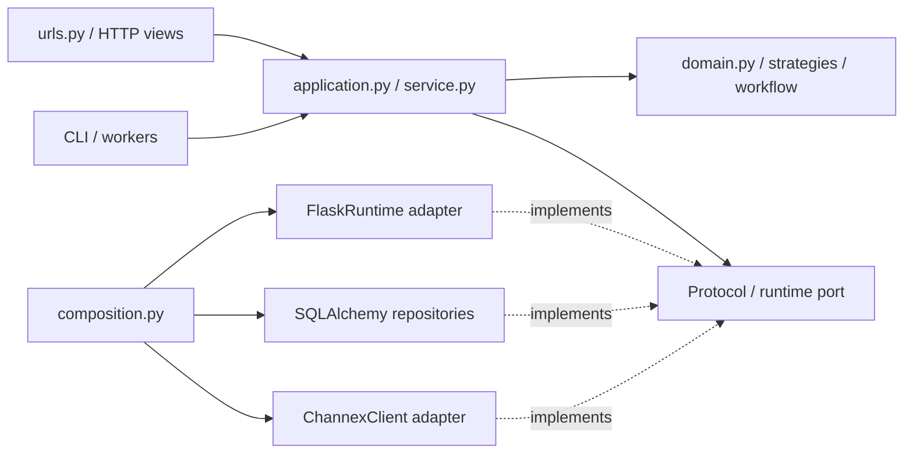

# Kiến trúc backend và ánh xạ design pattern

Ngày refactor: 18/10/2026. Mục tiêu là tạo ranh giới rõ ràng giữa HTTP, điều phối
nghiệp vụ, quy tắc thuần và tích hợp, đồng thời giữ hợp đồng API và transaction cũ.

## Cấu trúc và chiều phụ thuộc



- `urls.py` và các file `*_urls.py`: giữ URL, endpoint, HTTP methods, đăng ký lazy.
- `routes.py`: giữ class view và decorator phân quyền; gọi application tương ứng.
  Các module HTTP riêng của Manager/Channex, hoa hồng, notifications, workspace
  và health cũng dùng cùng cách tách qua file `*_application.py`.
- `application.py`: điều phối use case, validation có dữ liệu, snapshot, audit,
  kết quả trả về. Không import Flask trực tiếp và không gọi chéo HTTP handler.
- `domain.py`: các quy tắc thuần đã tách cho booking, catalog, finance, inventory,
  housekeeping, pricing và booking OTA; không truy cập database hoặc HTTP.
- `ports.py`: hợp đồng context, reservation persistence, pricing persistence và
  channel integration. `use_runtime()` cho phép inject implementation trong test
  hoặc entry point khác, có phục hồi context khi gặp lỗi.
- `adapters/flask_runtime.py`: nối context và JSON response của Flask với port.
  Adapter dùng context hiện hành; không sao chép actor, tenant hoặc cache quyền.
- `composition.py`: cấu hình dịch vụ riêng cho từng Flask app trong
  `app.extensions["pms_services"]`; đăng ký subscriber và repository.

Các helper còn được truy cập qua module route cũ bằng `__getattr__` để giữ tương
thích import. Code backend mới nên import từ application hoặc domain. Khi mock,
patch module sở hữu hàm sau khi tách, thay vì patch tên được chuyển tiếp bởi route.

## Đối chiếu với hình thiết kế

| Pattern | Triển khai | Hành vi được giữ |
| --- | --- | --- |
| Hexagonal Architecture | Domain thuần; context/repository/channel ports; Flask adapter và composition root | Context tenant/actor và response HTTP vẫn dùng cùng nguồn cũ |
| Repository | `bookings/repository.py`, `pricing/repository.py`, `channels/repository.py` | Predicate tenant, thứ tự truy vấn, row lock và session hiện hành |
| Service Layer | 22 module application cho các module HTTP; service worker riêng | 148 thân hàm handler được chuyển sang application |
| Adapter | `channels/client.py` triển khai các thao tác trong `channels/ports.py` | URL cố định, timeout, phân loại lỗi và payload Channex |
| Strategy | `pricing/strategies.py`; `channels/policies.py` | Phần trăm/stay-pay, quy tắc làm tròn, đóng bán và tồn âm |
| Factory | `channels/factory.py`; wiring trong `composition.py` | Hotel, Manager và worker tạo Channex client qua cùng điểm cấu hình |
| Observer / Event | `events.py`; audit phát tới notification rồi channel queue | Subscriber đồng bộ, cùng transaction, giữ thứ tự và truyền lỗi lên caller |
| Transactional workflow | `channels/workflows.py` và durable ACK job hiện có | Import booking và receipt trước, ACK trong job tiếp theo |

## Ranh giới transaction và phục hồi

Web request vẫn do `security.register_security` commit/rollback. Repository không
commit hoặc tạo session riêng. CSRF, RLS, khóa tenant, thứ tự khóa phòng/quỹ,
idempotency và append-only ledger giữ nguyên cơ chế hiện có. Worker vẫn tự sở hữu
transaction và scope của từng lượt chạy. Không đổi schema hoặc thêm dependency.

Audit thêm bản ghi rồi publish event đồng bộ. Notification subscriber chạy trước
subscriber xếp job ARI. Nếu subscriber lỗi, lỗi đi về transaction owner để rollback;
không bắt lỗi và báo thành công. Event bus này không phải message broker và không
bảo đảm giao sự kiện qua một hệ thống ngoài database. Job channel hiện có đóng vai
trò công việc bền vững; không thêm một hàng đợi trong bộ nhớ để gọi OTA sau commit.

Workflow booking dùng **forward recovery**, không tự hủy booking làm compensation:

1. Lấy và kiểm tra revision từ adapter.
2. Import bằng cơ chế chống trùng/stale revision hiện có.
3. Lưu receipt và xếp `ack_revision` trong cùng transaction của worker.
4. Job ACK kiểm tra receipt đã lưu trước khi gọi Channex. Lỗi upstream đi qua cơ
   chế retry/backoff cũ; không ACK nếu import chưa thành công.

Pacing ARI, thời gian chờ bền vững, publication footprint và cơ chế pause mapping
vẫn nằm trong worker hiện tại. Factory không tự retry thao tác tạo resource.

## Phạm vi còn chuyển tiếp

Đây là nền tảng hexagonal được áp dụng trên toàn bộ lớp HTTP và các quy tắc đã
tách, **chưa phải tách hoàn toàn mọi ORM entity và SQL khỏi application**.
Repository hiện bao phủ projection reservation, persistence của pricing engine
và receipt/ACK workflow. Các thao tác ghi booking, catalog, tài chính, kho, quản
trị và một số query worker vẫn dùng SQLAlchemy trong application/service. Việc
chuyển tiếp này được giữ rõ để tránh thay đồng thời các khóa và transaction quan
trọng khi chưa có kiểm thử PostgreSQL.

Khi tách tiếp, thêm operation cụ thể vào port, chuyển nguyên predicate/lock/order
sang repository, inject tại composition root, rồi chạy kiểm thử database của
nghiệp vụ đó. Không đưa Flask, model hoặc session vào `domain.py`.

## Kiểm chứng

Từ thư mục `backend`:

```powershell
.\.venv\Scripts\python.exe -m unittest discover -s tests -q
.\.venv\Scripts\python.exe -m ruff check pms_api common tests
```

Kết quả sau refactor: `Ran 131 tests`, `OK (skipped=54)`. 54 nhóm kiểm thử cần
PostgreSQL bị bỏ qua vì môi trường chưa cung cấp database test riêng. Script
`scripts/run_domain_tests.py` cũng xác nhận cluster local được quản lý chưa có;
không kết nối hoặc sửa database nghiệp vụ.

Kiểm tra hợp đồng hiện có giữ nguyên 161 URL rule, endpoint và HTTP method.
Smoke check nạp thành công 158 handler đăng ký. Đối chiếu AST với snapshot code
trước refactor xác nhận 148 thân hàm handler không đổi logic sau khi quy đổi
context/payload/JSON qua port và đường dẫn import mới. Thêm 26 hàm domain và
repository cũng được đối chiếu với snapshot trước refactor, giữ nguyên logic.
Các kiểm tra cấu trúc này
không thay cho kiểm thử nghiệp vụ trên PostgreSQL.

Test bổ sung kiểm tra ranh giới dependency, inject/khôi phục runtime, cô lập
composition giữa các app, thứ tự event và truyền lỗi, factory, tính tồn, các
strategy khuyến mãi, quote với repository giả, và workflow import/ACK khi lỗi.

Để kiểm thử database khi đã có cluster local của dự án:

```powershell
.\.venv\Scripts\python.exe scripts/run_domain_tests.py
```

Script tạo và xóa database `pms_test_<uuid>` riêng, không chạy test trên dữ liệu
nghiệp vụ. Có thể dùng hai biến `TEST_DATABASE_URL` và
`TEST_DATABASE_MIGRATION_URL` theo quy tắc trong `tests/domain_fixture.py` rồi chạy
unittest trực tiếp. Chưa có kết quả kiểm thử PostgreSQL hoặc Channex staging cho
refactor này.
