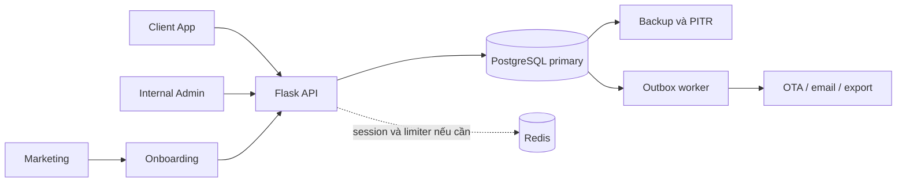

# Q: bạn xem qua file system_design_final và đánh giá là dự án public như này còn thiếu gì nữa không ? dự án sẽ release giữa tháng 12 lận nên tôi phải chuẩn bị kỹ càng và theo kinh nghiệm senior software developer của bạn thì nên nâng cấp gì , hay là dư cái gì hay là bỏ cái gì và viết lại 1 cái báo cáo đầy đủ cho tôi

## Answer

# Báo cáo đánh giá thiết kế và chuẩn bị public release PMS

**Ngày đánh giá:** 03/10/2026 · **Mốc lập kế hoạch:** 15/12/2026 · **Thời gian còn lại:** 73 ngày, khoảng 10 tuần 3 ngày.

**Đối tượng:** chủ dự án và đội phát triển Blue Jay PMS. **Tài liệu chính:** [pms_system_design_final.md](C:/Users/Laptop/Documents/GitHub/pms-system/pms_system_design_final.md).

## 1. Kết luận và quyết định đề xuất

**Thiết kế có hướng nền tảng hợp lý, nhưng phạm vi quá rộng so với hiện trạng triển khai. Repository hiện là frontend demo có một số luồng liên thông; chưa có backend nghiệp vụ để vận hành SaaS với dữ liệu thật.** Điểm cần đầu tư lớn nhất trước release là tính đúng của booking, tiền, quyền truy cập và khả năng phục hồi. Thêm menu, Redis hoặc read replica không thay thế được những nền tảng này.

Đề xuất chuẩn bị bản đầu cho **một phân khúc khách sạn rõ ràng, với onboarding có hỗ trợ và rollout giới hạn**. Giữ React + Flask + PostgreSQL; tổ chức backend thành các module trong một ứng dụng. Hoàn thành một vòng vận hành thật từ setup khách sạn → đặt phòng → nhận khách → ghi dịch vụ/thu tiền → trả phòng → dọn phòng → chốt ngày/đối soát. Tích hợp OTA chỉ đưa vào gói được bán khi đã kiểm chứng đường đi dữ liệu và đáp ứng yêu cầu của nhà cung cấp.

Ba quyết định quan trọng:

1. **Chốt scope v1 ngay trong tháng 10.** Nếu cố làm đồng thời PMS, POS hoàn chỉnh, kho, 40+ báo cáo, pricing engine, channel manager và nền tảng SaaS tự phục vụ thì rủi ro trễ hoặc release thiếu an toàn cao.
2. **Chuyển sang làm từng luồng đầy đủ frontend–API–database–test–vận hành.** Không chờ hoàn thiện toàn bộ giao diện mới bắt đầu backend; những quyết định database, tài chính và concurrency sẽ tác động trực tiếp đến UI.
3. **Giữ ngày 15/12 làm mục tiêu có điều kiện.** Quyết định release dựa trên bằng chứng pilot và các cổng nghiệm thu ở cuối báo cáo. Nếu booking, tiền, tenant isolation hoặc restore chưa đạt, chỉ phát hành demo/sandbox bằng dữ liệu giả hoặc dời thời điểm nhận vận hành thật. Live beta nhận dữ liệu thật vẫn phải đạt các cổng P0.

Không khuyến nghị đổi framework, chuyển sang microservices, thêm Kubernetes, xây ERP kế toán hay viết lại toàn bộ frontend trước tháng 12.

## 2. Phạm vi, giả định và độ tin cậy

Trong báo cáo này, **public** được hiểu là SaaS mở cho khách sạn thật sử dụng, có khả năng thu phí. Nếu public chỉ là đưa source lên GitHub hoặc công bố demo, điều kiện release sẽ khác; mục 15 nêu phần bổ sung cho mã nguồn công khai.

Chưa có thông tin xác nhận về số người, thời gian làm việc, ngân sách hosting, khách pilot, tải dự kiến và hợp đồng OTA. Vì vậy, các mốc thời gian, ngưỡng hiệu suất và quy mô pilot dưới đây là **đề xuất để chốt**, không phải estimate hay SLA đã được bảo đảm. Phân khúc v1 gợi ý: khách sạn độc lập tại Việt Nam, một cơ sở mỗi tenant, VND và lưu trú theo đêm.

Đã đọc toàn bộ thiết kế 1.053 dòng; dùng graph hiện có để tìm quan hệ tài liệu–code rồi kiểm tra file gốc. Đã rà routing, shared store, auth demo, booking, tài chính, báo cáo, marketing, cấu hình build và backend; có các lượt rà độc lập về kiến trúc, sản phẩm và bảo mật/vận hành. [PMS_GAP_REPORT.md](C:/Users/Laptop/Documents/GitHub/pms-system/PMS_GAP_REPORT.md) là báo cáo lịch sử có phần mô tả trước FE-01/FE-02, nên không dùng làm hiện trạng mặc định.

**Giới hạn:** chưa kiểm tra hạ tầng production, chạy browser E2E, thử tải, pentest, dependency vulnerability scan, secret scan toàn lịch sử Git hoặc restore database. “Chưa có” trong báo cáo nghĩa là chưa thấy triển khai/bằng chứng trong repository đang rà; không khẳng định hạ tầng bên ngoài không có. Báo cáo không cấp chứng nhận bảo mật, PCI hoặc tuân thủ pháp luật.

Truy vấn graph thực tế dùng các token trong vocabulary: `architecture tenant reservation available financial security recovery migrations notification billing redis replicas`. Graph có 412 node; truy vấn rộng trả 181 node và giới hạn hiển thị 82 node với budget 3.000 token. Traversal không dùng thêm LLM hoặc rebuild semantic graph; không có số đo tổng token/chi phí của toàn phiên để suy đoán. Các kết luận cụ thể được đối chiếu trực tiếp với source, không suy ra từ phần graph bị cắt.

## 3. Hiện trạng đã kiểm chứng

### 3.1. Những nền tảng nên giữ

- Frontend đã có tạo/sửa/hủy booking, kiểm tra trùng phòng trong store và quy ước khoảng lưu trú `[check_in, check_out)`.
- Check-in kiểm tra ngày lưu trú và phòng sạch; checkout làm phòng bẩn; housekeeping cập nhật lại trạng thái dùng chung.
- Booking liên thông giữa danh sách, Tape Chart, sơ đồ phòng, housekeeping và một phần dashboard/báo cáo.
- Danh mục, cấu hình, tenant membership, role/action, feature gating và quota trial đã có xử lý demo; Admin và Client có một số dữ liệu dùng chung.
- Có test logic cho ngày, phòng trống, tenant scope, quyền, quota và thay đổi danh mục. Đây là phần có giá trị để chuyển thành specification và test backend, thay vì bỏ làm lại.

Nguồn: [DEMO.md](C:/Users/Laptop/Documents/GitHub/pms-system/frontend/DEMO.md:24), [workspace.js](C:/Users/Laptop/Documents/GitHub/pms-system/frontend/src/apps/pms/data/workspace.js:106), [model.test.js](C:/Users/Laptop/Documents/GitHub/pms-system/frontend/src/apps/pms/data/model.test.js:6).

### 3.2. Màn hình đã có chưa đồng nghĩa chức năng production đã hoàn thành

| Mảng | Hiện trạng có bằng chứng | Khoảng cách trước khách hàng thật |
|---|---|---|
| Backend | Chỉ có `/` và `/api/health` | API nghiệp vụ, xác thực, database, transaction, migration, worker và kiểm thử chưa được triển khai trong backend này |
| Auth/tenant/quyền | Demo dùng mật khẩu chung; session và workspace nằm trong browser | Server phải xác thực và kiểm tra lại mọi quyền, quota, resource scope; dữ liệu phải đồng bộ nhiều thiết bị |
| Booking/lưu trú | Luồng cơ bản chạy trong shared store; mỗi booking demo gắn một phòng | Booking theo hạng chưa phân phòng, nhiều phòng/khách, room move khi đang ở, gia hạn, no-show và concurrency server |
| Giá | Giá cơ bản dùng chung; booking = giá hạng × số đêm | Giá theo từng đêm, snapshot thuế/phí/chính sách, daily override và tồn phòng cùng nguồn |
| Tiền/dịch vụ | Các tab thanh toán/dịch vụ booking còn placeholder; POS/sổ quỹ có dữ liệu minh họa | Folio, cọc, payment, refund, số dư, chứng từ, đóng ca và đối soát |
| Báo cáo | Có doanh thu phòng dự kiến phân bổ đều theo đêm và công suất demo | Doanh thu ghi nhận, tiền thu, cọc và công nợ phải lấy đúng nguồn giao dịch |
| Kho/HK nâng cao | Có nhập kho demo và clean/dirty | Chưa có ledger tồn, xuất/chuyển/kiểm kê đầy đủ; giao việc/ca và maintenance theo ngày |
| SaaS billing/OTA | Có giao diện quản trị, dữ liệu mẫu và thao tác cục bộ | Subscription/payment thật, tích hợp provider, retry/ACK/reconcile chưa được chứng minh |
| Vận hành | Không thấy workflow CI/deploy, migration hoặc cấu hình backup được track | Cần pipeline tái lập, staging, monitoring, restore/rollback và người xử lý sự cố |

Nguồn: [backend/app.py](C:/Users/Laptop/Documents/GitHub/pms-system/backend/app.py:1), [PmsProvider.jsx](C:/Users/Laptop/Documents/GitHub/pms-system/frontend/src/apps/pms/data/PmsProvider.jsx:9), [BookingDetailPanel.jsx](C:/Users/Laptop/Documents/GitHub/pms-system/frontend/src/apps/pms/reservations/components/BookingDetailPanel.jsx:194), [DEMO.md](C:/Users/Laptop/Documents/GitHub/pms-system/frontend/DEMO.md:50).

### 3.3. Kết quả kiểm tra trong lần đánh giá này

| Kiểm tra | Kết quả | Cách hiểu |
|---|---|---|
| Test frontend | 20/20 đạt bằng `node --test --test-isolation=none src/apps/pms/data/model.test.js src/apps/pms/data/workspace.test.js` | `npm test` ban đầu bị `spawn EPERM` do hạn chế tạo tiến trình trong môi trường; chạy cùng hai file với chế độ không tách process đạt. Không sửa test hoặc script repo |
| Lint | `npm run lint` exit 0, **80 cảnh báo**, chủ yếu biến/import chưa dùng | Cần xử lý dần và ngăn phát sinh mới; không phải 80 lỗi nghiệp vụ hay bằng chứng sản phẩm đã đạt chuẩn |
| Build | `npm run build` đạt trên Node v24.14.1 | Chứng minh frontend có thể build; chưa chứng minh backend, deploy hoặc luồng sử dụng thật |
| Bundle | App chunk 657,10 KB, gzip 115,72 KB | Có cơ hội giảm bằng route splitting; chưa đo tốc độ tải hoặc Core Web Vitals trên thiết bị thật |

[App.jsx](C:/Users/Laptop/Documents/GitHub/pms-system/frontend/src/App.jsx:9) import tĩnh cả Marketing/PMS/Admin và bọc chúng trong `PmsProvider`. [vite.config.js](C:/Users/Laptop/Documents/GitHub/pms-system/frontend/vite.config.js:9) nâng ngưỡng cảnh báo chunk lên 2.000 KB. Nên dùng budget và số đo tải trang; việc nâng ngưỡng cảnh báo không làm ứng dụng nhẹ hơn.

## 4. Những điểm trong thiết kế cần sửa trước khi triển khai

| Điểm hiện tại | Đánh giá | Hướng sửa |
|---|---|---|
| “Còn 3–4 tháng”, dòng 3 | Đã không còn đúng tại thời điểm rà | Kế hoạch còn 73 ngày đến 15/12, cần có scope freeze và thời gian pilot |
| Mọi bảng trừ users đều có tenant_id, dòng 92 | Mâu thuẫn với các master toàn hệ thống; child tables chưa nhất quán | Phân loại bảng global/tenant/control plane; child table nghiệp vụ cần tenant scope và FK cùng tenant |
| Daily inventory thay booking để dựng Tape Chart, dòng 126–141 | Counter hạng phòng/ngày không chứa khách, assignment và khoảng lưu trú | Inventory dùng kiểm soát capacity; Tape Chart cần reservation/stay/assignment trong cửa sổ ngày |
| Vài chục nghìn booking hoặc JOIN sẽ làm DB “treo”, dòng 141, 990–995 | Không có benchmark hoặc query plan chứng minh | Index, giới hạn ngày, pagination, query plan và load test trước khi quyết định cache/replica |
| Transactional DDL tạo zero downtime, dòng 153–156 | Rollback không đồng nghĩa tránh lock hoặc app incompatibility | Expand-contract, migration rehearsal, lock budget, backfill batch và tương thích app cũ/mới |
| Tách domain/source để “bảo mật tuyệt đối”, dòng 222–225 | Domain/build tách giúp quản lý bề mặt triển khai; giấu source không phải cơ chế authorization | API permission, MFA, session boundary, control plane và support access có scope |
| Channex giảm 90% code, bảo đảm PCI và sync vài giây, dòng 229–235 | Chưa có bằng chứng hợp đồng/đánh giá scope để cam kết | Nêu là lựa chọn giảm số adapter; xác minh access, SLA, phí và yêu cầu tích hợp thật |
| Nâng gói chỉ merge feature và không xóa feature cũ, dòng 370 | Dễ trôi quyền khi downgrade hoặc thay version gói | Effective entitlement = plan version + override có hạn + trạng thái thuê bao + global switch |
| Ghi PG đồng thời Redis, dòng 1004 | Dual write có thể lỗi hoặc đảo thứ tự | PG là nguồn chuẩn; outbox/invalidation sau commit và version cache nếu cần |
| Tất cả GET/SELECT sang replica, dòng 1018–1030 | Không bảo đảm đọc ngay sau ghi, inventory, quyền hoặc tiền nhất quán | Chọn nguồn đọc theo yêu cầu consistency; primary xử lý cả đọc lẫn ghi |
| Night Audit chạy trên replica, dòng 1024 | Báo cáo xem lại có thể đọc replica; nghiệp vụ post/chốt ngày cần ghi | Chạy nghiệp vụ trên primary; định nghĩa business date và posting idempotent |
| Mã hóa đĩa + masking = PCI compliance, dòng 1039 | Chưa đủ để kết luận tuân thủ | MVP tránh nhận/lưu PAN/CVV; xác định phạm vi với provider và đơn vị đánh giá phù hợp |
| Redis/replica bảo đảm 99.99% và luôn check-in được, dòng 1050–1052 | Không có đo lường, failover/on-call/runbook hỗ trợ cam kết | Đặt SLO có owner; HA, backup, consistency và kế hoạch sự cố là các yêu cầu riêng |
| Bắt đổi mật khẩu 30/60/90 ngày, dòng 779 | Không nên là mặc định nếu không có yêu cầu riêng | Blocklist, rate limit, MFA và đổi khi có dấu hiệu compromise; [NIST password guidance](https://pages.nist.gov/800-63-4/sp800-63b/authenticators/) không khuyến nghị đổi định kỳ vô cớ |

PostgreSQL standby có thể trả dữ liệu trễ và hạn chế thao tác ghi/khóa; đây là lý do cần consistency policy. [PostgreSQL Hot Standby](https://www.postgresql.org/docs/current/hot-standby.html). `CREATE INDEX CONCURRENTLY` cũng là ví dụ thao tác không chạy trong transaction block, nên không thể bao mọi migration trong một transaction để đạt mọi mục tiêu. [PostgreSQL CREATE INDEX](https://www.postgresql.org/docs/current/sql-createindex.html).

## 5. Thiết kế nghiệp vụ cốt lõi còn thiếu

### 5.1. Reservation, stay và room assignment

Tài liệu mới nêu tạo/sửa/hủy booking; cần bổ sung state machine và ảnh hưởng của mỗi thao tác lên tồn phòng, tiền, housekeeping và audit. Demo chỉ đổi phòng/ngày khi booking `CONFIRMED`; các chuyển trạng thái hiện có là `CONFIRMED → IN_HOUSE/CANCELLED`, `IN_HOUSE → CHECKED_OUT`. Nguồn: [workspace.js](C:/Users/Laptop/Documents/GitHub/pms-system/frontend/src/apps/pms/data/workspace.js:123).

Cần đặc tả tối thiểu:

- Người đặt khác người lưu trú; một reservation có nhiều phòng và nhiều khách. OTA có thể tạo booking theo hạng trước khi phân phòng vật lý.
- Xác nhận, hủy, no-show, nhận khách, trả phòng sớm, gia hạn/rút ngắn và chuyển phòng khi đang ở. Mỗi ngoại lệ có quyền và lý do.
- Room move giữ các đoạn phòng/đêm đã ở; không ghi đè lịch sử thành phòng mới. Phụ thu/đổi giá phải có quyết định rõ và snapshot.
- Khoảng ngày `[check_in, check_out)` cho lưu trú qua đêm. Hourly booking dùng mô hình khoảng thời gian khác; hoãn toggle thuê theo giờ nếu v1 chưa hỗ trợ.
- Cleanliness, occupancy và operational state là ba khái niệm riêng. Phòng dirty hôm nay không tự động bị loại khỏi tồn bán mọi ngày tương lai; out-of-order có khoảng hiệu lực.
- Tách lịch sử lưu trú đã xảy ra với capacity tương lai. Không copy nguyên quy tắc demo bỏ mọi `CHECKED_OUT` khỏi tính overlap để lập báo cáo lịch sử hoặc backdated booking.

**Nghiệm thu:** booking chưa phân phòng vẫn trừ capacity đúng; đổi phòng/gia hạn không trùng lịch, không đổi các đêm đã hoàn thành; no-show/hủy giải phóng đúng phần tồn và xử lý cọc đúng chính sách. Booking nhiều phòng không bị mất dữ liệu khi nhập từ OTA.

### 5.2. Folio, cọc, thu và hoàn tiền

Schema có giá booking, danh mục dịch vụ và phương thức thanh toán nhưng chưa mô tả sổ giao dịch. Cần tối thiểu folio, charge/entry, payment, allocation, refund/reversal và cash session. Có thể bắt đầu bằng sổ giao dịch PMS đủ đối soát, chưa cần general ledger ERP.

Phải phân biệt **giá dự kiến**, **khoản ghi nhận theo ngày kinh doanh**, **tiền thực thu**, **cọc chưa phân bổ** và **công nợ**. Nhận cọc không mặc nhiên là doanh thu phòng; báo cáo doanh thu không lấy tổng booking chia đều nếu giá từng đêm khác nhau.

- Lưu snapshot tiền phòng theo đêm, dịch vụ, thuế/phí, discount và chính sách; thay master không làm thay đổi chứng từ cũ.
- Entry đã posted không xóa/sửa trực tiếp để đổi số dư. Sửa sai bằng reversal/adjustment có quyền, người thao tác và lý do.
- Hỗ trợ thu nhiều lần/nhiều phương thức, phân bổ cọc, hoàn một phần; tổng refund không vượt số tiền có thể hoàn.
- Payment có reference/idempotency; trạng thái `pending/confirmed/failed/refunded` nếu có gateway. QR hoặc nút “đã trả” không tự chứng minh ngân hàng đã nhận tiền.
- Dùng số tiền chính xác và quy tắc làm tròn; chốt NUMERIC hoặc integer minor unit với currency exponent rõ. Không mặc định mọi đồng tiền đều có 2 chữ số thập phân.
- Snapshot tỷ giá của booking không thay thế tỷ giá/rounding của các payment hoặc refund phát sinh ngày khác. Có thể giữ v1 chỉ VND, nhưng contract phải lưu currency.
- Công nợ doanh nghiệp có thể hoãn. Khi checkout còn dư nợ, phải có quy tắc chặn hoặc ngoại lệ được duyệt; không âm thầm coi là đã tất toán.

**Nghiệm thu:** booking → cọc → dịch vụ → split payment → refund → checkout cho số dư khớp folio, sổ quỹ và báo cáo; request lặp/timeout không ghi nhận tiền hai lần. Mẫu cụ thể nằm ở mục 13.

### 5.3. Ngày kinh doanh, đóng ca và chốt ngày

Night Audit phải được đặc tả như quy trình nghiệp vụ nếu có posting tiền phòng/chốt sổ. Xem báo cáo audit và chạy quy trình audit là hai chức năng khác nhau. Cần `business_date`, trạng thái close, rule posting, đối soát arrivals/departures/quỹ và xử lý điều chỉnh sau chốt. Mẫu nghiệp vụ này cũng xuất hiện trong [Oracle End of Day](https://docs.oracle.com/en/industries/hospitality/opera-cloud/24.1/ocsuh/c_endofday_procedures.htm); đây là tham chiếu, không phải yêu cầu sao chép toàn bộ OPERA.

Thời điểm thao tác lưu bằng timestamp có timezone; đêm lưu trú dùng ngày địa phương. Business date do quy trình khách sạn xác định, không tự đồng nhất với ngày đồng hồ. Posting tiền phòng tự động có uniqueness theo tenant/stay-room/business-date/loại charge; dịch vụ và adjustment dùng entry/event ID cùng idempotency riêng để vẫn cho phép nhiều khoản cùng loại trong ngày. Một audit cho tenant/ngày; chạy lại hoặc crash rồi chạy lại không sinh tiền phòng đôi.

**Nghiệm thu:** có ca khách đến sau nửa đêm, đóng ca đổi nhân viên và chạy close đồng thời/lặp. Các số đã chốt không thay đổi âm thầm. Nếu chỉ đủ làm chốt ngày cơ bản, mô tả đúng giới hạn và chưa quảng bá Night Audit đầy đủ.

### 5.4. Giá, availability và báo cáo

Chốt v1 với base rate + override theo ngày + stop-sell và snapshot nightly rate. LOS, early-bird, stacking voucher/promotion hoặc dynamic pricing có thể để sau. `room_type_availabilities` cần unique tenant/hạng/ngày, định nghĩa sellable/held/booked/blocked, thời hạn hold và cách rebuild đối soát. `checkout_count` là chỉ số riêng, không được trừ cộng hai lần vào đêm bán.

Tape Chart đọc assignment và booking theo tenant + cửa sổ ngày; daily inventory cung cấp tổng capacity. Giá cache hoặc API cần rate plan và các chiều thực sự hỗ trợ, không chỉ một `price` cho hạng/ngày. Room block, sửa capacity, đổi booking và hủy đều phải cập nhật cùng nguồn tồn.

Ưu tiên một bộ báo cáo nhỏ đối soát được: khách đến/đi/đang ở, phòng trống/công suất, doanh thu phòng theo ngày kinh doanh, thu–hoàn theo phương thức, cọc và số dư. Định nghĩa rõ forecast so với actual, mẫu số công suất khi có phòng hỏng và cơ sở tính ADR/RevPAR. Các tài liệu/bảng dữ liệu chưa đủ để gọi hơn 40 báo cáo là chức năng đã sẵn sàng.

## 6. Kiến trúc backend và database đề xuất

### 6.1. Bắt đầu bằng modular monolith

Một backend Flask với module identity/tenant, hotel setup, reservations/stays, availability/rates, folio/payments, housekeeping, reports và integrations là đủ cho bản đầu. Dùng SQLAlchemy và migration có version; thêm worker cho tác vụ có retry hoặc lâu. Không cần một service riêng cho mỗi menu.

Marketing có thể độc lập với provider dữ liệu PMS. Admin/PMS có thể nằm cùng monorepo nhưng build/deploy riêng để giảm coupling và bundle; frontend tách không thay kiểm tra quyền ở API. Tách API/service account của control plane hợp lý khi thao tác quản trị có quyền lớn. Replica và cache nghiệp vụ chỉ thêm khi có số đo và policy consistency cụ thể.

**Contract API tối thiểu:** specification OpenAPI có version; schema request/response; lỗi có code ổn định và request ID; pagination/date-window limit; action permission; idempotency cho tạo booking/thu/hoàn; version khi sửa dữ liệu. Frontend dùng một API adapter và model thống nhất, tránh mỗi trang tự định nghĩa lại booking/payment. Nâng TypeScript từng phần ở boundary/model nếu có nguồn lực; không rewrite cả app để kịp deadline.

### 6.2. Transaction chống đặt trùng/bán vượt tồn

Kiểm tra phòng trống trong JavaScript là hữu ích cho UX, nhưng không xử lý hai request cùng đọc một snapshot rồi cùng ghi. Ngay cả transaction cũng cần locking/constraint/isolation phù hợp để giữ invariant nghiệp vụ.

Với booking theo hạng chưa phân phòng: kiểm tra và khóa/cập nhật capacity của mọi đêm trong một transaction, theo thứ tự khóa cố định. Cùng transaction ghi reservation, audit và outbox. Chọn conditional update, row locking hoặc serializable dựa trên thiết kế đã test, không kết hợp tùy ý nhiều cơ chế.

Với phòng vật lý: có ràng buộc không giao nhau cho tenant/phòng/khoảng lưu trú, hoặc room-night uniqueness tương đương, xử lý rõ cancelled/hold/assignment segments. PostgreSQL hỗ trợ exclusion constraint với range cho mục tiêu này. [PostgreSQL Range Constraints](https://www.postgresql.org/docs/current/rangetypes.html#RANGETYPES-CONSTRAINT). Ràng buộc phòng vật lý không tự kiểm soát hết tồn theo hạng khi còn booking chưa phân phòng.

**Nghiệm thu:** 100 request direct đồng thời cho suất cuối chỉ chấp nhận một; booking nhiều đêm rollback toàn bộ nếu một đêm hết tồn. Retry cùng idempotency key không tạo bản ghi mới; cùng key với payload khác trả conflict rõ. Sửa booking có version tránh ghi đè thay đổi vừa được người khác lưu. Test hủy/đổi ngày/đổi hạng/multi-room và deadlock retry.

### 6.3. Multi-tenancy phải là hợp đồng thực thi được

Chốt v1 một tenant = một khách sạn. Nếu một pháp nhân có nhiều cơ sở, cần xác định organization/property boundary trước khi có khách chuỗi; chưa cần xây UI quản trị chuỗi khi không nằm trong scope.

Phân loại schema thành global master, tenant-owned operational data và internal control plane. Child table nghiệp vụ như reservation_rooms, assignments, folio entries, payments và integration messages cần tenant scope. FK giữa các bảng tenant-owned phải bảo đảm cùng tenant, ví dụ `(tenant_id, reservation_id)` tham chiếu `(tenant_id, id)`. Unique room number/SKU/reference theo tenant; unique inventory theo tenant/hạng/ngày. Sửa ER guest để phân biệt người đặt và nhiều người lưu trú.

Runtime database role không dùng superuser, `BYPASSRLS` hoặc table owner; migration dùng role khác. Tenant context lấy từ membership được server xác thực, đặt theo transaction và không lưu sót trên connection pool. Policy đọc/ghi phải được kiểm tra; thiếu context phải từ chối. PostgreSQL ghi rõ owner thường bỏ qua RLS và superuser/BYPASSRLS luôn bỏ qua; FK checks cũng không bị RLS lọc. [PostgreSQL RLS](https://www.postgresql.org/docs/current/ddl-rowsecurity.html).

**Nghiệm thu:** tenant A không đọc/sửa/xóa/đếm/tìm kiếm/export dữ liệu B dù biết ID; FK không thể gắn parent của B vào child A. Test thật trên PostgreSQL với runtime role, pooled connection tái sử dụng và worker. Scope phải xuyên suốt cache, notification, file upload, download và logs, không chỉ query màn hình.

### 6.4. Cache, worker và migration

- PostgreSQL là nguồn quyết định booking, payment và quyền. Mất Redis không cho phép dùng inventory cũ để chấp nhận bán.
- Outbox ghi cùng transaction nghiệp vụ; worker chạy lại được và có dedupe, retry/backoff, delivery status và đường xử lý job lỗi. Có thể dùng outbox PostgreSQL với worker đơn giản trước, chưa bắt buộc nhiều loại queue.
- Nếu dùng Redis, xác định vai trò cụ thể: shared session/rate limit, broker phù hợp, hoặc cache đã chứng minh có lợi. Với dữ liệu nghiệp vụ, invalidation sau commit/version tránh event cũ ghi đè event mới; TTL 1–5 phút không đủ để hứa realtime.
- UI phải phản hồi sau commit, refresh/re-fetch và xử lý reconnect. SSE/WebSocket chỉ thêm nếu cần; không cần xây realtime platform trước khi API nhất quán.
- Reports dài chạy nền, giới hạn tài nguyên và date range; có cancel/timeout, file có thời hạn và permission khi tải. Không để một tenant chiếm hết pool vận hành.
- Migration dùng expand/backfill/switch/contract, rehearsal trên dữ liệu đại diện, lock/statement timeout và phiên bản app N/N−1. Backup không phải nút rollback schema tức thì.

**Nghiệm thu:** kill worker/Redis sau PG commit không mất booking; job gửi lặp hoặc đảo thứ tự không làm trạng thái lùi. Nâng schema trong khi app cũ/mới phục vụ vẫn hoạt động; backfill dừng/chạy lại được và contract có kiểm tra dữ liệu trước.

## 7. OTA: giữ có điều kiện và làm việc với provider ngay

Chọn một channel manager giúp giảm số adapter, nhưng PMS vẫn chịu trách nhiệm mapping, persistence, dedupe, inventory và xử lý sự cố. Chốt provider access, sandbox, phí theo property/channel, yêu cầu certification và thời điểm bật production ngay trong tháng 10. Không dựa vào các con số “90%” hoặc “vài giây” trong thiết kế để cam kết với khách.

Luồng tối thiểu:

1. Mapping tenant/property → room type → rate plan; có trạng thái kết nối, mapping version và quản lý secret.
2. Nhận new/modified/cancelled revision; lưu bền vững cùng external/revision ID và tenant đúng; xử lý idempotent/đúng phiên bản.
3. ACK sau khi đã lưu thành công, có khả năng retry ACK nếu phản hồi mất. Không coi HTTP response webhook và provider revision ACK là một việc.
4. Outbox đẩy ARI/rates theo batch, có retry, trạng thái pending/accepted/failed, cảnh báo và manual replay/reconciliation.
5. Poll feed làm đường khôi phục nếu event mất; đối soát reservations và inventory định kỳ. UI phải chỉ ra lần sync cuối và trạng thái cần xử lý.

Channex hướng dẫn dùng revision feed, kiểm tra property ID và chỉ ACK sau khi booking được lưu; cũng khuyến nghị gộp ARI updates. [Channex Best Practices](https://docs.channex.io/guides/best-practices-guide), [Booking Revisions](https://docs.channex.io/api-v.1-documentation/bookings-collection).

**Ngoại lệ phải có:** OTA đã xác nhận booking nhưng PMS hết tồn thì lưu booking/revision cùng trạng thái overbooking cần xử lý và báo vận hành; không làm booking biến mất. Có thể giữ phòng chưa phân và exception riêng, không ép assignment vi phạm ràng buộc phòng vật lý. PMS có thể chống oversell do request direct của mình, nhưng độ trễ giữa hệ thống ngoài vẫn có thể tạo xung đột. Không quảng bá “chống overbooking hoàn toàn” khi chưa có giới hạn và quy trình xử lý.

**Nghiệm thu:** duplicate, event mất/đảo thứ tự, timeout sau commit, sai mapping, provider down và restart worker không làm mất/nhân đôi booking; ACK/reconcile và cảnh báo khôi phục được. Nếu không đạt, release core PMS với OTA ghi rõ chưa phát hành, không bán tính năng này như đã hoạt động.

## 8. Bảo mật và dữ liệu khách hàng

### 8.1. Auth lifecycle và phân quyền server

Không chuyển nguyên session `{userId, expiresAt}` hoặc `password123` trong [PmsProvider.jsx](C:/Users/Laptop/Documents/GitHub/pms-system/frontend/src/apps/pms/data/PmsProvider.jsx:42) vào production. Với web first-party, server session cookie là lựa chọn đơn giản; nếu chọn JWT, đặc tả refresh, revoke, expiry, rotation và nơi lưu trước khi implement.

Cần login/invite/verification/reset/logout/revoke session; token một lần có hạn; password hash phù hợp; lỗi không lộ tài khoản có tồn tại; limiter theo account/IP. Cookie dùng HttpOnly/Secure/SameSite phù hợp và CSRF protection cho lệnh ghi. Thay mật khẩu, khóa account hoặc thu hồi membership phải có hiệu lực theo policy đã chốt.

Mỗi request bảo vệ cần: identity hợp lệ → account active → membership tenant → quyền action → entitlement → resource scope. Gói bật chức năng không đồng nghĩa mọi nhân viên được thao tác. Chống mass assignment: client không được tự gán role, trạng thái paid, giá trị refund hay tenant_id tùy ý. [OWASP API Security](https://api-security.owasp.org/editions/2023/en/0x11-t10/) là khung tham chiếu cho các boundary này.

### 8.2. Internal Admin và support access

[access.js](C:/Users/Laptop/Documents/GitHub/pms-system/frontend/src/apps/pms/data/access.js:32) hiện map global staff thành `HOTEL_OWNER` cho mọi tenant trong demo. Khi làm server, tách quyền quản lý dịch vụ với quyền đọc/sửa nghiệp vụ khách sạn. MFA bắt buộc cho internal admin; support access theo tenant/ticket, có scope, lý do và expiry. Audit giữ cả actor thật và người được impersonate; không tự động mở mọi PII hoặc secret.

Tenant deletion, quyền cao, xuất PII diện rộng và refund lớn cần xác thực bổ sung/xác nhận có ngữ cảnh theo policy. Việc support thao tác giúp khách phải có dấu vết, có thể thu hồi và không dùng tài khoản chung.

### 8.3. Production configuration và một đường render cần sửa

[backend/app.py](C:/Users/Laptop/Documents/GitHub/pms-system/backend/app.py:6) đang `CORS(app)` và dòng 24 chạy debug trên `0.0.0.0`; đây là skeleton local, chưa phải cấu hình deploy. Production cần WSGI server phù hợp, tắt debug/reloader, TLS/reverse proxy, CORS allowlist, security headers, body/upload limits, timeout và lỗi không lộ stack trace. Flask cũng yêu cầu không dùng development server cho production. [Flask Deployment](https://flask.palletsprojects.com/en/stable/deploying/).

Đường in invoice hiện lấy tên khách sạn từ form, nội suy vào HTML tại [AdminBilling.jsx](C:/Users/Laptop/Documents/GitHub/pms-system/frontend/src/apps/manager/billing/pages/AdminBilling.jsx:256), rồi `document.write` tại dòng 331. Các trường hotelName/method/plan chưa escape. **Đây là đường render không an toàn cần sửa trước khi nhận dữ liệu khách thật; chưa có bằng chứng stored XSS chéo người dùng trên production.** Dùng React print view hoặc textContent/encoding đúng context; test chuỗi có thẻ HTML được hiển thị như text.

### 8.4. PII, secrets, audit và quyền riêng tư

- Phân loại tên/liên hệ/giấy tờ/quốc tịch/dữ liệu tài chính; ghi mục đích thu thập, ai được đọc, masking và retention. Không mặc định cần ảnh CCCD/passport; OCR để sau.
- Tách identity khỏi chứng từ cần lưu. Có export/correction/deletion hoặc pseudonymization và legal hold theo nghĩa vụ đã xác nhận; tính cả cache, log và backup. Không hứa xóa mọi chứng từ ngay khi khách đóng tài khoản.
- Xác nhận trách nhiệm giữa Blue Jay, khách sạn, hosting/email/analytics/payment provider; có điều khoản và quy trình xử lý sự cố dữ liệu theo thị trường thực tế. Người phụ trách pháp lý/kế toán phải rà văn bản đang áp dụng, lưu trú và chứng từ trước release; báo cáo này chưa kết luận compliance.
- Secret OTA/webhook lưu server, quản lý key/rotation và quyền decrypt; API/UI chỉ trả trạng thái masked. Log/audit không chứa secret, reset token hoặc toàn bộ giấy tờ. Seed OTA secret trong demo không đủ căn cứ để kết luận đã lộ key thật.
- Audit server có actor ID, tenant, entity, action, UTC time, request ID, before/after đã redact, outcome và reason; hạn chế sửa/xóa, định nghĩa retention. Audit log trong workspace browser chưa có độ tin cậy production.
- MVP tránh nhận/lưu PAN/CVV, dùng hosted provider/token/reference khi cần thanh toán online. Outsourcing không tự loại bỏ mọi trách nhiệm PCI; CVV không được lưu sau authorization. [PCI SSC Outsourcing FAQ](https://www.pcisecuritystandards.org/faqs/1092/), [PCI SSC CVV FAQ](https://www.pcisecuritystandards.org/faqs/1574/).
- Nếu giữ custom webhook: cần chống SSRF/egress vào private, loopback, link-local/metadata cả IPv4/IPv6, redirect và DNS rebinding; HMAC với timestamp/event ID, secret rotation, bounded retry, dead-letter và replay. Nếu chưa có khách cần, hoãn bề mặt này sẽ giảm đáng kể việc phải bảo vệ.

## 9. Vận hành, CI/CD và phục hồi

### 9.1. Release tái lập được

[.gitignore](C:/Users/Laptop/Documents/GitHub/pms-system/.gitignore:27) bỏ `package-lock.json`; kiểm tra Git không thấy lockfile frontend được track. Cần commit một authoritative lockfile, pin runtime/package manager và cài clean/frozen từ lock. Backend cần khóa dependency/transitive phù hợp; không thể kết luận có CVE chỉ bằng số phiên bản trong requirements hiện tại.

Pipeline tối thiểu: frontend lint/test/build; backend unit + integration PostgreSQL; tenant isolation/concurrency/idempotency; migration từ schema cũ; dependency audit và secret scan; staging smoke/E2E. Có chính sách dependency install scripts và review lockfile, không tự `audit fix --force`. Các lỗ hổng high/critical phải được triage theo khả năng khai thác; ngoại lệ có owner, lý do và hạn rà lại.

Staging tách production, dùng dữ liệu giả/đã ẩn danh. Artifact có version và tái dùng giữa staging/prod; config/secret ngoài source; deploy có smoke checks và rollback ứng dụng tương thích schema. Khi tạo config, ignore `.env*` thực và giữ `.env.example` chỉ có placeholder. Hiện chưa thấy pipeline/deploy này được track trong repo.

### 9.2. Monitoring và người xử lý sự cố

Tối thiểu cần log structured có request/tenant ID đã redact, error monitoring, metric latency/error rate, DB pool/locks, worker queue age/failures, OTA sync lag, backup status và booking/payment duplicates. Liveness khác readiness: endpoint chỉ trả `ok` không chứng minh DB/worker có thể phục vụ. Alert phải có ngưỡng, người nhận và runbook xử lý.

Rate limit không chỉ một ví dụ 100 request/giây: auth theo account/IP; API theo tenant; giới hạn import/export/upload/search window; concurrency cap báo cáo. Khi nhiều instance, limiter cần store chia sẻ; định nghĩa rõ xử lý khi store đó lỗi. Có phương án khách sạn tiếp tục nhận khách/ghi giao dịch tạm và đối soát lại khi outage, cùng kênh thông báo sự cố.

SLO pilot có thể bắt đầu **99,9% cho luồng cốt lõi**, nếu có khả năng đo và đáp ứng. Đây là mức đề xuất, không SLA thương mại. Với tháng 30 ngày, 99,9% tương ứng khoảng 43,2 phút gián đoạn; 99,99% chỉ khoảng 4,32 phút. Không công bố 99,99% khi chưa có failover, on-call, bằng chứng và ngân sách duy trì.

### 9.3. Backup, PITR và restore drill

Đề xuất ban đầu để thảo luận: **RPO ≤15 phút, RTO ≤4 giờ** cho pilot, sau đó điều chỉnh theo nhu cầu khách và năng lực hạ tầng. Hai con số phải được thử và phê duyệt trước khi cam kết; khách sạn cần phương án vận hành khi gián đoạn. Replica không thay backup và không mặc nhiên là failover HA.

Cần backup mã hóa/quyền riêng, thời hạn lưu, PITR đúng cấu hình, cảnh báo backup lỗi và diễn tập restore trên môi trường sạch. Đối chiếu số booking, folio, payment và dữ liệu từng tenant sau restore. Khôi phục về một thời điểm có thể làm mất một phần ghi sau đó; phải đối soát provider/payment/OTA và kiểm soát replay để không gửi lại khoản thu/hoàn hai lần.

Shared database PITR khôi phục toàn DB. Với một tenant bị xóa nhầm, restore ra DB tạm rồi chọn/đối soát dữ liệu cần phục hồi, không ghi đè toàn bộ khách sạn khác. Runbook phải mô tả ai được khôi phục, ai duyệt dữ liệu và khi nào được mở ghi trở lại. **Đã có file backup chưa đủ để đạt cổng release; cần một lần restore có biên bản.**

## 10. Giữ, nâng cấp, hoãn và bỏ khỏi v1

| Quyết định | Nội dung | Lý do |
|---|---|---|
| **Giữ** | React/Flask/PostgreSQL, single schema tenant-scoped, SQLAlchemy/migration, responsive web, shared domain model | Phù hợp giai đoạn hiện tại; đổi stack tạo thêm rủi ro |
| **Nâng cấp trước release** | Server auth/RBAC/RLS, booking/stay, concurrency/idempotency, nightly price, folio/cọc/thu/hoàn, HK cơ bản, chốt ngày, audit, CI và restore | Đây là điều kiện vận hành với dữ liệu thật |
| **Giữ có điều kiện** | Một channel manager, create/modify/cancel + ARI | Chỉ bán khi access và acceptance đạt; nếu trễ, phát hành core không hứa OTA |
| **Thu gọn** | Minibar/dịch vụ thành charge vào folio; backoffice tenant/invite/plan/payment status; thông báo in-app + email thiết yếu | Tránh biến v1 thành POS nhà hàng, billing platform và notification engine |
| **Hoãn** | Kho đầy đủ/nhiều kho/giá vốn/kiểm kê; 40+ reports; advanced POS; vouchers/promotion/LOS engine; hoa hồng phức tạp | Nhiều invariant và test, không giúp cứu core booking/tiền còn thiếu |
| **Hoãn** | Native mobile/OCR, booking engine/site builder, public API, custom webhook/digest matrix, full multi-currency settlement, hourly booking | Chỉ đưa lại vào scope khi có khách và nguồn lực chứng minh cần |
| **Hoãn theo số đo** | Read replica routing và cache ARI diện rộng | Là tối ưu tải, không phải điều kiện correctness của bản đầu |
| **Bỏ/sửa** | Claim bảo mật tuyệt đối/PCI mặc nhiên/99.99%/zero overbooking; nội dung marketing không có bằng chứng | Hạn chế kỳ vọng sai trước khách thật |
| **Dọn khi xác nhận** | Asset template, import/biến thừa và màn hình bỏ scope khỏi bundle/menu release | Giảm nhiễu; chưa xóa source hoặc dữ liệu trong lần đánh giá này |

Để hoãn một feature: ẩn khỏi gói đang bán hoặc đánh dấu chưa phát hành, chặn route/API và không hiển thị số liệu giả như dữ liệu thật. Có thể giữ source trên nhánh/module để phát triển sau; không cần xóa hàng loạt giao diện đã làm.

Kho nếu vẫn buộc nằm trong v1 thì phải thêm movement ledger, posted/reversed documents, atomic transfer và quy tắc UOM/quantity; opening stock cần import batch/dry-run/controlled correction. Chỉ có danh mục và phiếu nhập không đủ để gọi là quản lý tồn kho.

## 11. Product, onboarding và nội dung public

### 11.1. Những việc ngoài code vẫn phải hoàn thành

Không bắt buộc self-service signup ở bản đầu. Có thể dùng yêu cầu demo + hỗ trợ tạo tenant, nhưng đó phải là luồng thật với người tiếp nhận, invite và trạng thái onboarding. Chuẩn bị checklist setup timezone/currency/phòng/giá/nhân viên, CSV import booking tương lai và cọc/số dư, dry-run báo lỗi từng dòng, chống nhập lặp và biên bản đối soát trước cutover.

Cần hướng dẫn lễ tân các ca thường gặp/ngoại lệ, training buồng phòng, checklist bàn giao ca, kênh support có người trực và giờ phản hồi công bố rõ. PMS hoạt động đêm/cuối tuần; lịch hỗ trợ phải phù hợp khách pilot. Có hướng dẫn export/offboarding và kênh cập nhật khi sự cố; không để form liên hệ thành nơi gửi yêu cầu rồi không ai nhận.

Billing SaaS có thể thu chuyển khoản và operator xác nhận giai đoạn đầu: lưu invoice/subscription/payment reference, hạn gia hạn, quyền operator và audit. Chưa cần tự động proration/coupon/gateway toàn bộ. Chốt taxonomy gói dùng thống nhất trong marketing, admin và API, giới hạn phòng/user, phí OTA, onboarding, kỳ thanh toán, thuế/phí và chính sách hoàn/hủy với người phụ trách phù hợp.

Trial nên cho khách hoàn thành một vòng core PMS trong sandbox hoặc onboarding có kiểm soát. Mốc 14 ngày/10 booking là thiết kế hiện tại, không bằng chứng đó là chính sách tốt nhất. Khóa Tape Chart/HK làm khách khó trải nghiệm vòng vận hành; nên thử gói trial core đầy đủ, chưa cần dùng FOMO như nguyên tắc cố định.

Expired vì chưa gia hạn và suspended vì sự cố bảo mật cần policy khác nhau. Đề xuất grace có kiểm soát cho việc hoàn tất stay đang ở, xem/xuất dữ liệu và xử lý tiền còn lại; không downgrade bằng cách xóa dữ liệu. Nếu có OTA, không dừng nhận/lưu booking đã được bán mà không có kế hoạch đóng bán và đối soát.

### 11.2. Các nội dung đang mâu thuẫn hoặc chưa có bằng chứng

| Nội dung | Nguồn hiện tại | Việc cần làm trước public |
|---|---|---|
| All-in-one và tên gói Advanced/Premium khác Trial/Basic/Pro | [Pricing.jsx](C:/Users/Laptop/Documents/GitHub/pms-system/frontend/src/apps/marketing/Pricing.jsx:30), thiết kế phần 8 | Chốt một bảng giá/entitlement duy nhất; không bán feature đang hoãn |
| Trial 10 ngày trên marketing, 14 ngày trong design/demo | [Pricing.jsx](C:/Users/Laptop/Documents/GitHub/pms-system/frontend/src/apps/marketing/Pricing.jsx:86), [MarketingLayout.jsx](C:/Users/Laptop/Documents/GitHub/pms-system/frontend/src/shared/layouts/MarketingLayout.jsx:144) | Đồng nhất policy, API, email và copy |
| CTA đăng ký dẫn về demo login | Pricing/Layout CTA; [App.jsx](C:/Users/Laptop/Documents/GitHub/pms-system/frontend/src/App.jsx:95) | Luồng đăng ký/invite/onboarding thật hoặc ghi rõ yêu cầu demo |
| “200+ khách sạn”, “50+ OTA”, “hàng nghìn khách sạn” | [Home.jsx](C:/Users/Laptop/Documents/GitHub/pms-system/frontend/src/apps/marketing/Home.jsx:82), dòng 152 | Repo chưa cung cấp bằng chứng; xác minh từ số liệu thực hoặc bỏ |
| Sync tức thì/chống overbooking hoàn toàn | [Home.jsx](C:/Users/Laptop/Documents/GitHub/pms-system/frontend/src/apps/marketing/Home.jsx:119) | Nêu khả năng đã kiểm chứng, giới hạn và cách xử lý xung đột |
| Booking engine/website builder | [Pricing.jsx](C:/Users/Laptop/Documents/GitHub/pms-system/frontend/src/apps/marketing/Pricing.jsx:119) | Hoãn khỏi gói bán nếu chưa có delivery scope và implementation |
| App Store/Google Play dù mobile là Phase 2 | [MarketingLayout.jsx](C:/Users/Laptop/Documents/GitHub/pms-system/frontend/src/shared/layouts/MarketingLayout.jsx:177) | Bỏ badge hoặc ghi đúng kế hoạch khi chưa có app phát hành |
| Terms/privacy chưa là link hoạt động | [MarketingLayout.jsx](C:/Users/Laptop/Documents/GitHub/pms-system/frontend/src/shared/layouts/MarketingLayout.jsx:187) | Tài liệu có owner, version, đường dẫn và nội dung đúng luồng dữ liệu |
| Contact không gửi form | [Contact.jsx](C:/Users/Laptop/Documents/GitHub/pms-system/frontend/src/apps/marketing/Contact.jsx:21) | Có handler/kênh tiếp nhận thật, xác nhận thành công/thất bại và chống spam |
| Nhiều ngôn ngữ nhưng lựa chọn chỉ đổi state | MarketingLayout dòng 20–26, 102–104 | Chỉ công bố ngôn ngữ thực sự hỗ trợ hoặc làm i18n và kiểm tra |
| Invoice in ra brand/liên hệ/thuế cố định và mã “SECURE” | AdminBilling dòng 244, 303, 326 | Sửa thông tin doanh nghiệp, nhãn chứng từ và thuế theo xác nhận kế toán; mã trang trí không phải bằng chứng xác thực |

Không kết luận các claim khách hàng là giả: có thể có bằng chứng ngoài repo. Nhưng trước public, chủ dự án cần xác nhận hoặc gỡ; đây là vấn đề độ tin cậy sản phẩm và kỳ vọng hợp đồng, không chỉ chỉnh câu chữ.

## 12. Backlog ưu tiên và đường găng

**P0:** điều kiện trước khi nhận dữ liệu/vận hành thật. **P1:** cần trước khi công bố hoặc bán chức năng liên quan. **P2:** có thể hoãn và ghi rõ ngoài scope. Ưu tiên không có nghĩa mọi mục có thể làm đồng thời; mỗi mục phải có một owner cụ thể và bằng chứng nghiệm thu.

| ID | Ưu tiên | Đầu ra | Owner vai trò đề xuất | Phụ thuộc / bằng chứng cần có |
|---|---|---|---|---|
| R01 | P0 | Scope v1, phân khúc, pilot, loại trừ, chính sách gói/trial | Chủ dự án/Product + tech lead | Specification được chốt, danh sách pilot/đầu mối và acceptance |
| R02 | P0 | API backend + schema/migration + staging | Backend/tech lead | Model reservation/stay/folio và API contract; clean deploy chạy được |
| R03 | P0 | Auth/invite/reset/session, tenant/action permission và support boundary | Backend + frontend | Negative tests gọi API trực tiếp, revoke và MFA admin |
| R04 | P0 | RLS/FK/unique tenant và scope worker/file/cache | Backend | Integration tests thật trên PG/runtime role/connection pool |
| R05 | P0 | Transaction inventory, chống trùng, idempotency, version | Backend | R02/R04; concurrent last-room và rollback tests |
| R06 | P0 | Booking/stay/assignment + HK + room block chạy nhiều thiết bị | Backend + frontend | R03–R05; room move, no-show, gia hạn và turnover đạt |
| R07 | P0 | Folio/charge/payment/allocation/refund/cash session | Backend + frontend, người kiểm nghiệp vụ | R02–R05; dữ liệu mẫu tiền khớp, không ghi lặp |
| R08 | P0 | Business date/chốt ngày cơ bản và báo cáo đối soát | Backend + người kiểm nghiệp vụ | R06/R07; posting một lần, số đã chốt không drift |
| R09 | P0 | CI/lockfiles/secrets/config/monitoring | Tech lead/DevOps | Clean install/build/test; staging/prod tách; alert có owner |
| R10 | P0 | Backup/restore/rollback và contingency/runbooks | DevOps + backend + support | Restore drill, RPO/RTO đo được, post-restore reconciliation |
| R11 | P0 | Privacy/terms/retention, onboarding/import/export và hỗ trợ | Product/support + backend, pháp lý/kế toán phù hợp | Cutover được diễn tập; form/CTA và offboarding hoạt động |
| R12 | P1, thành P0 nếu bán OTA | Provider access + revisions/ACK/outbox/ARI/reconciliation | Backend integration + provider | R04–R06/R09; provider tests và pilot channel đạt |
| R13 | P1 | Plan version/overrides/expiry/grace/billing cơ bản | Backend + frontend + operator | R03/R07; upgrade/downgrade không mất dữ liệu/quyền trôi |
| R14 | P1 | Marketing đúng capability, trial, thương hiệu và link thật | Product + frontend | R01/R11/R13; nội dung được xác nhận |
| R15 | P1 | E2E, mobile HK, lỗi mạng/session/403/empty/loading, hiệu suất core | QA hoặc người kiểm thử được chỉ định + dev | Staging và dataset đại diện, test report và lỗi được xử lý |
| R16 | P2 | Route splitting, lint cleanup và docs kỹ thuật hoàn thiện | Frontend + tech lead | Đo tải trang; ưu tiên bottleneck đã thấy |

Đường găng chính: **scope/model → server identity/isolation → booking concurrency → folio/tiền/chốt ngày → pilot → restore/rollback/go-no-go**. OTA access chạy sớm song song, nhưng không được lấy người duy nhất của đường găng để mở rộng hàng loạt feature.

### 12.1. Lộ trình có điều kiện đến 15/12/2026

| Khoảng thời gian | Kết quả cần đạt | Quyết định nếu chưa đạt |
|---|---|---|
| **03–09/10** | Chốt scope v1/model/acceptance; phân owner; tiếp cận pilot; provider OTA; xác định ngân sách và staging | Cắt bớt scope hoặc bổ sung người trước khi lập cam kết rộng |
| **10–23/10** | Một luồng server thật: invite/login → tenant → room/rate → booking → CI/CO → HK; isolation/concurrency; deploy staging | Không tiếp tục thêm menu để bù phần core chưa chạy; đánh giá lại mốc tháng 12 |
| **24/10–06/11** | Folio/cọc/thu/hoàn, nightly prices, business date/chốt ngày cơ bản, báo cáo khớp | Nếu chưa đối soát tiền được, chưa đưa khách vào vận hành thật |
| **07–20/11** | E2E; import/export; billing thủ công có audit; privacy/marketing/support; rehearsal restore và lỗi provider | Chốt lại features pilot. **Mốc quyết định OTA đề xuất: 13/11**; không đạt thì loại khỏi gói release |
| **21/11–04/12** | Mục tiêu pilot thật ít nhất 14 ngày liên tiếp với số ít khách sạn, có ca đêm/cuối tuần và đối soát mỗi ngày | Dừng tăng tenant nếu core chưa ổn định; nếu P0 bảo vệ dữ liệu/giao dịch chưa đạt thì chỉ thử bằng dữ liệu giả |
| **05–11/12** | Freeze feature; xử lý lỗi ảnh hưởng vận hành; restore/rollback/support drill; handbook và cutover checklist | Dừng nhận feature mới; giữ owner sửa core |
| **12/12** | Go/no-go từ các bằng chứng mục 14 | No-go cho vận hành thật nếu P0 còn mở; chỉ công bố demo/sandbox dữ liệu giả và lịch hoàn thiện |
| **15/12** | Rollout giới hạn, theo dõi và support trực tiếp; tăng tenant theo kết quả | Không mở thêm tenant khi error/queue/đối soát xấu hoặc support quá tải |

Các mốc là kế hoạch mục tiêu, không estimate được bảo đảm. Pilot đề xuất **3–5 khách sạn**; nếu chưa có khách sẵn sàng thì ít hơn nhưng phải đủ ca nghiệp vụ và thời gian quan sát. Pilot có dữ liệu thật chỉ bắt đầu sau khi các cổng an toàn về auth/isolation, booking/tiền và backup/restore đã đạt trên staging; pilot kiểm chứng vận hành, không thay các cổng này. Quảng bá công khai và mở đăng ký không bắt buộc mở toàn bộ khách vào live system cùng lúc; có thể onboarding theo lượt và công khai giới hạn.

### 12.2. Điều chỉnh theo năng lực đội

| Năng lực thực tế | Định hướng hợp lý |
|---|---|
| Một người hoặc phần lớn part-time | Scope rất hẹp; onboarding/billing thủ công có audit; core VND; hoãn warehouse, advanced POS, OTA nếu chưa có integration capacity. Mốc tháng 12 có thể là beta giới hạn nếu đạt P0, nếu chưa thì demo dữ liệu giả; không đủ cơ sở hứa full public paid SaaS |
| 2–3 developer có backend mạnh, có người QA/nghiệp vụ và support được phân công | Core PMS + một OTA có thể là mục tiêu nếu các mốc server/tiền đạt và provider sẵn sàng; vẫn cần pilot và go/no-go |
| Đội lớn hơn có integration/DevOps/QA rõ | Có thể chạy OTA và vận hành song song với core; chưa nên khôi phục toàn bộ feature list chỉ vì thêm người |

Không nên định giá hoặc hứa số khách tối đa từ thiết kế này. Trước launch, tính cost theo tenant từ compute/DB/backup/observability, channel manager, email, hỗ trợ và onboarding; kiểm tra thời gian support trung bình. Có budget alert và trần tải; giá phải dựa trên chi phí/khách mục tiêu và thử nghiệm thực tế.

## 13. Kịch bản nghiệm thu phải có dữ liệu và kết quả cụ thể

Các kịch bản này cần chạy trên staging có backend/database thật; test store frontend hiện tại không thay thế. Mỗi ca lưu input, expected, actual, phiên bản deploy và người kiểm.

| Ca | Thao tác | Kết quả bắt buộc |
|---|---|---|
| A01: onboarding | Owner nhận invite, cấu hình 20 phòng/giá, mời lễ tân và HK; login từ thiết bị khác | Cùng dữ liệu server; quyền đúng; reload/re-login không mất booking |
| A02: tenant isolation | A dùng ID của B để get/update/delete/search/export; thử cross-tenant FK và file URL | Không lộ dữ liệu/không ghi chéo; test qua API, PG runtime role và worker |
| A03: suất phòng cuối | 100 request direct đồng thời cho cùng một suất/cuối một đêm | Chỉ một booking được chấp nhận; các request khác báo hết tồn; inventory không âm/trôi |
| A04: retry/version | Tạo booking hoặc payment timeout sau commit rồi retry; hai người sửa cùng version | Không nhân đôi; cùng key khác payload bị conflict; stale update không ghi đè âm thầm |
| A05: flow tiền | Hai đêm × 1.200.000; nhận cọc 500.000 rồi phân bổ cọc vào folio; minibar 50.000; mẫu không có thuế/phí để kiểm số | Tổng charge 2.450.000; dư 1.950.000 sau phân bổ cọc; thu 1.000.000 thẻ + 950.000 cash thì folio = 0 và tổng nhận gồm cọc = 2.450.000 |
| A06: điều chỉnh/hoàn | Sau A05, ghi adjustment giảm 100.000 được duyệt và refund 100.000; gửi lặp request refund | Net charge/net payment đều 2.350.000, folio = 0; không sửa entry cũ, không hoàn hai lần; giữ reference/actor/reason |
| A07: room move/gia hạn | Khách đã ở một đêm, đổi phòng và thêm một đêm | Giữ room/price của đêm đã ở; kiểm tồn đêm mới; charge/HK/ARI đúng; ghi lịch sử |
| A08: hủy/no-show | Áp dụng policy đã snapshot, xử lý cọc/refund/fee, sau đó đổi trạng thái lặp | Inventory và số tiền đúng; không tạo phí/hoàn hai lần; không xóa lịch sử |
| A09: chốt ngày | Khách đến 00:30, business date chưa chốt; chạy close hai lần/đồng thời và crash rồi restart | Ngày kinh doanh đúng; mỗi charge chỉ posted một lần; totals đối soát khớp |
| A10: HK/maintenance | Checkout → dirty → clean; phòng bị block theo lịch tương lai; user không có quyền thử refund/đổi giá | HK liên thông; block đúng đêm; không bán phòng hỏng; lệnh trái quyền bị server từ chối |
| A11: OTA nếu phát hành | New→modify→cancel, duplicate/đảo thứ tự/mất event; provider down/restart; booking đã xác nhận khi PMS hết tồn | Không mất/trùng booking; không ghi lùi revision; ACK sau persistence; overbooking exception, alert và reconcile xử lý được |
| A12: gói/trial | Hết quota/hạn, downgrade, override hết hạn, suspend account và revoke membership | Entitlement đúng theo server; grace/export theo policy; không mất dữ liệu, không bypass bằng API |
| A13: import/export | CSV có dòng lỗi và nhập lại; export cùng tenant có quyền rồi hết hạn link | Dry-run chỉ lỗi rõ; không nhập lặp; file đúng scope, số đối soát khớp, link không tồn tại vô hạn |
| A14: restore/rollback | Restore backup vào môi trường sạch và rollback app với schema mới; thử phục hồi riêng tenant | RPO/RTO đo được; booking/folio/payment đối soát; tenant khác không bị ghi đè; không phát lại payment nguy hiểm |
| A15: failure/performance | API/network chậm, session hết hạn, Redis/worker lỗi, report nặng chạy cùng booking | Lỗi/timeout có hướng xử lý; booking không báo thành công giả; core không bị report chiếm hết tài nguyên |
| A16: HTML/upload | Invoice chứa chuỗi HTML; upload sai loại/quá lớn; link file của tenant khác | Render text an toàn, không chạy markup/script; input bị chặn đúng scope và giới hạn |

Ngưỡng hiệu suất cần được chốt theo pilot. Điểm khởi đầu đề xuất: p95 thao tác core ≤1 giây phía API, Tape Chart 30 ngày ≤2 giây khi tải, lỗi server <0,5% ở tải đại diện; tách lỗi validation dự kiến khỏi lỗi hệ thống. Đây là budget đề xuất, chưa phải số đo hiện tại. Chọn dataset gồm lịch sử nhiều năm, số phòng/tenant và concurrency dự kiến, chạy cả writes + reports thay vì chỉ benchmark GET rỗng.

## 14. Go/no-go và cách rollout

### 14.1. Chỉ go cho vận hành thật khi có đủ bằng chứng

- [ ] Scope, exclusions và giới hạn sản phẩm được chốt; nội dung marketing/gói bán khớp capability.
- [ ] Auth, tenant isolation, role/action, admin/support boundary đạt negative tests thật.
- [ ] Booking concurrency/idempotency và các ca stay quan trọng đạt; dữ liệu nhiều thiết bị nhất quán.
- [ ] Folio/cọc/thu/hoàn/chốt ngày đối soát đúng; không có vấn đề gây mất/nhân đôi tiền hoặc booking.
- [ ] Pipeline tái lập được; migration/staging/E2E đạt; không còn high/critical security issue có thể khai thác mà chưa được xử lý hoặc chấp nhận có căn cứ.
- [ ] Backup đã restore thành công; app rollback và hậu kiểm tiền/OTA đã diễn tập; RPO/RTO có biên bản.
- [ ] Pilot đạt mục tiêu quan sát và người dùng thực có thể tự hoàn thành ca với hướng dẫn; không còn P0 mở.
- [ ] Monitoring/alert/support/runbook có owner; giờ hỗ trợ và contingency phù hợp hoạt động của khách sạn.
- [ ] Onboarding/import/export/offboarding và terms/privacy thực sự hoạt động; trách nhiệm dữ liệu/chứng từ được xác nhận.
- [ ] Nếu bán OTA, provider acceptance, revision/ACK/reconcile và pilot channel đã đạt.

Lỗi P1 ảnh hưởng chức năng đang bán cũng phải được đóng hoặc loại chức năng đó khỏi release. Không hạ cổng bằng cách skip test, thay số bằng mock, đổi tên lỗi thành “known limitation” hoặc tăng threshold khi chưa hiểu nguyên nhân.

### 14.2. Rollout đề xuất

Mở cho pilot/nhóm nhỏ trước, theo dõi ít nhất một vòng turnover và chốt ngày, rồi tăng tenant theo error rate, backlog worker, đối soát tiền và năng lực support. Có thể dùng waitlist và onboarding theo lịch. Feature mới bật theo tenant với kill switch; tắt feature không được làm mất dữ liệu hoặc chặn recovery workflow.

Nếu no-go ngày 12/12 vì P0 chưa đạt: chỉ công bố demo/sandbox bằng dữ liệu giả, giữ tiến độ sửa P0 và đặt lại mốc vận hành dựa trên kết quả. Nhãn beta không làm giảm các điều kiện bảo vệ dữ liệu thật. Một landing page public có thể phát hành trước; PMS nhận dữ liệu thật phải qua cổng riêng.

### 14.3. Register rủi ro cần theo dõi hằng tuần

| Rủi ro | Tín hiệu sớm | Biện pháp / owner |
|---|---|---|
| Backend và mô hình tiền bắt đầu quá muộn | 23/10 chưa có flow server; 06/11 chưa đối soát được | Tech lead thu scope, ưu tiên R02–R08; đánh giá lại release |
| Không có pilot thật | 09/10 chưa có đầu mối, 20/11 chưa sẵn sàng cutover | Product/support tuyển pilot và lên lịch; không dùng demo nội bộ thay chứng cứ vận hành |
| OTA access/approval trễ | Sandbox/mapping/certification chưa rõ | Integration owner làm việc sớm; quyết định loại OTA khỏi v1 ngày 13/11 nếu chưa đạt |
| Thiếu người kiểm tiền/nghiệp vụ | Chỉ dev tự kiểm happy path | Phân người QA/nghiệp vụ, dùng dataset đối soát và lưu bằng chứng |
| Scope tiếp tục tăng | Mỗi tuần thêm kho/mobile/promotion/report | Chủ dự án freeze; đổi scope phải nêu phần bị thay thế và ảnh hưởng deadline |
| Mất/rò dữ liệu | Không có negative test/restore drill hoặc alert owner | Backend/DevOps đóng R04/R09/R10 trước nhận dữ liệu thật |
| Support/cost quá tải | Ticket chậm, queue tích tụ, vendor fee chưa tính | Giới hạn tenant, đo cost/support, điều chỉnh gói và onboarding |

## 15. Nếu mã nguồn cũng được public

Public source là quyết định khác với public SaaS. Nếu muốn mở repository cho cộng đồng, cần thêm hoặc hoàn thiện README có mục tiêu/trạng thái/giới hạn demo, hướng dẫn setup, config mẫu không secret, migrations/seed giả, test/deploy instructions, kiến trúc và phạm vi support. [README.md](C:/Users/Laptop/Documents/GitHub/pms-system/README.md:1) hiện vẫn là template React/Vite.

Chọn LICENSE theo quyền sở hữu và mô hình kinh doanh; không tự thêm một license khi chưa chốt. Thêm SECURITY.md/kênh báo lỗi riêng, CONTRIBUTING, issue/PR templates và chính sách hỗ trợ nếu nhận contribution. Kiểm tra lịch sử Git, credentials, dữ liệu khách, quyền sử dụng asset/logo/dependency và sample invoices trước khi public. Giấy phép dependency/asset cần được rà; báo cáo này chưa làm license audit hoặc secret scan lịch sử.

Demo có thể giữ tài khoản chung nếu ghi rõ môi trường giả, không có dữ liệu thật và tách hoàn toàn backend/secret production. Source public không làm thay đổi nguyên tắc: mọi authorization phải có ở server, không dựa vào giấu JavaScript/Admin UI.

## 16. Những việc nên làm ngay trong 7 ngày tới

1. Chốt một trang scope v1: khách hàng mục tiêu, tenancy/property, currency, booking theo đêm, danh sách giữ/hoãn, policy tiền/gói và điều kiện OTA.
2. Viết specification cho booking/stay và folio với các invariant, trạng thái, quyền, dữ liệu mẫu, API và transaction boundaries; review trước khi xây DB.
3. Phân owner R02–R10, xác định thời gian thực tế và người kiểm nghiệp vụ; nếu chưa đủ backend/QA thì thu scope hoặc bổ sung nguồn lực có năng lực.
4. Dựng staging, CI/lockfile/config và một flow server thật; chuyển UI sang API theo từng luồng, giữ demo mode riêng.
5. Làm việc với 2–3 đầu mối pilot và provider channel manager; lên lịch onboarding/cutover/quan sát, quyết định sớm feature không thể kịp.
6. Xác minh/gỡ claim public chưa có bằng chứng, đồng nhất trial/gói, làm contact/terms/privacy và hướng dẫn trạng thái demo.

## 17. Cách cập nhật tài liệu thiết kế sau báo cáo

Không cần viết lại bằng cách tiếp tục thêm danh sách menu. Giữ tài liệu hiện tại như bản tổng thể, nhưng bổ sung một bản release specification có các phần sau:

| Phần bổ sung | Nội dung cần có |
|---|---|
| Scope/capability | In/out v1, khách mục tiêu, ai dùng, mức hỗ trợ và tiêu chí hoàn thành |
| Domain/invariants | Reservation/stay/assignment, nightly rate, inventory, folio/payment và business date |
| Schema/constraints | DDL thực, tenant scope, FK/unique/check/exclusion, index và migration |
| API/permissions | Contract, error/version/idempotency, action matrix, session và support boundary |
| Integration/failure | OTA revisions/ACK/outbox, retries/replay/reconciliation, cache consistency và outage behavior |
| Operations | CI/deploy/config, SLI/SLO, backup/PITR/RPO/RTO, restore/rollback và incident runbooks |
| Product/data | Onboarding/import/export, privacy/retention, billing/grace/offboarding, marketing capabilities |
| Release evidence | Acceptance results, pilot feedback, defect register, go/no-go owner và biên bản |

Phân biệt **planned / demo / implemented / verified in staging / verified in pilot** cho từng capability. Chỉ đánh dấu hoàn thành khi có bằng chứng ở mức tương ứng, tránh tiếp tục nhầm số màn hình với tiến độ sản phẩm.

## 18. Nguồn và dấu vết đánh giá

Nguồn chính là repository tại ngày 03/10/2026 và [thiết kế cuối](C:/Users/Laptop/Documents/GitHub/pms-system/pms_system_design_final.md). Các link code ở từng mục chỉ ra bằng chứng cụ thể. Không sửa code ứng dụng hoặc chạy triển khai trong lần đánh giá; tạo báo cáo và lưu dấu vết truy vấn graph. Kết quả kiểm tra frontend ở mục 3.3; các cổng server/production vẫn chưa được xác minh.

Nguồn bên ngoài được dùng để kiểm tra các điểm kỹ thuật quan trọng, ưu tiên tài liệu chính thức: PostgreSQL RLS/ranges/standby/index, Flask deployment, Channex integration, NIST passwords, OWASP API và PCI SSC. Đã đặt link cạnh các nhận định được hỗ trợ; các ngưỡng, scope và lịch trình là đề xuất đánh giá riêng cho dự án này, không phải cam kết của các nguồn đó.

**Khuyến nghị cuối cùng:** dành quỹ thời gian còn lại cho một PMS cốt lõi vận hành đúng và có thể phục hồi, với phạm vi bán rõ ràng. Lợi thế của repo là đã có UI và nhiều logic demo để tái dùng; việc quan trọng tiếp theo là chứng minh chúng đúng trên server, trên nhiều thiết bị và trong ca làm việc thật của khách sạn.

## Outcome

- Signal: useful

## Source Nodes

- Planned SaaS PMS architecture
- Planned Expand and Contract migrations
- Planned PostgreSQL read/write replicas
- Planned Point-in-Time Recovery
- Planned room_type_availabilities daily inventory
- PmsProvider()
- app.py