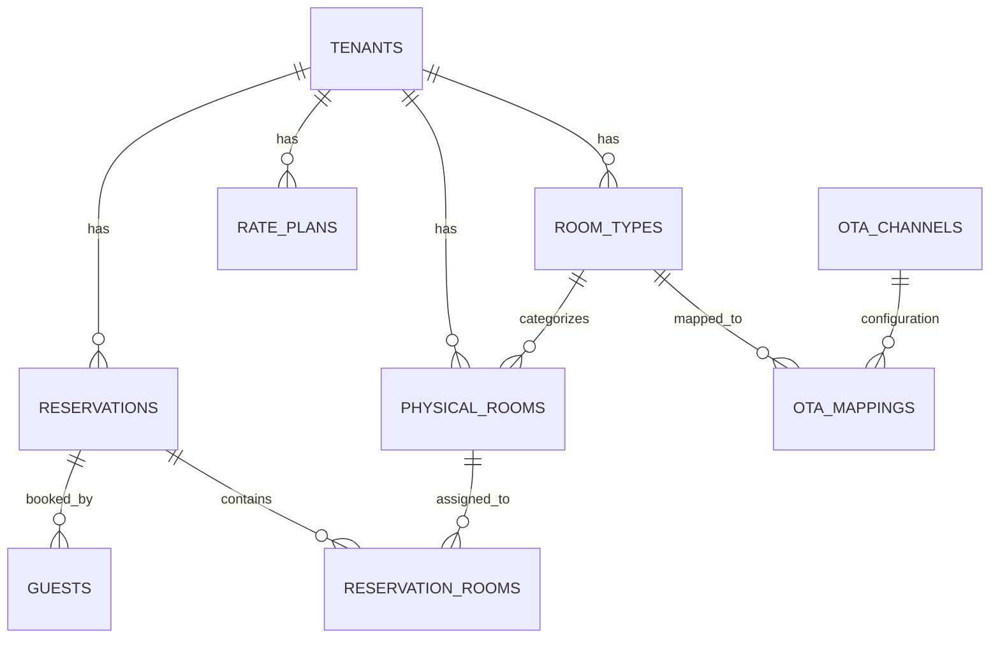
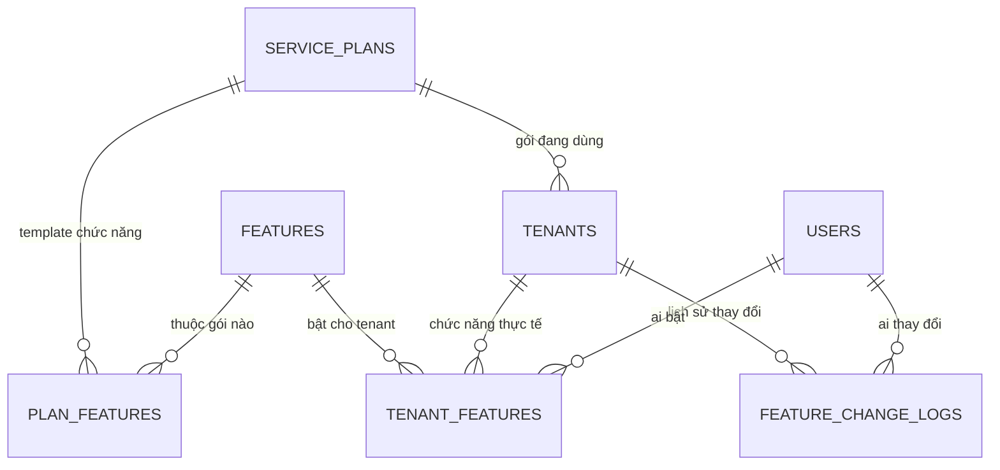
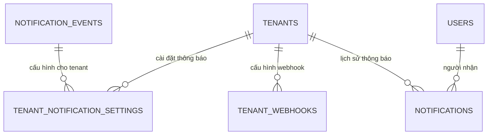
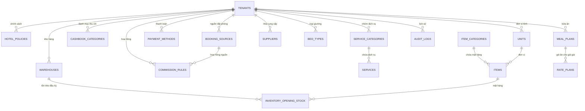

# Kiến trúc Hệ thống PMS & Thiết kế Cơ sở dữ liệu

Dự án ra mắt vào giữa tháng 12/2026 (còn khoảng 3-4 tháng), đây là một quỹ thời gian khá áp lực cho một hệ thống SaaS PMS. Để hệ thống có thể mở rộng (scalable) và không bị "gãy" khi nâng cấp, phần thiết kế Database và Migration là quan trọng nhất.

---

## Phần 1: Phân hệ Chức năng Client (Dành cho Khách sạn/Tenant)

> [!IMPORTANT]
> **Yêu cầu chung về Giao diện:**
> Cần đặc biệt chú ý thiết kế **Responsive UI**. Hệ thống phải hiển thị tốt và thao tác mượt mà trên nhiều kích thước màn hình khác nhau (Desktop, Tablet, Mobile) để nhân viên khách sạn có thể linh hoạt làm việc trên mọi thiết bị.

Dưới đây là danh sách toàn bộ quy mô nghiệp vụ mà hệ thống PMS sẽ cung cấp cho một khách sạn (Client). Cấu trúc này cần được phản ánh trực tiếp vào thanh Menu (Sidebar) và kiến trúc Database.

### 1. Bảng điều khiển (Dashboard)
- Giao diện tổng quan thời gian thực về tình trạng khách sạn (công suất, doanh thu trong ngày, khách đến/đi).

### 2. Lịch đặt phòng (Tape Chart / Calendar)
- Giao diện dạng Timeline lưới (Grid) hiển thị trực quan các phòng vật lý và các lượt booking kéo dài qua các ngày.

### 3. Đặt phòng (Reservations)
- Quản lý luồng tạo mới đặt phòng, tìm kiếm, sửa, hủy và quản lý hồ sơ khách lưu trú.

### 4. Bán hàng (POS / Sales)
- Ghi nhận các giao dịch bán dịch vụ lẻ ngoài tiền phòng (Minibar, Nhà hàng, Giặt ủi, Spa, Tour...).

### 5. Thu chi (Cash flow / Bank)
- **Quỹ tiền mặt:** Quản lý tiền mặt tại quầy (thu tiền cọc, chi lặt vặt).
- **Quỹ tiền gửi:** Quản lý các giao dịch qua thẻ, chuyển khoản ngân hàng.

### 6. Giá & Phòng trống (ARI - Availability, Rates, Inventory)
- **Giá cơ bản (Base Rates):** Thiết lập giá niêm yết theo hạng phòng.
- **Giá nâng cao (Advanced Rates):** Giá cuối tuần, giá theo độ dài kỳ nghỉ (LOS).
- **Giá & Phòng trống hàng ngày:** Lưới điều chỉnh giá nóng và đóng/mở phòng cho từng ngày cụ thể.
- **Vouchers:** Quản lý mã giảm giá.
- **Giá cho lịch đặt phòng:** Chính sách giá gắn liền với các dịp đặc biệt.
- **Chương trình khuyến mãi (Promotions):** Early bird, Last minute, Stay 3 pay 2...

### 7. Buồng phòng (Housekeeping)
- **Buồng phòng:** Quản lý trạng thái dọn dẹp (Sạch, Bẩn, Đang kiểm tra, Hỏng).
- **Nhân viên buồng phòng:** Quản lý danh sách và ca làm việc của đội Housekeeping.
- **Kế hoạch dọn phòng:** Tự động lên lịch dọn phòng dựa trên khách Check-in / Check-out / Stay-over.

### 8. Kho (Inventory/Warehouse)
- **Phiếu nhập kho:** Nhập hàng hóa (đồ uống, vật tư tiêu hao).
- **Phiếu xuất kho:** Xuất hàng cho các bộ phận (xuất nước suối cho buồng phòng).
- **Phiếu chuyển kho:** Luân chuyển hàng hóa giữa kho tổng và kho phụ.
- **Phiếu kiểm kê:** Chốt số lượng tồn kho thực tế so với sổ sách.

### 9. Báo cáo (Reports)
Bộ báo cáo đồ sộ phục vụ công tác đối soát và phân tích kinh doanh:

*   **Báo cáo kinh doanh:**
    - Báo cáo bữa sáng, Báo cáo hàng ngày, Kiểm toán đêm (Night Audit).
    - Báo cáo phòng trống, Công suất phòng, Tổng công suất phòng.
    - Báo cáo giá phòng trung bình (ADR).
    - Danh sách khách ở, Trả phòng, Trả phòng theo ngày, Nhận phòng.
    - Danh sách đặt phòng theo nhân viên, Đặt phòng theo gói giá.
    - Báo cáo khách ở theo quốc tịch, Hủy phòng, Tổng hợp kinh doanh.
*   **Báo cáo dòng tiền:**
    - Báo cáo các khoản chi, Thu chi tổng hợp.
    - Báo cáo thanh toán, Thanh toán theo loại phòng, Lịch sử thanh toán.
    - Báo cáo công nợ (City Ledger), Báo cáo đặt cọc.
    - Báo cáo chi hoa hồng (Commissions), Chi tiết voucher, CT Khuyến mãi.
    - Báo cáo thanh toán thêm, Giao dịch tổng hợp.
*   **Báo cáo doanh thu:**
    - Doanh thu hàng ngày, Doanh thu theo đặt phòng, theo phòng, theo loại phòng, theo nguồn (Source/OTA).
    - Doanh thu tổng hợp theo ngày, tổng hợp theo phòng.
    - Chi tiết dịch vụ theo phòng, theo nhóm, Tổng dịch vụ theo nhóm.
*   **Báo cáo kho:**
    - Báo cáo tồn kho.

---

## Phần 1B: Phân hệ UI Nội bộ (Internal Admin / Backoffice)
Bên cạnh giao diện dành cho khách sạn, hệ thống bắt buộc phải có một UI quản trị nội bộ riêng biệt dành cho đội ngũ phát triển/vận hành (System Manager / Super Admin). Phần này nên được chạy trên một domain/sub-domain tách biệt (ví dụ: `admin.domain.com`) với Client App để tối ưu bảo mật.

**Các chức năng cốt lõi của UI Nội bộ:**
1. **Quản lý Khách sạn (Tenants):** Tạo mới, kích hoạt, tạm ngưng, hoặc xóa tài khoản khách sạn. Quản lý thông tin liên hệ và domain của từng tenant.
2. **Quản lý Gói dịch vụ & Thanh toán (Billing):** Thiết lập các gói cước (Pricing Plans), theo dõi tình trạng thanh toán, gia hạn, nâng cấp/hạ cấp gói của khách hàng.
3. **Quản lý Tính năng (Feature Toggles / Gating):** Bật/tắt các tính năng cụ thể trên hệ thống đối với từng Tenant.
4. **Quản lý Người dùng Nội bộ (Global Users):** Phân quyền cho nhân viên công ty (Admin, Support, Sales, v.v.).
5. **Dashboard Hệ thống:** Thống kê tổng số tenant, doanh thu SaaS, số lượng user đang active, log hệ thống.

---

## Phần 2: Thiết kế Database PostgreSQL cho hệ thống SaaS
Hệ thống của bạn là SaaS (Cho nhiều khách sạn cùng thuê), do đó bạn phải áp dụng kiến trúc **Multi-Tenant (Đa khách thuê)**.

> [!IMPORTANT]
> **Chiến lược Multi-Tenant:**
> Khuyên dùng: **Single Database - Single Schema**. Tức là tất cả dữ liệu nằm chung 1 Database và 1 Schema, nhưng **MỌI TABLE** (ngoại trừ bảng users hệ thống) đều phải có cột `tenant_id` (Mã khách sạn).
>
> *Lý do:* Rất dễ quản lý, dễ lấy báo cáo tổng và cực kỳ dễ khi chạy Migration (thay vì phải chạy migration cho hàng ngàn schema riêng biệt). Bạn kết hợp với tính năng **Row Level Security (RLS)** của PostgreSQL để đảm bảo khách sạn A tuyệt đối không xem được data của khách sạn B.

### Lược đồ (Schema) Cốt lõi (Giản lược)



#### Các Bảng (Tables) quan trọng nhất:
1. `tenants`: Thông tin khách sạn (id, name, domain, status).
2. `room_types`: Hạng phòng (id, tenant_id, name, base_price, default_occupancy).
3. `physical_rooms`: Phòng thực tế (id, tenant_id, room_type_id, room_number, status [clean/dirty]).
4. `rate_plans`: Gói giá (id, tenant_id, name, meal_plan).
5. `guests`: Khách hàng (id, tenant_id, name, email, phone).
6. `reservations`: Đơn đặt phòng (id, tenant_id, guest_id, channel [Direct/Booking.com/Traveloka], total_price, status).
7. `reservation_rooms`: Chi tiết phòng đặt (id, reservation_id, room_type_id, physical_room_id, check_in, check_out).
9. `ota_mappings`: Bảng mapping mã PMS với mã OTA (id, ota_config_id, entity_type [room/rate], pms_id, ota_id).

### 2. Thiết kế bảng ARI (Availability, Rates, Inventory) - Dữ liệu Lịch Đặt Phòng
Qua phân tích kỹ thuật (Reverse Engineering) từ hệ thống đối thủ, bảng dữ liệu chạy cái Lịch Đặt Phòng (Tape Chart) thực chất không lấy từ bảng Booking, mà lấy từ một bảng "Kho phòng theo ngày" (Daily Inventory). Chúng ta sẽ thiết kế bảng `room_type_availabilities` (Tương đương `GetRoomAvails` của đối thủ) như sau:

**Bảng `room_type_availabilities` (Chốt số tồn kho mỗi ngày):**
- `id` (PK)
- `tenant_id` (Khóa ngoại trỏ về tenants - HotelId)
- `room_type_id` (Khóa ngoại trỏ về hạng phòng - RoomType_Id)
- `date` (Ngày áp dụng - Tương đương SellFrom / SellTo)
- `total_rooms` (Tổng số phòng vật lý của hạng này - MaxRoom)
- `booked_count` (Số phòng đã có khách đặt - BookCount)
- `blocked_count` (Số phòng bị khóa/đóng/hỏng không bán - BlockCount)
- `checkout_count` (Số khách sẽ trả phòng trong ngày này - CheckOutCount)
- `available_to_sell` (Số phòng còn lại được phép bán - Value)
*(Công thức: `available_to_sell = total_rooms - booked_count - blocked_count`)*

**Tại sao phải có bảng này?**
Nếu mỗi lần mở Lịch đặt phòng (Tape Chart), hệ thống phải quét hàng chục ngàn dòng trong bảng `reservations` để đếm xem ngày 19/09 có bao nhiêu phòng bị chiếm, thì Database sẽ bị "treo" (Quá tải). Thay vào đó, mỗi khi có khách đặt phòng, hệ thống chỉ cần cộng/trừ vào bảng `room_type_availabilities` này. Khi load Tape Chart, API chỉ việc lấy data thẳng từ bảng này ra (Rất nhẹ và nhanh, giống hệt cách đối thủ đang làm).

---

## Phần 3: Chiến lược Migration Database KHÔNG GÃY (Zero-Downtime Migration)

Khi hệ thống đã có khách hàng thật, việc sửa Database có thể làm sập hệ thống (Downtime) hoặc mất dữ liệu. Để làm hệ thống "không gãy", bạn phải tuân thủ quy tắc **Expand and Contract (Mở rộng và Thu hẹp)**.

### Quy tắc vàng:
> [!CAUTION]
> **KHÔNG BAO GIỜ** đổi tên cột hoặc xóa cột/bảng đang được sử dụng trong cùng 1 lần deploy. Luôn chia làm nhiều bước.

### Công cụ khuyên dùng cho PostgreSQL & Python (Flask):
1. Sử dụng thư viện ORM **SQLAlchemy**.
2. Sử dụng thư viện **Alembic (Flask-Migrate)** để quản lý lịch sử migration tự động.
3. Tận dụng **Transactional DDL** của Postgres: Postgres cho phép bỏ các lệnh `ALTER TABLE` vào trong `BEGIN; ... COMMIT;`. Nếu migration bị lỗi giữa chừng, nó sẽ tự động Rollback (Hoàn tác) lại toàn bộ, không làm hỏng Database.

---

## Phần 4: Xử lý Đa Tiền Tệ (Multi-Currency) cho khách quốc tế

Vì hệ thống có khách nước ngoài (và kết nối OTA thường trả về giá trị ngoại tệ như USD, EUR), bạn bắt buộc phải thiết kế cấu trúc dữ liệu theo chuẩn kế toán.

### 3 Nguyên tắc "Sống còn" khi lưu trữ tiền tệ trong PostgreSQL:

> [!WARNING]
> **Tuyệt đối KHÔNG BAO GIỜ dùng kiểu dữ liệu `FLOAT` hay `REAL` để lưu tiền.**
> Kiểu `float` gây ra sai số làm tròn (ví dụ 0.1 + 0.2 = 0.30000000000000004). Khi nhân với hàng tỷ đồng sẽ dẫn đến sai lệch lớn trong báo cáo tài chính.
> 
> **Hãy dùng kiểu `DECIMAL(19,4)` hoặc `NUMERIC`**, hoặc chuẩn nhất là lưu tiền ở đơn vị nhỏ nhất bằng kiểu `BIGINT` (Ví dụ: 10.50 USD thì lưu là `1050` Cents).

### Cấu trúc Database cho Tiền tệ:
1. **Tiền tệ gốc của khách sạn (Base Currency):**
   Mỗi khách sạn (tenant) chỉ có duy nhất 1 Base Currency để chốt sổ (Ví dụ: VND). Bảng `tenants` cần thêm cột:
   - `base_currency_code` (CHAR(3), ví dụ: 'VND', 'USD')
   
2. **Tại các bảng ghi nhận tiền (Ví dụ: `reservations` hay `invoices`):**
   Luôn phải lưu **cặp giá trị** (Số tiền + Loại tiền tệ) VÀ (Số tiền quy đổi ra tiền gốc của KS + Tỉ giá lúc đặt phòng).
   
   *Ví dụ trong bảng `reservations`:*
   - `total_price`: 100.00 (Tiền khách trả)
   - `currency_code`: 'USD' (Loại tiền khách trả trên OTA Booking.com)
   - `exchange_rate`: 25000 (Tỉ giá tại thời điểm khách đặt)
   - `base_total_price`: 2500000 (Quy đổi ra VND để báo cáo cho chủ khách sạn).

### Tại sao phải lưu tỷ giá cứng (Hardcode) vào từng booking?
Bởi vì tỷ giá ngoại tệ biến động mỗi ngày. Nếu hôm nay khách đặt phòng với giá 100 USD (tỉ giá 25k = 2.5tr VND), nhưng 1 tháng sau khách mới check-out và tỉ giá lúc đó là 24k, hóa đơn cũ và doanh thu cũ của khách sạn không được phép bị nhảy số. **Tỷ giá lúc giao dịch phải được "đóng băng" (snapshot) lại và lưu vào database.**

---

## Phần 5: Quản trị Phân quyền 3 Cấp (Role-Based Access Control)

Với yêu cầu phân quyền hệ thống gồm: **Admin (Hệ thống)** > **Quản lý (Quản lý các Client)** > **Client (Khách sạn)**, kiến trúc Database của bạn cần tách biệt rõ ràng giữa "Tài khoản toàn cầu" và "Tài khoản của Khách sạn".

### Giải pháp Kiến trúc Phân quyền (Global Users vs Tenant Users)

Bạn cần tạo 1 bảng `users` dùng chung (Global), và 1 bảng trung gian (Mapping) để quy định quyền hạn của họ ở đâu.

**Bảng `users`:**
- `id` (UUID)
- `email`
- `password_hash`
- `global_role`: ENUM (`SUPER_ADMIN`, `SYSTEM_MANAGER`, `USER`)
  - **`SUPER_ADMIN`**: Admin cao nhất, sửa lỗi hệ thống, can thiệp mọi thứ, cấu hình Core.
  - **`SYSTEM_MANAGER`**: Quản lý cấp trung. Chỉ có 1 (hoặc một nhóm nhỏ), chịu trách nhiệm tạo mới Tenant (khách sạn), khóa/mở khóa tài khoản khách hàng, hỗ trợ nghiệp vụ.
  - **`USER`**: Sẽ được gán vào các Khách sạn cụ thể ở bảng mapping bên dưới.

**Bảng `tenant_users` (Bảng trung gian phân quyền cấp Khách sạn):**
- `id`
- `user_id` (Khóa ngoại trỏ về bảng users)
- `tenant_id` (Khóa ngoại trỏ về bảng tenants/khách sạn)
- `tenant_role`: ENUM (`HOTEL_OWNER`, `FRONT_DESK`, `HOUSEKEEPING`, `ACCOUNTANT`)
  - Đây chính là cấp độ **Client**. Khi đăng nhập, hệ thống sẽ kiểm tra xem `user_id` này thuộc `tenant_id` nào và được cấp quyền (role) gì trong phạm vi khách sạn đó.

---

## Phần 6: Kiến trúc Công nghệ & Tích hợp (Tech Stack & Integrations)

Để đáp ứng mốc thời gian release tháng 12/2026 và đảm bảo tính mở rộng cao, dự án thống nhất kiến trúc công nghệ như sau:

### 1. Kiến trúc Tổng thể (Full-Stack) & Phân chia Domain
Hệ thống sẽ được phân tách vật lý (Source code) và logic (Domain) thành 3 mảng độc lập để đảm bảo bảo mật tuyệt đối và dễ bảo trì:
- **Marketing Site (Trang quảng bá):** Chạy trên Domain chính (Ví dụ: `bluejaypms.com`). Chỉ chứa Landing page giới thiệu phần mềm, Bảng giá.
- **Client App (Nghiệp vụ Khách sạn):** Chạy trên Sub-domain (Ví dụ: `app.bluejaypms.com`). Nơi Lễ tân và Quản lý khách sạn (Tenant) thao tác nghiệp vụ PMS (Dashboard, Tape Chart, OTA).
- **Internal Admin (Quản trị Nội bộ hệ thống):** Có **Source code tách biệt hoàn toàn** khỏi Client App, chạy trên Sub-domain riêng (Ví dụ: `admin.bluejaypms.com`). Chỉ dành cho System Manager (Đội ngũ Blue Jay) dùng để tạo/khóa tài khoản khách sạn (Tenant), quản lý gói cước (Billing). Việc tách hẳn Source code đảm bảo rủi ro bảo mật thấp nhất (Hacker không thể tìm thấy luồng code Admin bên trong app của Khách sạn).
- **Backend (API Core):** Sử dụng **Python (Flask)**. Làm não bộ trung tâm cung cấp API bảo mật cho cả 3 mảng Frontend trên.
- **Database:** **PostgreSQL** kết hợp với **SQLAlchemy (ORM)**. Sử dụng **Alembic** (hoặc Flask-Migrate) để quản lý lịch sử Migration (áp dụng chiến lược Zero-Downtime ở Phần 3).

### 2. Tích hợp OTA (Channel Manager)
Thay vì xin cấp quyền API trực tiếp từ Booking.com, Traveloka, Ctrip (mất 3-6 tháng rủi ro pháp lý và kỹ thuật), hệ thống sẽ chọn giải pháp thông minh hơn:
- **Sử dụng Channel Manager Switch (Channex.io hoặc tương đương):**
  - Giảm tải 90% khối lượng công việc Code kết nối OTA.
  - Đảm bảo chuẩn bảo mật thẻ tín dụng (PCI DSS).
  - Tốc độ đồng bộ 2 chiều (Rates & Inventory) tính bằng giây.
  - Phía Backend Python chỉ cần viết 1 tích hợp duy nhất với chuẩn API của Channex là có thể đẩy dữ liệu lên hàng loạt OTA cùng lúc.

---

## Phần 7: Kế hoạch mở rộng Mobile App (iOS / Android) - Phase 2

Trong tương lai, hệ thống sẽ phát hành ứng dụng di động cho chủ khách sạn và nhân viên. Dưới đây là phân tích về tác động của Mobile App đến kiến trúc hiện tại:

### 1. Về Cơ sở dữ liệu (Database) và Backend
- **Cấu trúc lõi (Core Database): KHÔNG CẦN THAY ĐỔI.** Kiến trúc Backend Flask xây dựng theo chuẩn RESTful API, trả về dữ liệu định dạng JSON. Dù là Website (React) hay Mobile App (React Native/Flutter) thì đều gọi chung một API này. Sự tách bạch (Decoupling) giữa Frontend và Backend giúp hệ thống hoàn toàn sẵn sàng cho Mobile App.
- **Bổ sung nhỏ (Add-ons):** Khi làm Mobile App, chúng ta chỉ cần tạo thêm bảng `device_tokens` để lưu mã Token của điện thoại (FCM Token / APNs Token). Việc này chỉ để phục vụ tính năng **Push Notification** (Gửi thông báo "ting ting" về điện thoại khi có khách đặt phòng mới).

### 2. Về Giao diện (UI/UX)
- **Web UI (Hiện tại):** Thiết kế cho Lễ tân và Quản lý dùng trên máy tính. Có không gian rộng để hiển thị Tape Chart 30 ngày, hệ thống Báo cáo đồ sộ, và giao diện phức tạp.
- **Mobile UI (Cần thiết kế riêng hoàn toàn):**
  - Tuyệt đối **KHÔNG** mang y nguyên giao diện máy tính lên điện thoại (màn hình 6-inch không thể chứa nổi cái Lịch Tape Chart khổng lồ hay Bảng số liệu).
  - Ứng dụng Mobile (App) sẽ thiết kế giao diện dạng dọc (Vertical), to, rõ, dễ bấm và chỉ tập trung giải quyết các tác vụ "Tức thời" và "Di động":
    1. **Chủ khách sạn (Owner):** Xem nhanh Dashboard doanh thu, phòng trống, và nhận Push Notification biến động kinh doanh.
    2. **Nhân viên Buồng phòng (Housekeeping):** Cầm điện thoại đi dọn phòng. Dọn xong phòng nào, lấy điện thoại bấm nút "Đã dọn sạch", tình trạng lập tức cập nhật thời gian thực về máy tính của Lễ tân.
    3. **Tác vụ nhanh (Nâng cao sau này):** Chụp ảnh Passport/CCCD của khách bằng điện thoại để quét OCR lưu tự động vào hệ thống.

---

## Phần 8: Quản lý Gói Dịch Vụ & Người Dùng Thử (Feature Gating & Trial Mode)

Hệ thống SaaS cần phân biệt rõ giữa **khách dùng thử miễn phí** và **khách đã mua gói dịch vụ**. Mục tiêu UX cốt lõi: Người dùng thử **vẫn thấy toàn bộ chức năng** trên giao diện (để biết hệ thống mạnh cỡ nào), nhưng khi bấm vào chức năng nâng cao sẽ **bị khóa** và hiển thị thông báo nâng cấp.

### 1. Khái niệm Feature Gating (Cổng Chức Năng)

Mỗi tính năng trong hệ thống PMS được gán một **Feature Code** (Mã chức năng). System Manager sẽ bật/tắt từng chức năng cho mỗi khách sạn (Tenant) dựa trên gói dịch vụ mà khách đã mua.

**Danh sách Feature Code mẫu:**

| Feature Code | Tên chức năng | Mức gói |
|:---|:---|:---|
| `DASHBOARD` | Bảng điều khiển | 🟢 Trial (Miễn phí) |
| `ROOM_DIAGRAM` | Sơ đồ phòng | 🟢 Trial |
| `RESERVATION_VIEW` | Xem danh sách đặt phòng | 🟢 Trial |
| `RESERVATION_CREATE` | Tạo đặt phòng mới | 🟢 Trial (Giới hạn 10 booking) |
| `TAPE_CHART` | Lịch đặt phòng Timeline | 🟡 Basic |
| `ARI_MANAGEMENT` | Quản lý Giá & Phòng trống | 🟡 Basic |
| `HOUSEKEEPING` | Buồng phòng | 🟡 Basic |
| `POS_SALES` | Bán hàng (POS) | 🟡 Basic |
| `CASHBOOK` | Thu chi / Sổ quỹ | 🟡 Basic |
| `REPORTS_BASIC` | Báo cáo cơ bản | 🟡 Basic |
| `OTA_SYNC` | Đồng bộ OTA (Booking.com, Traveloka) | 🔴 Pro |
| `REPORTS_ADVANCED` | Báo cáo nâng cao (40+ báo cáo) | 🔴 Pro |
| `INVENTORY_WAREHOUSE` | Quản lý Kho | 🔴 Pro |
| `MULTI_CURRENCY` | Đa tiền tệ | 🔴 Pro |
| `VOUCHER_PROMO` | Voucher & Khuyến mãi | 🔴 Pro |
| `API_EXTERNAL` | API mở cho bên thứ 3 | 🔴 Pro |

### 2. Trải Nghiệm Người Dùng Thử (Trial User UX)

Khi khách sạn đăng ký dùng thử (Trial), hệ thống tự động:
- Tạo Tenant với `subscription_status = 'TRIAL'` và `trial_expires_at` = ngày hiện tại + 14 ngày.
- Bật sẵn các Feature Code mức 🟢 Trial.
- **Giao diện (UI):** Hiển thị **TẤT CẢ** menu chức năng (bao gồm cả Basic và Pro), nhưng:
  - Các chức năng **chưa được bật** sẽ hiển thị với trạng thái **mờ (greyed out)** kèm biểu tượng 🔒.
  - Khi người dùng **click vào chức năng bị khóa**, hệ thống hiển thị popup/modal:
    > *"Chức năng này thuộc gói [Basic/Pro]. Vui lòng liên hệ đội ngũ Blue Jay để nâng cấp."*
    > Nút CTA: **[Liên hệ nâng cấp]** (Gửi email/Zalo tới System Manager)
  - Một số chức năng Trial có thể bị **giới hạn số lượng** (Ví dụ: Chỉ tạo được tối đa 10 booking trong Trial).

> [!IMPORTANT]
> **Triết lý UX quan trọng:** Người dùng thử phải **thấy được** toàn bộ sức mạnh của hệ thống. Việc ẩn hoàn toàn chức năng sẽ khiến khách hàng không biết hệ thống có gì hay, và giảm tỷ lệ chuyển đổi sang gói trả phí. Thay vào đó, chúng ta **cho xem nhưng không cho dùng** — tạo FOMO (Fear of Missing Out) và thúc đẩy khách nâng cấp.

### 3. Quản Lý Gói Dịch Vụ Bởi System Manager (Trang Admin)

Trên giao diện **Internal Admin** (`admin.bluejaypms.com`), System Manager sẽ có màn hình **Quản lý Tenant** với các thao tác:

#### a) Tạo Tenant (Khách sạn) mới
- Nhập thông tin khách sạn (tên, địa chỉ, liên hệ).
- Chọn gói dịch vụ ban đầu (Trial / Basic / Pro) hoặc custom.
- Hệ thống tự động bật các Feature Code tương ứng.

#### b) Quản lý chức năng cho từng Tenant (Feature Toggle)
- Giao diện dạng **bảng checkbox** (checklist):
  - Cột trái: Danh sách tất cả Feature Code.
  - Cột phải: Checkbox ☑️ bật / ☐ tắt cho Tenant đang chọn.
- System Manager có thể **bật/tắt từng chức năng riêng lẻ** — không bắt buộc phải theo gói cứng.
  - *Ví dụ:* Khách mua gói Basic nhưng muốn thêm riêng tính năng OTA Sync → System Manager chỉ cần tick thêm `OTA_SYNC` mà không cần nâng lên Pro.
- Mỗi lần thay đổi, hệ thống ghi lại log (`feature_change_logs`) để truy vết ai đã bật/tắt gì, khi nào.

#### c) Quản lý người dùng trong Tenant
- System Manager có thể tạo/xóa user cho từng khách sạn.
- Gán `tenant_role` (HOTEL_OWNER, FRONT_DESK, HOUSEKEEPING, ACCOUNTANT) cho từng user.
- Mỗi role tự động kế thừa quyền truy cập Feature của Tenant đó (Ví dụ: Tenant được bật `HOUSEKEEPING` → user role `HOUSEKEEPING` mới truy cập được).

### 4. Thiết Kế Database Bổ Sung

#### Bảng `features` (Danh sách Master chức năng)
- `id` (PK)
- `code` (VARCHAR, UNIQUE) — Ví dụ: `'TAPE_CHART'`, `'OTA_SYNC'`
- `name` (VARCHAR) — Tên hiển thị: `'Lịch đặt phòng Timeline'`
- `description` (TEXT) — Mô tả ngắn
- `tier` (ENUM: `'TRIAL'`, `'BASIC'`, `'PRO'`) — Mức gói mặc định
- `sort_order` (INT) — Thứ tự hiển thị trên UI

#### Bảng `service_plans` (Gói dịch vụ)
- `id` (PK)
- `name` (VARCHAR) — Ví dụ: `'Trial'`, `'Basic'`, `'Pro'`, `'Enterprise'`
- `price_monthly` (DECIMAL) — Giá hàng tháng (VND)
- `price_yearly` (DECIMAL) — Giá hàng năm
- `max_rooms` (INT) — Giới hạn số phòng (NULL = Không giới hạn)
- `max_users` (INT) — Giới hạn số user
- `trial_days` (INT) — Số ngày dùng thử (Mặc định 14)
- `is_active` (BOOLEAN) — Còn bán gói này không

#### Bảng `plan_features` (Feature mặc định của mỗi gói — Bảng trung gian)
- `id` (PK)
- `plan_id` (FK → `service_plans`)
- `feature_id` (FK → `features`)
- Khi System Manager tạo Tenant mới và chọn gói "Basic", hệ thống tự động copy tất cả feature từ bảng này sang `tenant_features`.

#### Bổ sung cột vào bảng `tenants`
- `plan_id` (FK → `service_plans`) — Gói dịch vụ hiện tại
- `subscription_status` (ENUM: `'TRIAL'`, `'ACTIVE'`, `'EXPIRED'`, `'SUSPENDED'`)
- `trial_expires_at` (TIMESTAMP) — Ngày hết hạn dùng thử
- `subscription_expires_at` (TIMESTAMP) — Ngày hết hạn gói dịch vụ

#### Bảng `tenant_features` (Chức năng THỰC TẾ đang bật cho từng Tenant)
- `id` (PK)
- `tenant_id` (FK → `tenants`)
- `feature_id` (FK → `features`)
- `is_enabled` (BOOLEAN) — Bật hay tắt
- `enabled_by` (FK → `users`) — System Manager nào đã bật
- `enabled_at` (TIMESTAMP) — Bật lúc nào
- `usage_limit` (INT, NULLABLE) — Giới hạn sử dụng (Ví dụ: Trial chỉ cho tạo 10 booking)
- `usage_count` (INT, DEFAULT 0) — Đã sử dụng bao nhiêu lần

> [!NOTE]
> **Tại sao tách `plan_features` và `tenant_features`?**
> - `plan_features` là **template mặc định** của gói (Trial có gì, Basic có gì).
> - `tenant_features` là **trạng thái thực tế** của từng khách sạn — cho phép System Manager custom bật/tắt riêng lẻ mà không ảnh hưởng gói chung.
> - Khi khách nâng cấp gói, hệ thống sẽ **merge** thêm feature mới từ `plan_features` vào `tenant_features`, không xóa feature cũ.

#### Bảng `feature_change_logs` (Lịch sử thay đổi — Audit Trail)
- `id` (PK)
- `tenant_id` (FK → `tenants`)
- `feature_id` (FK → `features`)
- `action` (ENUM: `'ENABLED'`, `'DISABLED'`)
- `changed_by` (FK → `users`) — Ai thay đổi
- `changed_at` (TIMESTAMP) — Khi nào
- `reason` (TEXT, NULLABLE) — Ghi chú lý do

### 5. Luồng Xử Lý Trên API (Backend Logic)

#### Middleware kiểm tra Feature Access
Mỗi API endpoint cần được bảo vệ bởi middleware `@require_feature('FEATURE_CODE')`:

```python
# Ví dụ sử dụng decorator
@app.route('/api/v1/ota/sync', methods=['POST'])
@require_auth          # Bước 1: Kiểm tra JWT token hợp lệ
@require_feature('OTA_SYNC')  # Bước 2: Kiểm tra tenant có bật feature này không
def sync_ota():
    # Logic đồng bộ OTA...
    pass
```

#### Luồng kiểm tra chi tiết:
1. **Frontend** gọi API `GET /api/v1/tenant/features` khi load app → nhận danh sách feature + trạng thái (enabled/disabled).
2. **Frontend** dựa vào danh sách này để render menu: enabled → hoạt động bình thường, disabled → greyed out + icon 🔒.
3. Khi user click chức năng bị khóa → Frontend hiển thị popup nâng cấp (không cần gọi API).
4. Nếu user cố gắng bypass Frontend gọi thẳng API → **Backend middleware** chặn và trả về `HTTP 403 Forbidden` với message `"Feature not available in your current plan"`.

### 6. Lược Đồ Quan Hệ Bổ Sung



---

## Phần 9: Cài Đặt Thông Báo Tùy Biến (Notification Settings)

Mỗi khách sạn (Tenant) có nhu cầu nhận thông báo khác nhau. Khách sạn nhỏ muốn chủ nhận tất cả mọi thứ qua Zalo, khách sạn lớn chỉ muốn Lễ tân nhận thông báo check-in và Housekeeping nhận thông báo dọn phòng. Hệ thống cần cung cấp giao diện **Setting Notification** để mỗi Tenant tùy chỉnh theo ý mình.

### 1. Các Sự Kiện Cần Thông Báo (Notification Events)

Hệ thống PMS có các sự kiện nghiệp vụ quan trọng cần thông báo:

| Event Code | Sự kiện | Mô tả | Mức ưu tiên |
|:---|:---|:---|:---|
| `NEW_BOOKING` | Đặt phòng mới | Có khách đặt phòng (Walk-in hoặc từ OTA) | 🔴 Cao |
| `BOOKING_CANCELLED` | Hủy đặt phòng | Khách hoặc OTA hủy booking | 🔴 Cao |
| `BOOKING_MODIFIED` | Sửa đặt phòng | Thay đổi ngày, loại phòng, số khách | 🟡 Trung bình |
| `CHECKIN_TODAY` | Khách đến hôm nay | Tổng hợp danh sách khách sẽ check-in trong ngày | 🟡 Trung bình |
| `CHECKOUT_TODAY` | Khách trả phòng hôm nay | Tổng hợp danh sách khách sẽ check-out trong ngày | 🟡 Trung bình |
| `CHECKIN_DONE` | Khách đã nhận phòng | Xác nhận check-in thành công | 🟢 Thấp |
| `CHECKOUT_DONE` | Khách đã trả phòng | Xác nhận check-out thành công | 🟢 Thấp |
| `ROOM_CLEANED` | Phòng đã dọn xong | Housekeeping báo phòng sạch | 🟡 Trung bình |
| `ROOM_MAINTENANCE` | Phòng cần sửa chữa | Báo hỏng thiết bị trong phòng | 🔴 Cao |
| `PAYMENT_RECEIVED` | Nhận thanh toán | Khách thanh toán tiền phòng/dịch vụ | 🟡 Trung bình |
| `PAYMENT_OVERDUE` | Quá hạn thanh toán | Công nợ chưa thu hồi quá hạn | 🔴 Cao |
| `OTA_SYNC_ERROR` | Lỗi đồng bộ OTA | Đồng bộ Booking.com/Traveloka thất bại | 🔴 Cao |
| `LOW_INVENTORY` | Sắp hết phòng trống | Công suất phòng > 90% cho ngày sắp tới | 🟡 Trung bình |
| `DAILY_SUMMARY` | Báo cáo tổng hợp ngày | Doanh thu, công suất, check-in/out trong ngày | 🟢 Thấp |
| `TRIAL_EXPIRING` | Sắp hết hạn dùng thử | Nhắc nhở trước 3 ngày hết trial | 🔴 Cao |

### 2. Kênh Gửi Thông Báo (Notification Channels)

| Kênh | Mô tả | Ghi chú |
|:---|:---|:---|
| **In-App** | Chuông thông báo 🔔 trong giao diện web | Luôn bật mặc định, không tắt được |
| **Email** | Gửi email tới người nhận | Dùng Resend/SendGrid |
| **Push Notification** | Thông báo trên điện thoại (Phase 2 - Mobile App) | FCM / APNs |
| **Webhook** | Gọi URL bên ngoài khi có sự kiện | Dành cho khách sạn muốn tích hợp hệ thống riêng |

> [!NOTE]
> **Về Zalo/SMS:** Phase 1 chưa tích hợp Zalo OA hoặc SMS (tốn phí và cần đăng ký doanh nghiệp). Có thể bổ sung Phase 2 khi có nhu cầu thực tế từ khách hàng. Webhook là giải pháp mở để khách tự kết nối với bất kỳ dịch vụ nào (bao gồm Zalo qua Zapier/n8n).

### 3. Giao Diện Setting Notification (UX)

Giao diện cài đặt thông báo nằm trong menu **Cài đặt** của Client App (`app.bluejaypms.com`), chỉ **HOTEL_OWNER** và **FRONT_DESK** (Manager) mới được truy cập.

#### a) Cài đặt cấp Khách sạn (Tenant-Level Settings)
Giao diện dạng **bảng lưới (matrix)** — dòng là sự kiện, cột là kênh gửi:

```
┌──────────────────────┬─────────┬─────────┬──────────┐
│ Sự kiện              │ In-App  │ Email   │ Webhook  │
├──────────────────────┼─────────┼─────────┼──────────┤
│ 🔴 Đặt phòng mới    │ ☑️ (🔒) │ ☑️      │ ☐        │
│ 🔴 Hủy đặt phòng    │ ☑️ (🔒) │ ☑️      │ ☐        │
│ 🟡 Sửa đặt phòng    │ ☑️ (🔒) │ ☐       │ ☐        │
│ 🟡 Khách đến hôm nay │ ☑️ (🔒) │ ☑️      │ ☐        │
│ 🟡 Phòng đã dọn xong │ ☑️ (🔒) │ ☐       │ ☐        │
│ 🔴 Lỗi đồng bộ OTA  │ ☑️ (🔒) │ ☑️      │ ☑️       │
│ 🟢 Báo cáo tổng hợp  │ ☑️ (🔒) │ ☑️      │ ☐        │
│ ...                  │         │         │          │
└──────────────────────┴─────────┴─────────┴──────────┘
  🔒 = Không tắt được (In-App luôn bật)
```

#### b) Cài đặt người nhận theo Role
Mỗi sự kiện có thể cấu hình **ai nhận** dựa theo role trong khách sạn:

| Sự kiện | HOTEL_OWNER | FRONT_DESK | HOUSEKEEPING | ACCOUNTANT |
|:---|:---:|:---:|:---:|:---:|
| Đặt phòng mới | ☑️ | ☑️ | ☐ | ☐ |
| Hủy đặt phòng | ☑️ | ☑️ | ☐ | ☐ |
| Phòng đã dọn xong | ☐ | ☑️ | ☑️ | ☐ |
| Phòng cần sửa chữa | ☑️ | ☑️ | ☑️ | ☐ |
| Nhận thanh toán | ☑️ | ☑️ | ☐ | ☑️ |
| Quá hạn thanh toán | ☑️ | ☐ | ☐ | ☑️ |
| Báo cáo tổng hợp ngày | ☑️ | ☐ | ☐ | ☑️ |

*Bảng này là cấu hình mặc định, HOTEL_OWNER có thể tùy chỉnh lại theo nhu cầu.*

#### c) Cài đặt lịch gửi (Delivery Schedule)
Một số thông báo có thể gộp lại thay vì gửi từng cái:
- **Tức thời (Realtime):** Gửi ngay khi sự kiện xảy ra (Mặc định cho sự kiện 🔴 Cao).
- **Gộp theo giờ (Hourly Digest):** Gom các thông báo trong 1 giờ rồi gửi 1 email tổng hợp.
- **Tổng hợp cuối ngày (Daily Digest):** Gửi 1 email/notification tổng hợp lúc 20:00 hoặc giờ tùy chọn.

*Ví dụ: HOTEL_OWNER bận nên chọn nhận `CHECKIN_DONE` theo Daily Digest thay vì bị spam mỗi lần có khách check-in.*

#### d) Cài đặt Webhook (Nâng cao)
Cho phép khách sạn nhập URL webhook để nhận sự kiện dạng JSON:
- **Webhook URL:** `https://example.com/webhook/pms`
- **Secret Key:** Để xác thực request (HMAC signature)
- **Retry Policy:** Tự động gửi lại 3 lần nếu thất bại (sau 1 phút, 5 phút, 30 phút)
- **Events:** Chọn sự kiện nào sẽ gửi qua webhook

### 4. Thiết Kế Database Bổ Sung

#### Bảng `notification_events` (Master danh sách sự kiện)
- `id` (PK)
- `code` (VARCHAR, UNIQUE) — Ví dụ: `'NEW_BOOKING'`, `'ROOM_CLEANED'`
- `name` (VARCHAR) — Tên hiển thị
- `description` (TEXT)
- `priority` (ENUM: `'HIGH'`, `'MEDIUM'`, `'LOW'`)
- `default_channels` (JSONB) — Kênh mặc định: `["in_app", "email"]`
- `default_roles` (JSONB) — Role mặc định nhận: `["HOTEL_OWNER", "FRONT_DESK"]`

#### Bảng `tenant_notification_settings` (Cấu hình thông báo cấp Tenant)
- `id` (PK)
- `tenant_id` (FK → `tenants`)
- `event_id` (FK → `notification_events`)
- `channels` (JSONB) — Kênh đang bật: `{"in_app": true, "email": true, "webhook": false}`
- `recipient_roles` (JSONB) — Role nhận: `["HOTEL_OWNER", "FRONT_DESK"]`
- `delivery_mode` (ENUM: `'REALTIME'`, `'HOURLY_DIGEST'`, `'DAILY_DIGEST'`)
- `digest_time` (TIME, NULLABLE) — Giờ gửi Daily Digest (Ví dụ: `'20:00'`)
- `is_active` (BOOLEAN, DEFAULT TRUE) — Tắt hoàn toàn sự kiện này

#### Bảng `tenant_webhooks` (Cấu hình Webhook)
- `id` (PK)
- `tenant_id` (FK → `tenants`)
- `url` (VARCHAR) — URL nhận webhook
- `secret_key` (VARCHAR) — HMAC secret
- `events` (JSONB) — Danh sách event code: `["NEW_BOOKING", "OTA_SYNC_ERROR"]`
- `is_active` (BOOLEAN)
- `last_triggered_at` (TIMESTAMP)
- `failure_count` (INT, DEFAULT 0)

#### Bảng `notifications` (Lưu trữ thông báo đã gửi)
- `id` (PK, UUID)
- `tenant_id` (FK → `tenants`)
- `event_code` (VARCHAR) — Event gì
- `recipient_user_id` (FK → `users`) — Gửi cho ai
- `channel` (ENUM: `'IN_APP'`, `'EMAIL'`, `'PUSH'`, `'WEBHOOK'`)
- `title` (VARCHAR) — Tiêu đề thông báo
- `body` (TEXT) — Nội dung
- `metadata` (JSONB) — Dữ liệu bổ sung (booking_id, room_number, v.v.)
- `is_read` (BOOLEAN, DEFAULT FALSE) — Đã đọc chưa (cho In-App)
- `sent_at` (TIMESTAMP)
- `read_at` (TIMESTAMP, NULLABLE)

> [!TIP]
> **Tại sao lưu notifications vào DB?**
> - Hiển thị lịch sử thông báo trong chuông 🔔 (In-App notification center).
> - Cho phép user xem lại thông báo cũ, đánh dấu đã đọc.
> - Thống kê: System Manager biết tenant nào đang active (nhận nhiều event = đang dùng nhiều).

### 5. Luồng Xử Lý Thông Báo (Notification Pipeline)

```
Sự kiện xảy ra (VD: Booking mới)
        │
        ▼
┌─────────────────────────┐
│ Event Dispatcher        │  Phát sự kiện NEW_BOOKING
│ (Backend Flask)         │
└────────┬────────────────┘
         │
         ▼
┌─────────────────────────┐
│ Notification Service    │  Tra bảng tenant_notification_settings
│                         │  → Xác định kênh + người nhận + delivery mode
└────────┬────────────────┘
         │
    ┌────┼────┬──────────┐
    ▼    ▼    ▼          ▼
 In-App Email Push    Webhook
 (DB)  (Resend)(FCM)  (HTTP POST)
```

### 6. Lược Đồ Quan Hệ Bổ Sung



---

## Phần 10: Hồ Sơ & Cài Đặt Khách Sạn (Hotel Profile & Settings)

Mỗi khách sạn (Tenant) cần một trang **Cài đặt** tập trung để cấu hình toàn bộ thông tin nghiệp vụ. Trang này nằm trong Client App và được phân thành 4 nhóm chức năng.

> [!NOTE]
> **Kiểm tra trùng lặp:** Các chức năng đã được thiết kế ở các phần trước sẽ KHÔNG lặp lại ở đây:
> - ~~Danh sách loại phòng~~ → Đã có ở Phần 2 (bảng `room_types`)
> - ~~Tỉ giá tiền tệ~~ → Đã có ở Phần 4 (Multi-Currency)
> - ~~Phiếu nhập/xuất/kiểm kê kho~~ → Đã có ở Phần 1 mục 8 (Kho)

---

### Nhóm 1: THÔNG TIN CƠ BẢN

#### 1.1 Hồ sơ khách sạn (Hotel Profile)
Thông tin hiển thị trên hóa đơn, email xác nhận và trang đặt phòng:
- **Tên khách sạn** (name)
- **Logo** (logo_url) — Upload ảnh logo
- **Địa chỉ** (address, city, province, country, postal_code)
- **Số điện thoại liên hệ** (phone)
- **Email liên hệ** (contact_email)
- **Website** (website_url)
- **Mã số thuế** (tax_code) — Hiển thị trên hóa đơn VAT
- **Số tài khoản ngân hàng** (bank_name, bank_account_number, bank_account_holder)
- **Múi giờ** (timezone) — Quan trọng cho khách sạn ở các nước khác nhau
- **Ngôn ngữ mặc định** (default_language)

> [!TIP]
> Tất cả thông tin trên lưu trực tiếp vào bảng `tenants` hiện có. Chỉ cần **bổ sung cột** vào bảng `tenants`, không cần tạo bảng mới.

#### 1.2 Thông tin chung (General Settings)
Cấu hình nghiệp vụ cơ bản cho khách sạn:
- **Giờ Check-in mặc định** (default_checkin_time) — Ví dụ: 14:00
- **Giờ Check-out mặc định** (default_checkout_time) — Ví dụ: 12:00
- **Thuế VAT mặc định** (default_tax_rate) — Ví dụ: 10%
- **Phí dịch vụ mặc định** (default_service_charge) — Ví dụ: 5%
- **Số tầng** (total_floors) — Liên kết với Sơ đồ phòng
- **Đơn vị tiền tệ hiển thị** (display_currency) — Liên kết với Phần 4
- **Định dạng ngày** (date_format) — DD/MM/YYYY hoặc MM/DD/YYYY
- **Cho phép đặt phòng giờ** (allow_hourly_booking) — Bật/tắt chế độ thuê phòng theo giờ

*Lưu vào bảng `tenants` hoặc bảng `tenant_settings` (JSONB) nếu muốn linh hoạt.*

#### 1.3 Chính sách khách sạn (Hotel Policies)
Cấu hình các chính sách áp dụng cho khách lưu trú:

| Chính sách | Mô tả | Ví dụ |
|:---|:---|:---|
| Chính sách hủy phòng | Quy định hoàn tiền khi hủy | Hủy trước 24h: hoàn 100%, <24h: mất 1 đêm |
| Chính sách trẻ em | Tuổi tính phụ thu, giá trẻ em | Dưới 6 tuổi miễn phí, 6-12: 50% |
| Chính sách giường phụ | Giá thuê giường phụ / đệm thêm | 200.000 VND/đêm |
| Chính sách thú cưng | Cho phép mang thú cưng hay không | Không cho phép / Cho phép + phụ thu |
| Chính sách hút thuốc | Phòng hút thuốc / Không hút thuốc | Tầng 1-3: Không hút thuốc |
| Chính sách đặt cọc | Yêu cầu đặt cọc trước bao nhiêu | 50% tổng tiền phòng |
| Chính sách check-in/out sớm/muộn | Phụ thu khi nhận/trả phòng ngoài giờ | Check-out sau 14:00: +50% tiền phòng |
| Quy định nội quy | Nội quy chung của khách sạn | Không ồn ào sau 22:00 |

**Bảng `hotel_policies`:**
- `id` (PK)
- `tenant_id` (FK → `tenants`)
- `policy_type` (ENUM: `'CANCELLATION'`, `'CHILDREN'`, `'EXTRA_BED'`, `'PET'`, `'SMOKING'`, `'DEPOSIT'`, `'EARLY_LATE'`, `'HOUSE_RULES'`)
- `title` (VARCHAR) — Tên chính sách hiển thị
- `description` (TEXT) — Nội dung chi tiết
- `is_active` (BOOLEAN)
- `sort_order` (INT)

#### 1.4 Nguồn đặt phòng (Booking Sources)
Quản lý danh sách các nguồn/kênh mà khách đặt phòng. Dùng để phân loại booking và lên báo cáo doanh thu theo nguồn:

| Nguồn mặc định | Loại | Ghi chú |
|:---|:---|:---|
| Walk-in | Trực tiếp | Khách vãng lai đến quầy |
| Điện thoại | Trực tiếp | Gọi điện đặt phòng |
| Website | Trực tiếp | Đặt qua website khách sạn |
| Booking.com | OTA | Tự động qua Channel Manager |
| Traveloka | OTA | Tự động qua Channel Manager |
| Agoda | OTA | Tự động qua Channel Manager |
| Đại lý / Travel Agent | Đối tác | Đặt qua công ty du lịch |
| Công ty / Corporate | Đối tác | Hợp đồng doanh nghiệp |

**Bảng `booking_sources`:**
- `id` (PK)
- `tenant_id` (FK → `tenants`)
- `name` (VARCHAR) — Tên nguồn
- `source_type` (ENUM: `'DIRECT'`, `'OTA'`, `'PARTNER'`, `'OTHER'`)
- `is_system` (BOOLEAN) — Nguồn mặc định hệ thống (không xóa được)
- `is_active` (BOOLEAN)
- `commission_rate` (DECIMAL) — % hoa hồng phải trả cho nguồn này (nếu có)

---

### Nhóm 2: CÀI ĐẶT NÂNG CAO

#### 2.1 Danh mục thu chi (Income/Expense Categories)
Phân loại các khoản thu và chi trong sổ quỹ để lên báo cáo tài chính chính xác:

**Thu (Income):** Tiền phòng, Tiền dịch vụ, Tiền cọc, Tiền phạt, Thu khác
**Chi (Expense):** Lương nhân viên, Tiền điện nước, Mua vật tư, Sửa chữa, Chi khác

**Bảng `cashbook_categories`:**
- `id` (PK)
- `tenant_id` (FK → `tenants`)
- `name` (VARCHAR) — Tên danh mục
- `type` (ENUM: `'INCOME'`, `'EXPENSE'`)
- `parent_id` (FK → `cashbook_categories`, NULLABLE) — Hỗ trợ danh mục con (cây phân cấp)
- `is_system` (BOOLEAN) — Danh mục mặc định
- `is_active` (BOOLEAN)
- `sort_order` (INT)

#### 2.2 Danh mục dịch vụ (Service Categories)
Nhóm các dịch vụ bán thêm ngoài tiền phòng vào các danh mục:

**Danh mục mặc định:** Minibar, Nhà hàng, Giặt ủi, Spa & Massage, Tour & Vận chuyển, Phòng họp, Khác

**Bảng `service_categories`:**
- `id` (PK)
- `tenant_id` (FK → `tenants`)
- `name` (VARCHAR) — Tên danh mục (Ví dụ: "Minibar")
- `icon` (VARCHAR, NULLABLE) — Icon hiển thị trên POS
- `is_active` (BOOLEAN)
- `sort_order` (INT)

#### 2.3 Dịch vụ (Services)
Chi tiết từng dịch vụ trong mỗi danh mục, dùng cho màn hình POS/Bán hàng:

**Bảng `services`:**
- `id` (PK)
- `tenant_id` (FK → `tenants`)
- `category_id` (FK → `service_categories`)
- `name` (VARCHAR) — Tên dịch vụ (Ví dụ: "Coca-Cola", "Giặt 1 bộ đồ")
- `sku` (VARCHAR, NULLABLE) — Mã hàng hóa
- `price` (DECIMAL) — Giá bán
- `unit` (VARCHAR) — Đơn vị (lon, chai, lần, kg)
- `tax_included` (BOOLEAN) — Giá đã bao gồm thuế chưa
- `is_active` (BOOLEAN)
- `sort_order` (INT)

#### 2.4 Phương thức thanh toán (Payment Methods)
Quản lý các hình thức thanh toán mà khách sạn chấp nhận:

| Phương thức mặc định | Loại | Ghi chú |
|:---|:---|:---|
| Tiền mặt | Trực tiếp | Mặc định, không tắt được |
| Chuyển khoản ngân hàng | Điện tử | Hiển thị QR Code / STK |
| Thẻ Visa/Mastercard | Thẻ quốc tế | Qua máy POS vật lý |
| Thẻ ATM nội địa | Thẻ nội địa | Quẹt thẻ tại quầy |
| VNPay / Momo | Ví điện tử | QR Code |
| Công nợ (City Ledger) | Trả sau | Dành cho khách doanh nghiệp |

**Bảng `payment_methods`:**
- `id` (PK)
- `tenant_id` (FK → `tenants`)
- `name` (VARCHAR) — Tên phương thức
- `type` (ENUM: `'CASH'`, `'BANK_TRANSFER'`, `'CREDIT_CARD'`, `'DEBIT_CARD'`, `'E_WALLET'`, `'CITY_LEDGER'`)
- `is_system` (BOOLEAN) — "Tiền mặt" là system, không xóa được
- `is_active` (BOOLEAN)
- `account_info` (JSONB, NULLABLE) — Thông tin tài khoản (STK, tên ngân hàng...) để hiển thị cho khách
- `sort_order` (INT)

#### 2.5 Các bữa ăn (Meal Plans)
Cấu hình các gói ăn uống đi kèm giá phòng — liên kết trực tiếp với bảng `rate_plans`:

| Mã | Tên | Mô tả |
|:---|:---|:---|
| `RO` | Room Only | Chỉ phòng, không ăn |
| `BB` | Bed & Breakfast | Bao gồm bữa sáng |
| `HB` | Half Board | Bao gồm sáng + tối |
| `FB` | Full Board | Bao gồm sáng + trưa + tối |
| `AI` | All Inclusive | Tất cả bữa ăn + đồ uống |

**Bảng `meal_plans`:**
- `id` (PK)
- `tenant_id` (FK → `tenants`)
- `code` (VARCHAR) — Mã viết tắt (RO, BB, HB...)
- `name` (VARCHAR) — Tên đầy đủ
- `description` (TEXT) — Mô tả chi tiết bữa ăn bao gồm gì
- `extra_charge` (DECIMAL) — Phụ thu thêm so với RO (nếu có)
- `is_active` (BOOLEAN)

*Khi tạo Rate Plan (Gói giá), nhân viên sẽ chọn Meal Plan từ danh sách này.*

#### 2.6 Bảo mật nâng cao (Advanced Security)
Cấu hình bảo mật cho khách sạn:
- **Đổi mật khẩu** cho tài khoản đang đăng nhập
- **Bắt buộc đổi mật khẩu** định kỳ (30/60/90 ngày)
- **Quản lý phiên đăng nhập** (Sessions) — Xem các thiết bị đang đăng nhập, đăng xuất từ xa
- **Lịch sử hoạt động** (Audit Log) — Ai đã làm gì, khi nào (tạo booking, sửa giá, xóa phòng...)
- **Khóa IP** (IP Whitelist) — Chỉ cho phép truy cập từ IP cụ thể (Tùy chọn nâng cao)

*Lưu trữ audit log vào bảng `audit_logs`:*

**Bảng `audit_logs`:**
- `id` (PK, UUID)
- `tenant_id` (FK → `tenants`)
- `user_id` (FK → `users`)
- `action` (VARCHAR) — Hành động (CREATE, UPDATE, DELETE)
- `entity_type` (VARCHAR) — Đối tượng (reservation, room, rate_plan...)
- `entity_id` (VARCHAR) — ID của đối tượng bị tác động
- `old_values` (JSONB, NULLABLE) — Giá trị cũ trước khi sửa
- `new_values` (JSONB, NULLABLE) — Giá trị mới sau khi sửa
- `ip_address` (VARCHAR)
- `user_agent` (VARCHAR)
- `created_at` (TIMESTAMP)

---

### Nhóm 3: CÀI ĐẶT KHO

> [!NOTE]
> Phần này bổ sung **cấu hình Master Data cho Kho**, khác với Phần 1 mục 8 (là các thao tác nghiệp vụ nhập/xuất/kiểm kê).

#### 3.1 Danh sách kho (Warehouses)
Khách sạn có thể có nhiều kho (Kho tổng, Kho minibar, Kho nhà hàng, Kho buồng phòng):

**Bảng `warehouses`:**
- `id` (PK)
- `tenant_id` (FK → `tenants`)
- `name` (VARCHAR) — Tên kho (Ví dụ: "Kho tổng", "Kho Minibar Tầng 1")
- `location` (VARCHAR, NULLABLE) — Vị trí kho
- `is_default` (BOOLEAN) — Kho mặc định khi nhập hàng
- `is_active` (BOOLEAN)

#### 3.2 Danh mục mặt hàng (Item Categories)
Phân loại hàng hóa trong kho:

**Danh mục mặc định:** Đồ uống, Thực phẩm, Vật tư tiêu hao, Hóa chất vệ sinh, Đồ dùng phòng, Khác

**Bảng `item_categories`:**
- `id` (PK)
- `tenant_id` (FK → `tenants`)
- `name` (VARCHAR) — Tên danh mục
- `parent_id` (FK → `item_categories`, NULLABLE) — Hỗ trợ phân cấp
- `is_active` (BOOLEAN)
- `sort_order` (INT)

#### 3.3 Mặt hàng (Items)
Chi tiết từng mặt hàng được quản lý trong kho:

**Bảng `items`:**
- `id` (PK)
- `tenant_id` (FK → `tenants`)
- `category_id` (FK → `item_categories`)
- `name` (VARCHAR) — Tên mặt hàng (Ví dụ: "Nước suối Aquafina 500ml")
- `sku` (VARCHAR, UNIQUE per tenant) — Mã hàng hóa
- `unit_id` (FK → `units`) — Đơn vị tính
- `cost_price` (DECIMAL) — Giá nhập
- `selling_price` (DECIMAL, NULLABLE) — Giá bán (nếu bán lẻ qua POS)
- `min_stock` (INT) — Tồn kho tối thiểu (cảnh báo khi dưới ngưỡng)
- `is_active` (BOOLEAN)

#### 3.4 Số dư ban đầu (Initial Balance / Opening Stock)
Khi khách sạn mới bắt đầu sử dụng hệ thống, cần nhập số lượng tồn kho hiện có của từng mặt hàng tại từng kho:

**Bảng `inventory_opening_stock`:**
- `id` (PK)
- `tenant_id` (FK → `tenants`)
- `warehouse_id` (FK → `warehouses`)
- `item_id` (FK → `items`)
- `quantity` (DECIMAL) — Số lượng tồn
- `unit_cost` (DECIMAL) — Giá vốn trung bình
- `opening_date` (DATE) — Ngày chốt số dư
- `created_by` (FK → `users`)

> [!IMPORTANT]
> Số dư ban đầu chỉ được nhập **1 lần duy nhất** khi khách sạn setup hệ thống. Sau đó, tồn kho sẽ được tính tự động dựa trên phiếu nhập/xuất.

#### 3.5 Quản lý nhà cung cấp (Suppliers)
Danh sách đối tác cung cấp hàng hóa cho khách sạn:

**Bảng `suppliers`:**
- `id` (PK)
- `tenant_id` (FK → `tenants`)
- `name` (VARCHAR) — Tên nhà cung cấp
- `contact_person` (VARCHAR) — Người liên hệ
- `phone` (VARCHAR)
- `email` (VARCHAR, NULLABLE)
- `address` (TEXT, NULLABLE)
- `tax_code` (VARCHAR, NULLABLE) — MST nhà cung cấp
- `bank_name` (VARCHAR, NULLABLE)
- `bank_account` (VARCHAR, NULLABLE)
- `notes` (TEXT, NULLABLE) — Ghi chú (điều khoản thanh toán, thời gian giao hàng...)
- `is_active` (BOOLEAN)

---

### Nhóm 4: CÀI ĐẶT KHÁC

#### 4.1 Loại giường (Bed Types)
Cấu hình các loại giường trong khách sạn — liên kết với `room_types` và `physical_rooms`:

| Mã | Tên | Mô tả |
|:---|:---|:---|
| `SINGLE` | Giường đơn | 1m - 1m2 |
| `DOUBLE` | Giường đôi | 1m4 - 1m6 |
| `QUEEN` | Giường Queen | 1m6 |
| `KING` | Giường King | 1m8 - 2m |
| `TWIN` | 2 Giường đơn | 2 giường riêng biệt |
| `BUNK` | Giường tầng | Giường 2 tầng |
| `SOFA_BED` | Sofa giường | Sofa gập thành giường |
| `EXTRA` | Giường phụ | Giường gấp thêm khi có yêu cầu |

**Bảng `bed_types`:**
- `id` (PK)
- `tenant_id` (FK → `tenants`)
- `code` (VARCHAR) — Mã viết tắt
- `name` (VARCHAR) — Tên loại giường
- `description` (VARCHAR, NULLABLE)
- `is_active` (BOOLEAN)
- `sort_order` (INT)

*Bảng `room_types` sẽ bổ sung cột `bed_type_id` (FK) hoặc dùng bảng trung gian `room_type_beds` nếu 1 phòng có nhiều loại giường.*

#### 4.2 Đơn vị tính (Units of Measurement)
Dùng cho hàng hóa trong Kho và Dịch vụ trong POS:

**Đơn vị mặc định:** Cái, Chai, Lon, Hộp, Gói, Kg, Lít, Bộ, Lần, Giờ, Ngày, Tấm, Cuộn

**Bảng `units`:**
- `id` (PK)
- `tenant_id` (FK → `tenants`)
- `name` (VARCHAR) — Tên đơn vị (Ví dụ: "Chai")
- `abbreviation` (VARCHAR) — Viết tắt (Ví dụ: "chai")
- `is_system` (BOOLEAN) — Đơn vị mặc định
- `is_active` (BOOLEAN)

#### 4.3 Hoa hồng (Commissions)
Cấu hình tỷ lệ hoa hồng phải trả cho các nguồn đặt phòng và nhân viên:

**Bảng `commission_rules`:**
- `id` (PK)
- `tenant_id` (FK → `tenants`)
- `name` (VARCHAR) — Tên quy tắc (Ví dụ: "Hoa hồng Booking.com")
- `type` (ENUM: `'SOURCE'`, `'STAFF'`, `'PARTNER'`)
  - `SOURCE`: Hoa hồng theo nguồn đặt phòng (OTA, đại lý)
  - `STAFF`: Hoa hồng cho nhân viên bán phòng
  - `PARTNER`: Hoa hồng cho đối tác giới thiệu
- `source_id` (FK → `booking_sources`, NULLABLE) — Gắn với nguồn nào
- `rate` (DECIMAL) — % hoa hồng (Ví dụ: 15 = 15%)
- `fixed_amount` (DECIMAL, NULLABLE) — Hoặc số tiền cố định/booking
- `calculation_base` (ENUM: `'ROOM_REVENUE'`, `'TOTAL_REVENUE'`) — Tính trên tiền phòng hay tổng doanh thu
- `is_active` (BOOLEAN)

---

### 5. Lược Đồ Quan Hệ Tổng Hợp — Settings



### 6. Tổng Hợp Bảng Database Mới (Phần 10)

| STT | Bảng | Chức năng |
|:---|:---|:---|
| 1 | `hotel_policies` | Chính sách khách sạn |
| 2 | `booking_sources` | Nguồn đặt phòng |
| 3 | `cashbook_categories` | Danh mục thu chi |
| 4 | `service_categories` | Nhóm dịch vụ |
| 5 | `services` | Chi tiết dịch vụ |
| 6 | `payment_methods` | Phương thức thanh toán |
| 7 | `meal_plans` | Gói bữa ăn |
| 8 | `audit_logs` | Lịch sử hoạt động |
| 9 | `warehouses` | Danh sách kho |
| 10 | `item_categories` | Danh mục mặt hàng |
| 11 | `items` | Chi tiết mặt hàng |
| 12 | `inventory_opening_stock` | Số dư tồn kho ban đầu |
| 13 | `suppliers` | Nhà cung cấp |
| 14 | `bed_types` | Loại giường |
| 15 | `units` | Đơn vị tính |
| 16 | `commission_rules` | Quy tắc hoa hồng |
| + | `tenants` (bổ sung cột) | Logo, địa chỉ, MST, ngân hàng, giờ CI/CO, thuế... |

---

## Phần 11: Kiến trúc Caching (Redis) & Tối ưu Hiệu suất
Với tính chất đặc thù của một hệ thống PMS SaaS tích hợp OTA (Channel Manager), tần suất truy xuất dữ liệu **ARI (Availability, Rates, Inventory - Phòng trống, Giá, Tồn kho)** là cực kỳ lớn. Việc truy vấn trực tiếp vào PostgreSQL cho mỗi API request sẽ dẫn đến thắt cổ chai hiệu suất.

Hệ thống sẽ sử dụng **Redis** làm Memory Cache với chiến lược như sau:

### 1. Caching Lưới Đặt Phòng (Tape Chart) & Dashboard
*   **Vấn đề:** Màn hình Tape Chart của Lễ tân thường xuyên Auto-refresh để cập nhật phòng trống, kéo theo các câu lệnh SQL JOIN rất nặng giữa `reservations`, `physical_rooms`, và `tenants`.
*   **Giải pháp:** Cache lại dữ liệu "Snapshot" của biểu đồ phòng trong khoảng thời gian ngắn (ví dụ 1-5 phút) theo `tenant_id`.
*   **Cơ chế Invalidation (Xóa Cache):** Bất cứ khi nào có hành động Tạo/Sửa/Hủy booking thành công, hệ thống chủ động xóa (Invalidate) key cache của `tenant_id` đó để ép API query lại từ Database ở lần tải tiếp theo.

### 2. Caching Availability & Rates (ARI) cho OTA
*   **Vấn đề:** Channel Manager (như Channex) gọi API hoặc hệ thống PMS gửi dữ liệu liên tục để đồng bộ số lượng phòng trống và giá lên các trang như Booking.com, Agoda.
*   **Giải pháp:** 
    - Cache mức giá (Rates) và số lượng phòng trống (Availability) theo từng ngày của từng hạng phòng (`room_type_id`) trên Redis. 
    - Định dạng key trên Redis: `ARI:tenant_id:room_type_id:YYYY-MM-DD` chứa `{ "available": 5, "price": 1500000 }`
*   **Cơ chế:** Khi có khách đặt phòng làm giảm số lượng trống, hoặc Quản lý đổi giá, hệ thống sẽ Update vào PostgreSQL, đồng thời cập nhật đè ngay lập tức (Write-through) lên key Redis tương ứng.

### 3. Quản lý Phiên (Session) & Giới hạn Request (Rate Limiting)
*   **Session Management:** Quản lý phiên đăng nhập, JWT token blacklisting (khi người dùng đăng xuất) sẽ được lưu trên Redis với cơ chế tự hủy thời gian sống (TTL - Time to Live).
*   **Rate Limiting (Chống lạm dụng API):** Hệ thống sẽ đếm số lượng Request của từng `tenant_id` hoặc `IP` trên Redis. Nếu vượt quá ngưỡng (Ví dụ: 100 requests/giây), hệ thống sẽ chặn lại và trả về lỗi HTTP `429 Too Many Requests` nhằm bảo vệ tầng Database lõi khỏi bị sập.

---

## Phần 12: Kiến trúc Database Master-Replica (Tách luồng Đọc/Ghi)
Để đảm bảo phần mềm không bị "sập" (Crash/Downtime) khi một khách sạn thực hiện các tác vụ trích xuất dữ liệu khổng lồ (ví dụ: Xuất báo cáo doanh thu trong 5 năm), hệ thống áp dụng kiến trúc **Read/Write Replica** cho PostgreSQL.

Kiến trúc này nhân bản (Replication) Database thành các Node chuyên biệt:

### 1. Master Node (Luồng Ghi - Write Stream)
*   **Chức năng:** Chỉ xử lý các luồng thao tác làm thay đổi dữ liệu (Lệnh `INSERT`, `UPDATE`, `DELETE`).
*   **Ví dụ:** Khách OTA đặt phòng mới, Lễ tân thực hiện Check-in, Quản lý đổi giá phòng.
*   **Ưu điểm:** Bất chấp việc hệ thống báo cáo đang bị quá tải, Master Node vẫn rảnh rỗi và cho phép Lễ tân thao tác mượt mà, không gián đoạn hoạt động kinh doanh của khách sạn.

### 2. Read-Replica Node (Luồng Đọc - Read Stream)
*   **Chức năng:** Chỉ xử lý các luồng truy xuất dữ liệu (Lệnh `SELECT`). Dữ liệu được đồng bộ liên tục (gần như tức thời - độ trễ mili-giây) từ Master Node sang.
*   **Ví dụ:** Lễ tân mở xem danh sách khách lưu trú, Quản lý chạy Night Audit, Hệ thống trích xuất báo cáo Excel doanh thu.
*   **Xử lý sự cố:** Nếu có một câu lệnh Query quá nặng làm sập (quá tải 100% CPU) Read-Replica Node, thì chỉ tính năng Báo cáo của hệ thống tạm thời bị gián đoạn, còn luồng Tạo Booking (Master) vẫn sống an toàn.

### 3. Tự động bẻ lái (Query Routing) tại tầng Backend
Tại tầng Backend (API), hệ thống ORM sẽ được cấu hình Multiple Bindings để tự động định tuyến:
*   Các API Endpoint thuộc nhóm `GET` (như `get_reservations`, `export_reports`) sẽ tự động trỏ Connection pool về **Read-Replica Node**.
*   Các API Endpoint thuộc nhóm `POST`, `PUT`, `DELETE` (như `create_booking`, `update_price`) sẽ tự động trỏ Connection pool về **Master Node**.

---

## Phần 13: Tiêu chuẩn Bảo mật Thông tin (CIA Triad)
Hệ thống PMS xử lý các dữ liệu cực kỳ nhạy cảm (thông tin hộ chiếu, thẻ tín dụng khách hàng, doanh thu khách sạn). Do đó, toàn bộ kiến trúc được thiết kế tuân thủ nghiêm ngặt **Mô hình bảo mật CIA Triad**:

### 1. C - Confidentiality (Tính Bảo mật)
Đảm bảo dữ liệu chỉ được truy cập bởi những người có thẩm quyền:
*   **Data at Rest (Dữ liệu lưu trữ):** Mã hóa ở cấp độ đĩa cứng (Disk-level encryption) cho Database. Che giấu (Masking) số thẻ tín dụng (chỉ hiển thị 4 số cuối) tuân thủ tiêu chuẩn PCI-DSS.
*   **Data in Transit (Dữ liệu truyền tải):** Bắt buộc sử dụng HTTPS (TLS 1.2/1.3) cho toàn bộ API và thao tác web.
*   **Phân quyền (RBAC) chặt chẽ:** Tách biệt rõ ràng quyền hạn giữa Hệ thống (Super Admin) và Khách hàng (Tenant) như đã đề cập ở Phần 5. Ngay trong nội bộ khách sạn, một Lễ tân không thể xem báo cáo doanh thu của Quản lý.

### 2. I - Integrity (Tính Toàn vẹn)
Đảm bảo dữ liệu không bị thay đổi trái phép hoặc mất mát sai lệch:
*   **Audit Logs (Lịch sử hoạt động):** Bảng `audit_logs` (Bảng 8) ghi lại mọi dấu vết (Ai đã xóa booking này? Ai đã đổi giá phòng từ 1 triệu thành 100 ngàn?).
*   **Tính ACID của PostgreSQL:** Đảm bảo mọi giao dịch thanh toán hoặc tạo booking đều được xử lý trọn vẹn (Database Transaction). Nếu lỗi giữa chừng, toàn bộ tiến trình sẽ được Rollback, không có tình trạng "dữ liệu rác".
*   **Zero-Downtime Migration:** Cơ chế nâng cấp Database an toàn (Phần 3) giúp bảo vệ toàn vẹn cấu trúc dữ liệu khi update phần mềm.

### 3. A - Availability (Tính Sẵn sàng)
Đảm bảo hệ thống luôn hoạt động (Uptime 99.99%) để khách sạn vận hành 24/7:
*   **Tách luồng Đọc/Ghi (Read/Write Replica):** (Phần 12) Đảm bảo Lễ tân luôn có thể check-in khách kể cả khi module Báo cáo đang quá tải.
*   **Caching với Redis:** (Phần 11) Giảm tải cho Database lõi, chống nghẽn cổ chai (Bottleneck) khi tính lượng phòng trống.
*   **Backup & Disaster Recovery:** Hỗ trợ **Point-in-Time Recovery (PITR)** – cho phép "quay ngược thời gian", khôi phục lại dữ liệu của hệ thống về chính xác từng phút trong quá khứ nếu lỡ có thảm họa xóa nhầm dữ liệu.
