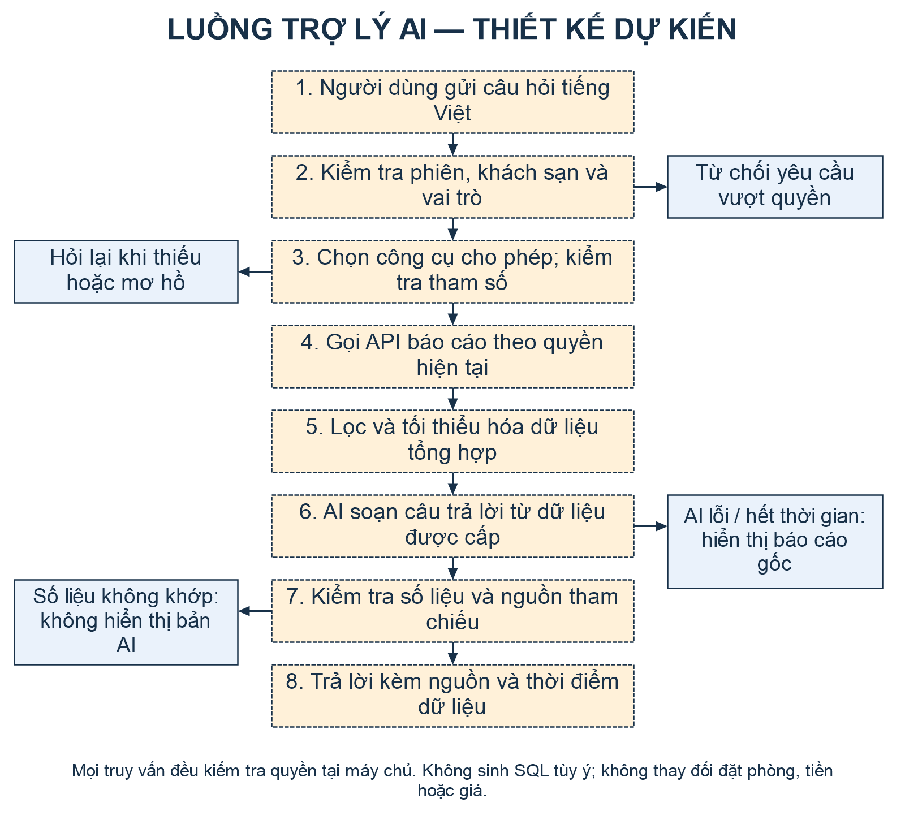
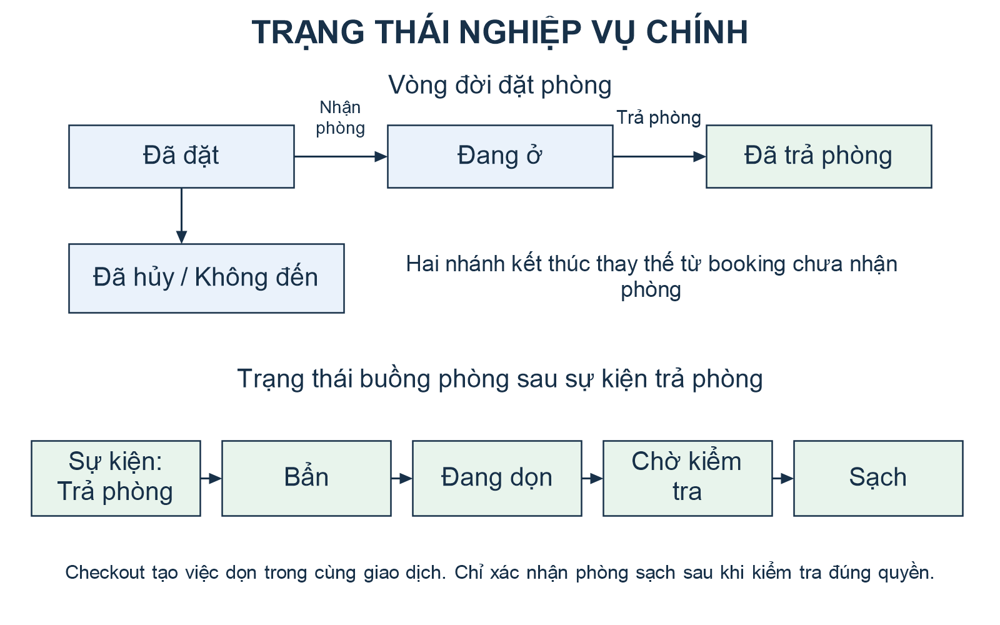

# TÀI LIỆU ĐẶC TẢ YÊU CẦU PHẦN MỀM (SRS)

**Đề tài:** Xây dựng hệ thống phần mềm quản lý khách sạn kết hợp AI trong quản lý và vận hành.

**Học phần:** Tiểu luận chuyên ngành  
**Trường / khoa:** [Tên trường] / [Khoa]  
**Sinh viên thực hiện:** [Họ và tên sinh viên / nhóm]  
**Mã số sinh viên:** [Mã số sinh viên]  
**Giảng viên hướng dẫn:** [Giảng viên hướng dẫn]  
**Phiên bản:** 1.0 — Dự thảo  
**Ngày lập:** 08/11/2026

## Thông tin kiểm soát tài liệu

| Phiên bản | Ngày | Nội dung | Trạng thái |
| --- | --- | --- | --- |
| 1.0 | 08/11/2026 | Xác định yêu cầu PMS kế thừa và phạm vi trợ lý AI; chuẩn bị tiêu chí kiểm chứng | Dự thảo, chưa xác nhận nghiệm thu |

Tài liệu này mô tả yêu cầu cần đáp ứng của đề tài, không xác nhận mọi chức năng đã hoàn thành. Phần PMS được xây dựng trên mã nguồn LOHA PMS hiện có; phần AI là hạng mục đề xuất triển khai trong tiểu luận. Các ngưỡng chất lượng trong tài liệu là mục tiêu nghiệm thu. Chưa thực hiện chạy ứng dụng, kiểm thử nghiệp vụ, đo hiệu năng hoặc đánh giá AI khi biên soạn tài liệu này.

## Mục lục nội dung

1. Giới thiệu.
2. Mô tả tổng quan.
3. Kiến trúc và mô hình hệ thống.
4. Yêu cầu chức năng.
5. Yêu cầu giao diện bên ngoài.
6. Yêu cầu phi chức năng.
7. Mô hình hóa yêu cầu.
8. Kiểm chứng và xác nhận yêu cầu.
9. Phụ lục: kế hoạch thực hiện và quản lý thay đổi.

## 1. Giới thiệu

### 1.1. Mục đích tài liệu

SRS là cơ sở thống nhất giữa sinh viên, giảng viên hướng dẫn và người tham gia đánh giá về sản phẩm cần xây dựng, giới hạn nghiên cứu và điều kiện nghiệm thu. Mỗi yêu cầu có mã định danh để liên kết với mục tiêu, tình huống sử dụng và ca kiểm thử. Tài liệu phục vụ phân tích, thiết kế, triển khai, kiểm thử và viết báo cáo tiến độ của đề tài.

Đề tài hướng đến giảm thao tác ghi chép rời rạc trong vận hành khách sạn, đồng thời nghiên cứu cách dùng AI để giúp người quản lý tra cứu và tổng hợp dữ liệu nhanh hơn. Kết quả tài chính và trạng thái nghiệp vụ phải do PMS xác định; AI diễn giải thông tin đã được kiểm soát và có thể đối chiếu.

### 1.2. Phạm vi sản phẩm

Sản phẩm là ứng dụng Web quản lý khách sạn trên nền Flask/Python, React và PostgreSQL. Phạm vi chính bao gồm xác thực, phân quyền theo khách sạn, quản lý phòng và khách, đặt phòng, nhận/trả phòng, dịch vụ, thanh toán, buồng phòng và báo cáo. Tích hợp OTA qua Channex được kiểm chứng trong môi trường giả lập hoặc sandbox riêng khi có điều kiện.

Phần AI dự kiến cung cấp hai khả năng: trả lời câu hỏi tiếng Việt về số liệu tổng hợp được phép xem và tạo bản tóm tắt tình hình vận hành theo kỳ. Phạm vi câu hỏi được giới hạn ở các báo cáo và tài liệu nghiệp vụ được duyệt. AI không tự tạo, sửa, hủy booking; không thu/hoàn tiền; không đổi giá và không trực tiếp ghi dữ liệu PMS.

POS, kho, chính sách giá nâng cao, đối soát cuối ngày và quản trị thuê bao là các phân hệ kế thừa được mô tả để bảo đảm tính nhất quán; đề tài không cam kết mở rộng toàn bộ các phân hệ này. Không bao gồm dự báo nhu cầu bằng mô hình học máy, định giá tự động bằng AI, ứng dụng di động gốc, khóa cửa/cảm biến IoT, cổng thanh toán hoặc hóa đơn thuế điện tử, triển khai vận hành production.

### 1.3. Đối tượng sử dụng tài liệu

| Đối tượng | Nội dung quan tâm |
| --- | --- |
| Giảng viên hướng dẫn, người đánh giá | Mục tiêu, giới hạn, đóng góp AI, phương pháp đánh giá và bằng chứng |
| Nhóm phát triển | FR, NFR, kiến trúc, dữ liệu, hợp đồng tích hợp và quy tắc nghiệp vụ |
| Người kiểm thử | Luồng chính, ngoại lệ, dữ liệu chuẩn và tiêu chí nghiệm thu |
| Đại diện khách sạn tham gia demo | Luồng vận hành, quyền sử dụng, báo cáo và giới hạn trợ lý AI |

### 1.4. Thuật ngữ và từ viết tắt

| Thuật ngữ | Giải thích trong đề tài |
| --- | --- |
| PMS | Property Management System, hệ thống quản lý nghiệp vụ khách sạn |
| Tenant | Phạm vi dữ liệu và quyền của một khách sạn trong hệ thống |
| Booking / reservation | Đơn đặt phòng, có thể gồm nhiều phòng và nhiều khách |
| OTA | Kênh bán phòng trực tuyến; kết nối trong đề tài thông qua Channex |
| ARI | Availability, Rates, Inventory: phòng trống, giá và tồn phòng theo ngày |
| POS | Bán dịch vụ/hàng hóa tại khách sạn, có thể ghi chi phí vào booking |
| Ledger | Sổ giao dịch dùng đối chiếu thu, chi, hoàn và số dư quỹ |
| Night Audit | Đối soát, chốt ngày nghiệp vụ; không đồng nhất với thu tiền trong ngày |
| LLM | Mô hình ngôn ngữ lớn, dự kiến dùng diễn giải câu hỏi và tạo câu trả lời |
| Tool được duyệt | Hàm đọc báo cáo hoặc truy xuất tài liệu có tham số được kiểm tra tại máy chủ |
| RLS | Row-Level Security, cơ chế giới hạn hàng dữ liệu theo tenant ở PostgreSQL |
| Idempotency | Gửi lại cùng yêu cầu hợp lệ không tạo thêm tác động nghiệp vụ |
| FR / NFR / UC / TC | Yêu cầu chức năng / phi chức năng / tình huống sử dụng / ca kiểm thử |
| p95 | Mốc thời gian mà 95% mẫu đo không vượt quá |

### 1.5. Cơ sở xây dựng và tài liệu tham khảo nội bộ

| Mã | Nguồn | Cách sử dụng |
| --- | --- | --- |
| TL-01 | [Mẫu mục tiêu](../Muc_tieu_de_tai_Smart_Irrigation.docx), [mẫu phạm vi](../Pham_vi_thuc_hien_Smart_Irrigation.docx) | Tham khảo cách tổ chức mục tiêu, chức năng, kiểm thử và giới hạn |
| TL-02 | [Mẫu SRS v1.1](../TAI_LIEU_SRS_v1.1.docx) | Bám bố cục tám chương, bảng FR/NFR, use case, truy vết và kiểm chứng |
| TL-03 | [Đề cương minh họa](../01_Muc_tieu_và_pham_vi.pdf) | Tham khảo cách liên kết tổng quan, thiết kế, thực nghiệm và kết luận |
| TL-04 | [Hợp đồng API hiện tại](../../../backend/API_CONTRACT.md) | Đối chiếu vai trò, nghiệp vụ, thanh toán, OTA và đối soát |
| TL-05 | [Kiến trúc backend](../../../backend/ARCHITECTURE.md), [cấu trúc dự án](../../ARCHITECTURE.md) | Xác định công nghệ và ranh giới module thực tế |
| TL-06 | [Hướng dẫn backend](../../../backend/README.md), [hướng dẫn frontend](../../../frontend/README.md) | Đối chiếu môi trường và công cụ kiểm thử |
| TL-07 | [Báo cáo tuần 03–09/10](../Bao_cao_tuan_03-09_10_2026_Le_Tran_Xuan_Loc.md), [rà soát 9 luồng 25/10](../../reports/reviews/pms-nine-workflows-2026-10-25.md) | Bối cảnh tiến độ lịch sử; không dùng thay kết quả kiểm thử phiên bản hiện tại |

Tài liệu tháng 10 có thể mô tả giới hạn đã được mã hiện tại bổ sung. Ví dụ, API hiện có luồng thay đổi lưu trú và Night Audit. Khi có khác biệt, đối chiếu API và mã liên quan, rồi ghi rõ thời điểm kiểm chứng; không suy ra đã nghiệm thu từ việc tồn tại endpoint.

### 1.6. Phương pháp và công cụ

Thực hiện theo vòng lặp: khảo sát nghiệp vụ → chốt yêu cầu → mô hình hóa → hoàn thiện PMS → tích hợp trợ lý AI → kiểm thử và đánh giá. Công cụ chính gồm Git, Python/Flask, React, PostgreSQL, công cụ kiểm thử API và trình duyệt. Loại mô hình AI, nhà cung cấp, phiên bản và chi phí thử nghiệm được lựa chọn trong giai đoạn triển khai, sau khi đối chiếu khả năng bảo vệ dữ liệu và kết quả trên bộ đánh giá cố định.

Thời gian từng đợt thực hiện được ghi ở phụ lục; tài liệu chưa ấn định ngày bảo vệ hoặc thời hạn học phần khi chưa có thông tin chính thức từ nhóm.

## 2. Mô tả tổng quan

### 2.1. Bối cảnh và bài toán

Vận hành khách sạn cần phối hợp thông tin giữa lễ tân, buồng phòng, kế toán và người quản lý. Nếu dữ liệu đặt phòng, trạng thái phòng và thanh toán không được cập nhật thống nhất, người dùng có thể phân phòng trùng, bàn giao phòng chưa sạch hoặc đối chiếu sai tiền. Việc đọc nhiều màn hình báo cáo cũng làm tăng thời gian tổng hợp thông tin.

Hệ thống đề xuất dùng một nguồn dữ liệu giao dịch tập trung, kiểm soát quyền tại máy chủ và hỗ trợ truy vấn số liệu bằng ngôn ngữ tự nhiên. AI hỗ trợ đọc hiểu và trình bày thông tin; quy tắc xác định tồn phòng, tiền và quyền tiếp tục do các dịch vụ PMS thực hiện.

### 2.2. Mục tiêu hệ thống

| Mã mục tiêu | Nội dung |
| --- | --- |
| MT-01 | Phân tích nghiệp vụ, xác định phạm vi, mô hình và yêu cầu có thể kiểm chứng |
| MT-02 | Xây dựng kiến trúc Web và bảo vệ dữ liệu theo người dùng, vai trò, khách sạn |
| MT-03 | Hoàn thiện chu trình đặt phòng, lưu trú, thanh toán, buồng phòng và báo cáo |
| MT-04 | Kiểm chứng trao đổi OTA và sự nhất quán với các phân hệ kế thừa |
| MT-05 | Xây dựng nguyên mẫu trợ lý AI tra cứu và tổng hợp vận hành có nguồn đối chiếu |
| MT-06 | Kiểm thử, đánh giá chất lượng và bàn giao sản phẩm demo cùng tài liệu |

### 2.3. Tác nhân và quyền sử dụng

| Tác nhân | Vai trò thực tế | Phạm vi sử dụng |
| --- | --- | --- |
| Quản trị nền tảng | SUPER_ADMIN, SYSTEM_MANAGER | Khách sạn, tài khoản hệ thống, gói và cấu hình dịch vụ trong quyền được cấp |
| Chủ khách sạn | HOTEL_OWNER | Quản lý nghiệp vụ, nhân viên, cấu hình và báo cáo khách sạn mình |
| Lễ tân | FRONT_DESK | Đặt phòng, khách, nhận/trả phòng, dịch vụ, thu tiền và phối hợp buồng phòng |
| Nhân viên buồng phòng | HOUSEKEEPING | Xem và cập nhật nhiệm vụ được giao, trạng thái dọn phòng theo quyền |
| Kế toán | ACCOUNTANT | Quỹ, đối soát, báo cáo và nghiệp vụ kho theo quyền |
| Hệ thống Channex | Dịch vụ ngoài | Nhận ARI; cung cấp booking/revision và sự kiện tích hợp |
| Dịch vụ AI dự kiến | Thành phần ngoài hoặc nội bộ | Nhận dữ liệu đã tối thiểu hóa, sinh nội dung diễn giải; không có tài khoản DB |

Khách lưu trú là đối tượng được quản lý dữ liệu, không phải người dùng đăng nhập trực tiếp trong phạm vi này. Giảng viên và người đánh giá sử dụng tài khoản demo theo một trong các vai trò đã định nghĩa.

### 2.4. Ma trận phân quyền ở mức yêu cầu

| Nhóm chức năng | Owner | Lễ tân | Buồng phòng | Kế toán | Quản trị nền tảng |
| --- | --- | --- | --- | --- | --- |
| Cấp/đổi/thu hồi membership nhân viên PMS | Owner thông thường | Không | Không | Không | Không, kể cả có membership Owner |
| Cấu hình nghiệp vụ khách sạn | Có theo quyền | Không | Không | Không | Cần membership và quyền nghiệp vụ tương ứng |
| Tạo/quản trị tenant, tài khoản nền tảng | Không | Không | Không | Không | Theo quyền quản trị hệ thống |
| Đặt phòng, khách, nhận/trả phòng | Có | Có | Không | Chỉ phần được API cho phép | Không tự có quyền PMS |
| Dịch vụ, thu tiền booking | Có | Có theo quyền | Không | Có theo quyền | Không tự có quyền PMS |
| Quỹ, báo cáo tài chính | Có | Giới hạn theo API | Không | Có | Không tự có quyền PMS |
| Nhiệm vụ buồng phòng | Điều phối, kiểm tra | Điều phối theo quyền | Nhiệm vụ được giao | Không | Không tự có quyền PMS |
| Báo cáo vận hành | Có | Phạm vi được cấp | Phạm vi công việc | Có theo quyền | Không tự có quyền PMS |
| Trợ lý AI dự kiến | Báo cáo được phép | Báo cáo được phép | Chưa mở trong nguyên mẫu | Báo cáo được phép | Không truy vấn dữ liệu tenant mặc định |

Ma trận trên là khung kiểm thử; quyền chi tiết từng endpoint phải đối chiếu với chính sách API. Công cụ AI luôn gọi lại kiểm tra quyền tại máy chủ; không suy diễn quyền từ việc giao diện đã ẩn hoặc hiện một nút.

### 2.5. Quy trình hoạt động tổng quát

1. Người dùng đăng nhập và chọn khách sạn có membership hợp lệ.
2. Lễ tân tra cứu phòng trống, xem giá, tạo booking và ghi nhận khách.
3. Người dùng có quyền nhận cọc, thực hiện check-in và thêm dịch vụ trong thời gian lưu trú.
4. PMS tổng hợp công nợ; người dùng thu đủ tiền trước khi checkout.
5. Checkout cập nhật trạng thái lưu trú, chuyển phòng sang bẩn và tạo việc dọn trong cùng giao dịch.
6. Buồng phòng thực hiện nhiệm vụ; người có quyền kiểm tra xác nhận phòng sạch.
7. Chủ khách sạn/kế toán xem báo cáo hoặc yêu cầu AI dự kiến diễn giải số liệu trong quyền của mình.
8. Khi bật tích hợp, các thay đổi phù hợp được đưa vào hàng đợi OTA; trạng thái xử lý được theo dõi riêng với trạng thái booking nội bộ.

### 2.6. Môi trường, giả định và phụ thuộc

Ứng dụng được kiểm chứng trên môi trường phát triển/demo riêng, dùng dữ liệu giả lập. Có tối thiểu hai khách sạn thử nghiệm để đánh giá cách ly dữ liệu và tài khoản mẫu cho từng vai trò. Không dùng dữ liệu khách thật hoặc tài khoản production cho đánh giá học phần.

PMS cần PostgreSQL và máy chủ API hoạt động. Các worker phải được chạy khi kiểm thử tác vụ nền. OTA phụ thuộc tài khoản Channex sandbox, mapping và kết nối mạng. AI phụ thuộc mô hình phù hợp, ngân sách thử nghiệm và bộ tài liệu được duyệt; khi chưa có các điều kiện này, hạng mục được ghi nhận chưa triển khai hoặc bị chặn tương ứng, không ghi đạt.

## 3. Kiến trúc và mô hình hệ thống

### 3.1. Kiến trúc tổng thể

Frontend React gọi Flask API; API thực thi xác thực, phân quyền, kiểm tra nghiệp vụ và giao dịch với PostgreSQL. Các module nghiệp vụ kế thừa bao gồm auth, catalog, bookings, finance, housekeeping, inventory, pricing, reports, reconciliation, channels và saas_billing. Phần tích hợp ngoài được đặt sau adapter để có thể thay bằng giả lập trong kiểm thử.

Thành phần AI dự kiến gồm giao diện hội thoại, bộ điều phối yêu cầu, danh sách công cụ đọc được duyệt, truy xuất tài liệu và bộ kiểm tra đầu ra. Khóa dịch vụ AI chỉ nằm ở máy chủ. Mô hình không nhận quyền truy cập trực tiếp cơ sở dữ liệu hoặc khả năng thực thi SQL tùy ý.

### 3.2. Thành phần và trách nhiệm

| Thành phần | Trách nhiệm |
| --- | --- |
| React và lớp gọi API | Hiển thị biểu mẫu, bảng, lịch phòng, thông báo, trạng thái tải/lỗi và giao diện AI dự kiến |
| Xác thực và tenant context | Kiểm tra phiên, membership, vai trò và tính năng hiệu lực trên mỗi yêu cầu |
| Dịch vụ PMS | Tính giá/tồn, chuyển trạng thái, ghi tiền, tạo việc dọn và tổng hợp báo cáo |
| PostgreSQL | Lưu trữ dữ liệu; ràng buộc, giao dịch, khóa cạnh tranh và cách ly tenant |
| Adapter Channex và worker | Mapping, xếp hàng ARI, xử lý revision, retry và theo dõi lỗi |
| Bộ điều phối AI dự kiến | Chọn ý định, xác minh tham số, gọi công cụ đọc đúng quyền, kiểm soát giới hạn |
| Bộ nguồn AI dự kiến | Cung cấp báo cáo tổng hợp từ API và trích đoạn tài liệu đã duyệt có mã nguồn |
| Bộ kiểm tra đầu ra AI dự kiến | Đối chiếu số liệu, kỳ, đơn vị, nguồn và loại bỏ kết quả không đạt |

### 3.3. Dữ liệu chính và liên kết

| Nhóm dữ liệu | Nội dung và quan hệ |
| --- | --- |
| Người dùng, khách sạn, membership | Một người dùng có thể thuộc nhiều khách sạn; vai trò gắn với membership |
| Phòng, loại phòng, giá, khóa bán | Phòng thuộc khách sạn và loại phòng; giá/tồn quản lý theo ngày |
| Khách, booking, phòng trong booking | Booking liên kết nhiều khách, nhiều phòng, ngày ở, nguồn và snapshot giá |
| Chi phí, thanh toán, sổ quỹ | Chi phí xác định phải thu; các khoản thu/hoàn liên kết booking, chứng từ và quỹ |
| Buồng phòng | Nhiệm vụ gắn phòng, chu kỳ dọn, người được giao, trạng thái và lịch sử |
| OTA | Mapping, job, revision và receipt gắn khách sạn/nguồn để chống xử lý lặp |
| AI dự kiến | Yêu cầu, nguồn báo cáo/tài liệu, thời điểm dữ liệu, trạng thái, phiên bản cấu hình; hạn chế lưu nội dung nhạy cảm |

Mọi bản ghi nghiệp vụ thuộc tenant phải được giới hạn tenant tại API và tầng dữ liệu. Các cấu hình dùng chung toàn hệ thống phải có quyền quản trị riêng. Lược đồ chi tiết và migration được lập ở giai đoạn thiết kế, theo quy ước hiện có; SRS không tự đặt tên bảng mới như một yêu cầu bắt buộc.

### 3.4. Luồng xử lý AI dự kiến

1. Nhận câu hỏi, kiểm tra phiên, tenant, vai trò và giới hạn độ dài.
2. Xác định ý định thuộc danh sách hỗ trợ; yêu cầu làm rõ nếu thiếu kỳ báo cáo hoặc khái niệm có nhiều nghĩa.
3. Bộ điều phối kiểm tra tên công cụ và tham số theo schema. Tenant lấy từ phiên/ngữ cảnh đã xác thực, không từ lời nhắc của người dùng hoặc câu trả lời mô hình.
4. Máy chủ gọi API báo cáo tương ứng. Dữ liệu khách có thể nhận diện bị loại khỏi ngữ cảnh AI; chỉ số tài chính chỉ được trả cho người có quyền.
5. Mô hình nhận dữ liệu tổng hợp và trích đoạn tài liệu được phép, tạo nội dung diễn giải có mã nguồn.
6. Bộ kiểm tra đối chiếu số liệu, kỳ, đơn vị và nguồn. Chỉ số quyết định được chèn từ dữ liệu cấu trúc hoặc kiểm tra trước khi hiển thị; đầu ra sai bị thay bằng bảng số liệu có nguồn hoặc thông báo không đủ cơ sở.
7. Trả kết quả với kỳ, thời điểm truy xuất và liên kết màn hình báo cáo. Ghi nhật ký tối thiểu để phục vụ đánh giá và xử lý lỗi.

Truy xuất tài liệu có thể dùng tìm kiếm văn bản hoặc chỉ mục ngữ nghĩa tùy quy mô. Không bắt buộc huấn luyện mô hình nền mới. Nội dung tài liệu và lời nhắc được xem là dữ liệu không đáng tin; không được dùng để thay đổi chính sách quyền hoặc thêm công cụ ghi dữ liệu.

### 3.5. Hành vi khi xảy ra lỗi

| Tình huống | Hành vi yêu cầu |
| --- | --- |
| Mất kết nối trình duyệt/API | Báo lỗi rõ; không hiển thị lưu thành công nếu chưa có phản hồi; khi thử lại phải đọc trạng thái thực |
| Lỗi giữa giao dịch booking/tiền/checkout | Rollback toàn bộ thay đổi liên quan; không để quỹ, booking và phòng lệch nhau |
| Channex lỗi hoặc giới hạn tốc độ | Giữ tác vụ có trạng thái rõ, retry có giới hạn; không xem xếp hàng là đã đồng bộ |
| Webhook lặp hoặc revision cũ | Không áp dụng nghiệp vụ thêm lần nữa; xử lý theo định danh và thứ tự phiên bản |
| AI chậm, mất kết nối hoặc hết hạn mức | Timeout tối đa 30 giây, thông báo lỗi và dẫn tới báo cáo thường; PMS vẫn sử dụng được |
| AI thiếu dữ liệu hoặc đầu ra không kiểm chứng được | Hỏi làm rõ, từ chối kết luận hoặc trả dữ liệu cấu trúc đã xác thực; không tự bổ sung số liệu |

## 4. Yêu cầu chức năng

### 4.1. Quy ước đặc tả

Ưu tiên **Cao** là điều kiện của bản demo chính hoặc bảo vệ tính đúng đắn/an toàn; **Trung bình** là chức năng tích hợp hay phân hệ kế thừa cần kiểm tra trong phạm vi đã chọn. Cột cơ sở phân biệt mã đã có với phần mới dự kiến; không thay thế kết quả nghiệm thu.

### 4.2. Danh sách yêu cầu PMS

| ID | Tên yêu cầu | Mô tả yêu cầu | Ưu tiên | Cơ sở |
| --- | --- | --- | --- | --- |
| FR-01 | Xác thực | Đăng nhập, đăng xuất, hết hạn/thu hồi phiên; mật khẩu lưu dạng băm | Cao | Kế thừa |
| FR-02 | Tenant và phân quyền | Chọn khách sạn có membership; chặn truy cập sai vai trò, tenant khóa và dữ liệu khách sạn khác | Cao | Kế thừa |
| FR-03 | Danh mục | Quản lý phòng, loại phòng, dịch vụ, nguồn đặt, phương thức thanh toán/quỹ trong quyền; bảo toàn dữ liệu đã phát sinh | Cao | Kế thừa |
| FR-04 | Giá và phòng trống | Tra cứu theo ngày, loại phòng; tính giá từng đêm; loại phòng khóa bán/bảo trì khỏi khả năng đặt phù hợp | Cao | Kế thừa |
| FR-05 | Hồ sơ khách | Tạo, tìm và cập nhật hồ sơ khách thuộc tenant; liên kết nhiều khách với booking, kiểm soát trường bắt buộc | Cao | Kế thừa |
| FR-06 | Quản lý booking | Tạo nhiều phòng, sửa/hủy/no-show đúng trạng thái; kiểm tra ngày, tồn và phiên bản; lưu giá tại thời điểm chốt | Cao | Kế thừa |
| FR-07 | Nhận phòng và thay đổi lưu trú | Check-in đúng điều kiện; thay đổi phòng/ngày ở có xem trước tác động, xác nhận quyền và kiểm tra lại tồn | Cao | Kế thừa |
| FR-08 | Dịch vụ và POS | Ghi dịch vụ/phụ thu, hóa đơn POS, ghi chi phí vào booking; hoàn/hủy có lịch sử | Trung bình | Kế thừa |
| FR-09 | Thanh toán và sổ quỹ | Cọc, thu từng phần, hoàn/đảo giao dịch trong quyền; cập nhật số dư nhất quán, chống ghi lặp | Cao | Kế thừa |
| FR-10 | Trả phòng | Chặn checkout còn nợ; cập nhật lưu trú, phòng bẩn và nhiệm vụ dọn trong cùng giao dịch | Cao | Kế thừa |
| FR-11 | Buồng phòng | Giao việc, nhận việc, dọn, gửi kiểm tra, xác nhận sạch; chặn người không được giao/quyền sai | Cao | Kế thừa |
| FR-12 | Báo cáo và đối soát ngày | Dashboard, doanh thu, thực thu, công nợ, công suất; Night Audit theo ngày tuần tự và định nghĩa chỉ số rõ | Cao | Kế thừa |
| FR-13 | Kho | Nhập/xuất/chuyển/kiểm kê, lịch sử biến động và báo cáo tồn; đối chiếu tiêu hao POS nếu được bật | Trung bình | Kế thừa bổ trợ |
| FR-14 | Giá nâng cao | Chính sách cuối tuần, độ dài ở, đặt sớm/cận ngày, khuyến mãi/voucher, snapshot tỷ giá | Trung bình | Kế thừa bổ trợ |
| FR-15 | Mapping và ARI | Mapping khách sạn/loại phòng/gói giá; xếp hàng đồng bộ, retry và lịch sử trạng thái | Trung bình | Kế thừa, phụ thuộc sandbox |
| FR-16 | Booking OTA | Xác thực nguồn, nhận mới/sửa/hủy, chống revision trùng/cũ; lưu bền vững trước ACK và đưa ngoại lệ vào đối soát | Cao | Kế thừa, phụ thuộc sandbox |
| FR-17 | Thông báo và nhật ký | Thông báo trong ứng dụng, trạng thái đã đọc; lịch sử thao tác theo quyền và tenant, không lộ bí mật | Trung bình | Kế thừa |
| FR-18 | Quản trị dịch vụ | Khách sạn, tài khoản hệ thống, gói, thuê bao, tính năng và quota; backend thực thi quyền hiệu lực | Trung bình | Kế thừa bổ trợ |

### 4.3. Danh sách yêu cầu AI dự kiến

| ID | Tên yêu cầu | Mô tả yêu cầu | Ưu tiên |
| --- | --- | --- | --- |
| FR-AI-01 | Hội thoại tiếng Việt | Nhận câu hỏi vận hành, nhận biết kỳ và chỉ số; hỏi lại khi mơ hồ hoặc ngoài danh sách hỗ trợ | Cao |
| FR-AI-02 | Công cụ đọc có kiểm soát | Chỉ gọi tool được duyệt; xác thực schema, quyền và tenant ở mỗi lần gọi; không sinh/thực thi SQL tùy ý | Cao |
| FR-AI-03 | Trả lời có nguồn | Trả kết quả từ báo cáo/tài liệu được duyệt, kèm kỳ, đơn vị, thời điểm và nguồn; không tự tạo số liệu | Cao |
| FR-AI-04 | Tóm tắt vận hành | Tổng hợp đến/đi/đang ở, phòng bẩn, công nợ và chỉ số được phép; phân biệt quan sát với đề xuất để người quản lý quyết định | Cao |
| FR-AI-05 | Tối thiểu hóa dữ liệu | Chỉ chuyển số liệu tổng hợp cần thiết; không chuyển tên, giấy tờ, số điện thoại, email hoặc ghi chú khách cho dịch vụ AI ngoài | Cao |
| FR-AI-06 | Kiểm soát lỗi và đánh giá | Timeout, fallback báo cáo, ghi nguồn/phiên bản và độ trễ; hỗ trợ chạy bộ đánh giá cố định không chứa dữ liệu thật | Cao |

Phạm vi câu hỏi ban đầu gồm số lượt đặt phòng đến/đi/đang ở, trạng thái phòng, công suất, doanh thu và thực thu theo kỳ được API hỗ trợ, công nợ hiện tại tại thời điểm truy xuất và hướng dẫn nghiệp vụ đã duyệt. Ví dụ: “Có bao nhiêu đặt phòng dự kiến đến ngày 08/11/2026?” hoặc “Tóm tắt tình hình vận hành khách sạn hôm nay”. Với câu “Hôm nay thu được bao nhiêu?”, hệ thống phải phân biệt thực thu với doanh thu và hỏi lại nếu chưa đủ ngữ cảnh. Snapshot cọc/nợ hiện tại không tái hiện số dư lịch sử theo kỳ; câu hỏi về công nợ tại một thời điểm quá khứ phải được thông báo chưa hỗ trợ khi nguồn API chưa cung cấp.

### 4.4. Đặc tả yêu cầu quan trọng: FR-06 — Quản lý booking

| Thuộc tính | Đặc tả |
| --- | --- |
| Tác nhân | Owner hoặc lễ tân có quyền |
| Đầu vào | Khách, ngày đến/đi, phòng hoặc loại phòng, số khách, nguồn và lựa chọn giá |
| Điều kiện trước | Phiên và membership hợp lệ; danh mục hoạt động; ngày đi sau ngày đến |
| Xử lý | Kiểm tra tenant, trạng thái, tồn theo toàn bộ khoảng ở; khóa/kiểm soát cạnh tranh; lưu phòng, khách và snapshot giá trong một giao dịch |
| Đầu ra | Booking có mã, trạng thái, chi tiết phòng/đêm và tổng tiền; hoặc lỗi có thể xử lý |
| Điều kiện sau | Không đặt trùng một phòng trong khoảng giao nhau; sửa/hủy giải phóng tồn đúng; không thay lịch sử giá vì đổi bảng giá |
| Ưu tiên | Cao |
| Kiểm thử | TC-05, TC-06: dữ liệu hợp lệ, trùng khoảng ở, cập nhật cũ, sửa/hủy và hai yêu cầu cạnh tranh |

### 4.5. Đặc tả yêu cầu quan trọng: FR-09 — Thanh toán

| Thuộc tính | Đặc tả |
| --- | --- |
| Tác nhân | Owner, lễ tân hoặc kế toán theo quyền cụ thể |
| Đầu vào | Booking/chứng từ, loại thu/hoàn, số tiền, đơn vị tiền, quỹ và khóa chống lặp |
| Điều kiện trước | Có quyền thao tác tiền, booking/quỹ đúng tenant; số tiền dương và trong giới hạn nghiệp vụ |
| Xử lý | Kiểm tra hạn mức thu/hoàn, số dư và trạng thái; ghi thanh toán và ledger trong cùng giao dịch; hoàn/đảo tạo dòng đối ứng |
| Đầu ra | Chứng từ và số dư mới hoặc lỗi; gửi lại cùng khóa và cùng nội dung trả kết quả đã có |
| Điều kiện sau | Không ghi tiền hai lần; cùng khóa khác nội dung bị từ chối; không xóa dấu vết giao dịch gốc |
| Ưu tiên | Cao |
| Kiểm thử | TC-09: thu từng phần, hoàn vượt mức, replay, khóa trùng khác nội dung và rollback |

### 4.6. Đặc tả yêu cầu quan trọng: FR-10 — Checkout

| Thuộc tính | Đặc tả |
| --- | --- |
| Tác nhân | Owner hoặc lễ tân có quyền |
| Đầu vào | Booking đang ở, phiên bản hiện tại và yêu cầu checkout |
| Điều kiện trước | Booking đúng tenant, ở trạng thái cho phép, công nợ đã thanh toán hết |
| Xử lý | Kiểm tra lại số dư, quyền và trạng thái; cập nhật lưu trú, phòng bẩn, công việc dọn và lịch sử trong một transaction |
| Đầu ra | Trạng thái đã trả phòng và thông tin phòng/nhiệm vụ liên quan |
| Điều kiện sau | Không checkout hai lần; khi lỗi không tạo trạng thái phòng hoặc nhiệm vụ dở dang |
| Ưu tiên | Cao |
| Kiểm thử | TC-10: còn nợ, đủ tiền, yêu cầu lặp, lỗi trong khi tạo việc dọn |

### 4.7. Đặc tả yêu cầu quan trọng: FR-16 — Booking OTA

| Thuộc tính | Đặc tả |
| --- | --- |
| Tác nhân | Channex, worker tích hợp và người xử lý ngoại lệ có quyền |
| Đầu vào | Webhook/sự kiện, định danh property/booking/revision và dữ liệu đọc từ provider |
| Điều kiện trước | Nguồn được xác thực theo cơ chế tích hợp; mapping đúng tenant; môi trường thử nghiệm riêng |
| Xử lý | Kiểm tra nguồn, idempotency, thứ tự revision và mapping; ghi kết quả bền vững trong DB trước xác nhận provider; retry/đối soát khi lỗi |
| Đầu ra | Booking mới/cập nhật/hủy phù hợp hoặc ngoại lệ cần xử lý và lịch sử trạng thái |
| Điều kiện sau | Không áp dụng một revision nhiều lần; không ghi đè bằng revision cũ; không báo ACK nghiệp vụ đã hoàn tất nếu chưa lưu bền vững |
| Ưu tiên | Cao |
| Kiểm thử | TC-16, TC-17: chữ ký/thông tin xác thực sai, lặp/cũ, thiếu mapping, lỗi DB, ACK lỗi và retry |

Phản hồi HTTP cho webhook và ACK revision phía Channex là hai bước cần phân biệt. Việc tiếp nhận sự kiện không đồng nghĩa booking đã đồng bộ thành công; giao diện phải phản ánh trạng thái thực tế của toàn quy trình.

### 4.8. Đặc tả yêu cầu quan trọng: FR-AI-02, FR-AI-03 — Truy vấn có nguồn

| Thuộc tính | Đặc tả |
| --- | --- |
| Tác nhân | Owner, lễ tân hoặc kế toán trong phạm vi nguyên mẫu |
| Đầu vào | Câu hỏi tiếng Việt, kỳ báo cáo đã xác định, phiên người dùng và tenant hiện hành |
| Điều kiện trước | Có quyền đọc báo cáo tương ứng; tool và nguồn tài liệu thuộc danh sách duyệt |
| Xử lý | Chọn tool, kiểm tra schema và quyền; đọc dữ liệu tổng hợp; tạo diễn giải; đối chiếu chỉ số với dữ liệu cấu trúc |
| Đầu ra | Câu trả lời kèm kỳ, đơn vị, nguồn, thời điểm và đường dẫn đối chiếu; hoặc yêu cầu làm rõ/từ chối có lý do |
| Điều kiện sau | Không ghi dữ liệu nghiệp vụ, không vượt tenant/vai trò, không trả số liệu không có nguồn |
| Ưu tiên | Cao |
| Kiểm thử | TC-20, TC-22, TC-23, TC-24: hỏi đúng, thiếu kỳ, yêu cầu tenant khác, prompt injection, giả mạo tên tool và đầu ra sai số |

### 4.9. Quy tắc nghiệp vụ và định nghĩa chỉ số

| Mã | Quy tắc |
| --- | --- |
| BR-01 | Tồn phòng theo khoảng ngày dùng quy ước đến bao gồm, đi không bao gồm; hai booking nối tiếp cùng ngày chỉ hợp lệ khi đáp ứng điều kiện vận hành |
| BR-02 | Phân biệt trạng thái booking, tình trạng sử dụng phòng và trạng thái vệ sinh; một trạng thái không thay thế toàn bộ các trạng thái khác |
| BR-03 | Giá và tỷ giá đã chốt được lưu theo giao dịch; sửa cấu hình giá không tự tính lại booking lịch sử |
| BR-04 | Tổng phải thu = tiền phòng + dịch vụ/phụ thu − giảm giá hợp lệ; công nợ = tổng phải thu − số đã thu ròng được phân bổ; không cộng một giao dịch hai lần |
| BR-05 | Tiền cọc/thu tiền là biến động dòng tiền; không mặc nhiên là doanh thu đã ghi nhận. Hoàn tiền và đảo chi phí có ý nghĩa khác nhau |
| BR-06 | Công suất hiện tại trên Dashboard = số phòng khác nhau đang có khách / tổng phòng hoạt động hiện tại × 100%. Chỉ số lịch sử dùng công suất phòng hoạt động hiện tại, chưa có snapshot mọi thay đổi sức chứa trong quá khứ; không tự suy diễn loại trừ phòng bảo trì khỏi mẫu số |
| BR-07 | ADR = roomRevenue / servedNights theo API tài chính; servedNights là số đêm đã phục vụ trước ngày nghiệp vụ hiện tại của booking đang ở/đã trả. Mẫu số bằng 0 thì API hiện trả 0; AI nêu không có đêm phục vụ, không diễn giải thành hiệu quả kinh doanh bằng 0 |
| BR-08 | Doanh thu đã ghi nhận theo ngày, doanh thu dự kiến và thực thu là các chỉ số riêng; AI phải dùng đúng nhãn và nguồn báo cáo tương ứng |
| BR-09 | Ngày “hôm nay” xác định theo timezone khách sạn. Kỳ dữ liệu, đơn vị tiền và thời điểm truy xuất phải có trong kết quả tổng hợp |
| BR-10 | Ngày nghiệp vụ Night Audit đóng tuần tự, chống chốt trùng; điều chỉnh giữ dấu vết, không âm thầm sửa kỳ đã chốt |
| BR-11 | Kết quả AI chỉ hỗ trợ quyết định. Gợi ý phải nêu căn cứ, không khẳng định nguyên nhân nếu dữ liệu chỉ cho thấy hiện tượng |
| BR-12 | Dữ liệu báo cáo rỗng hợp lệ có thể cho kết quả 0; dữ liệu không truy cập được phải báo chưa có dữ liệu. Cọc/nợ là snapshot hiện tại tại asOf, không phụ thuộc kỳ báo cáo; không dùng làm số dư lịch sử |

Nếu định nghĩa chỉ số trong báo cáo khác công thức dự kiến, nhóm phải thống nhất và cập nhật SRS trước nghiệm thu. AI sử dụng số liệu đã tính tại API, không tự tính lại công suất, ADR hoặc doanh thu từ văn bản tự do.

## 5. Yêu cầu giao diện bên ngoài

### 5.1. Giao diện người dùng

| Màn hình/nhóm | Thông tin và hành vi cần có |
| --- | --- |
| Đăng nhập, chọn khách sạn | Lỗi đăng nhập rõ, phiên hết hạn, tên khách sạn đang thao tác |
| Danh mục và khách | Tìm/lọc, thêm/sửa theo quyền, xác nhận thao tác ảnh hưởng dữ liệu |
| Lịch đặt và sơ đồ phòng | Ngày, loại phòng, trạng thái lưu trú/vệ sinh; xem giá và chi tiết booking |
| Chi tiết booking | Khách, phòng, giá từng đêm, dịch vụ, thanh toán, nợ và lịch sử |
| Buồng phòng | Danh sách việc, người được giao, trạng thái và thao tác gửi/kiểm tra |
| Dashboard/báo cáo | Bộ lọc kỳ, đơn vị tiền, định nghĩa chỉ số, dữ liệu rỗng và trạng thái lỗi |
| OTA | Mapping, trạng thái đang chờ/đang xử lý/thành công/lỗi, lý do và lần thử |
| Trợ lý AI dự kiến | Ô nhập, câu hỏi mẫu, trạng thái đang xử lý, nguồn, thời điểm dữ liệu, thông báo giới hạn và lối mở báo cáo |

Form phải có kiểm tra tại frontend để hỗ trợ người dùng và kiểm tra độc lập tại backend. Khi đổi khách sạn, dữ liệu và kết quả AI của khách sạn trước phải được xóa khỏi vùng hiển thị/ngữ cảnh đang dùng. Không hiển thị mã lỗi nội bộ, SQL, stack trace hoặc khóa dịch vụ cho người dùng.

### 5.2. Giao diện phần cứng

Người dùng sử dụng máy tính hoặc máy tính bảng có trình duyệt. Demo không cần thiết bị chuyên dụng; không tích hợp máy quét giấy tờ, khóa cửa, máy POS phần cứng hoặc cảm biến. Máy in có thể dùng chức năng in của trình duyệt nếu biểu mẫu hiện có hỗ trợ, không xem là yêu cầu tích hợp phần cứng riêng.

### 5.3. Giao diện phần mềm

| Giao diện | Yêu cầu |
| --- | --- |
| React → Flask | REST/JSON theo API hiện có; phiên cookie và cơ chế bảo vệ yêu cầu thay đổi dữ liệu; xử lý 401/403/409/422 phù hợp |
| Flask → PostgreSQL | Giao dịch và ràng buộc dữ liệu; tài khoản có quyền tối thiểu, tenant context và RLS |
| PMS ↔ Channex | Adapter, mapping, webhook và worker; khóa giữ ở máy chủ; môi trường thử nghiệm được tách riêng |
| PMS → dịch vụ AI dự kiến | Adapter cấu hình được; timeout, hạn mức; dữ liệu tổng hợp được lọc trước khi gửi; không lộ khóa ở frontend |
| PMS → tài liệu nghiệp vụ | Nguồn được duyệt có mã/phiên bản; truy xuất theo phạm vi, không lấy tùy ý từ toàn bộ máy chủ |

Không quy định tên endpoint AI như thể đã tồn tại. Hợp đồng API mới sẽ được bổ sung sau khi thiết kế nguyên mẫu, bao gồm schema đầu vào, cấu trúc nguồn, mã lỗi và chính sách lưu dữ liệu.

### 5.4. Giao tiếp mạng

Môi trường triển khai thử có truy cập từ ngoài máy phải dùng HTTPS. Kết nối cơ sở dữ liệu và khóa dịch vụ không được đưa vào repository/tài liệu nộp. Tác vụ OTA dùng retry có giới hạn và kiểm soát tốc độ. Yêu cầu AI đọc có thể thử lại trong giới hạn cấu hình nhưng không được tạo thao tác ghi hoặc vòng lặp gọi công cụ không giới hạn.

## 6. Yêu cầu phi chức năng

### 6.1. Điều kiện đo hiệu năng đề xuất

Môi trường chuẩn để lập kế hoạch đo: máy chủ 4 vCPU, RAM 8 GB, PostgreSQL riêng cho thử nghiệm, mạng nội bộ ổn định; hai tenant, mỗi tenant 50 phòng, tối đa 20.000 booking tổng cộng trong 12 tháng; tải 20 người dùng đồng thời trong 10 phút sau giai đoạn làm nóng. Cấu hình thực tế và bộ dữ liệu phải được ghi trong biên bản. Nếu thay đổi điều kiện, báo cáo lại ngưỡng đã thống nhất trước khi so sánh.

### 6.2. Danh sách NFR

| Mã | Yêu cầu | Tiêu chí đánh giá đề xuất | Ưu tiên |
| --- | --- | --- | --- |
| NFR-01 | Hiệu năng PMS | Trong điều kiện 6.1: p95 thao tác đọc/ghi thông thường ≤ 2 giây, báo cáo ≤ 5 giây; lỗi kỹ thuật dưới 1%, loại trừ lỗi từ chối hợp lệ | Cao |
| NFR-02 | Hiệu năng AI | Trên yêu cầu hợp lệ khi provider ổn định: p95 phản hồi thành công ≤ 20 giây; timeout cứng ≤ 30 giây; công bố riêng tỷ lệ thành công, lỗi và số lần gọi | Trung bình |
| NFR-03 | Toàn vẹn giao dịch | Ca cạnh tranh/rollback không đặt trùng phòng, không ghi tiền lặp, không để checkout thiếu việc dọn; số tiền đối chiếu chính xác theo đơn vị tiền | Cao |
| NFR-04 | Xác thực và cách ly | 100% ca kiểm thử quyền/tenant bị cấm không trả dữ liệu hoặc tạo thay đổi; kiểm tra cả API thường, AI, nguồn và lịch sử | Cao |
| NFR-05 | Bảo vệ dữ liệu AI | 100% payload thử nghiệm gửi provider không chứa trường nhận diện khách; khóa dịch vụ không xuất hiện trong trình duyệt, log hoặc tài liệu | Cao |
| NFR-06 | Chất lượng trả lời AI | Đạt ít nhất 36/40 câu đúng ở nhóm tra cứu/tóm tắt; mọi số liệu hiển thị có nguồn và khớp API; 10/10 câu thiếu/mơ hồ xử lý đúng; 10/10 câu vượt quyền/injection bị chặn | Cao |
| NFR-07 | Phục hồi và phụ thuộc ngoài | AI lỗi không ngăn PMS; OTA lỗi giữ trạng thái và không ACK sai; phục hồi tác vụ không tạo bản ghi trùng | Cao |
| NFR-08 | Dễ sử dụng | Ít nhất 4/5 người thử hoàn thành chu trình demo có hướng dẫn ban đầu mà không cần người phát triển thao tác hộ; ghi thời gian, lỗi và góp ý | Trung bình |
| NFR-09 | Tương thích | Kiểm tra các luồng chính trên Chrome và Edge tại phiên bản ghi trong biên bản; giao diện không che nút chính ở 1366×768 và 768×1024 | Trung bình |
| NFR-10 | Bảo trì và truy vết | Thay adapter AI giả lập/thật không sửa quy tắc tiền/phòng; yêu cầu ưu tiên Cao có liên kết UC/TC; ghi phiên bản mã và cấu hình đánh giá | Trung bình |
| NFR-11 | Nhật ký và lưu trữ | Nhật ký có actor, tenant, thời điểm, loại sự kiện và kết quả; nội dung hội thoại AI mặc định không lưu toàn văn, metadata thử nghiệm lưu tối đa 30 ngày nếu không có yêu cầu khác | Cao |
| NFR-12 | Sao lưu và khôi phục demo | Có hướng dẫn backup/restore; ít nhất một lần khôi phục sang DB thử riêng và đối chiếu số lượng/mẫu booking/ledger; chưa công bố SLA production | Trung bình |

Các tiêu chí là yêu cầu đề xuất của bản dự thảo, chưa có số đo. Với NFR-06, câu từ chối an toàn ở nhóm 40 câu có dữ liệu đầy đủ vẫn tính là trả lời chưa đúng; không được nâng tỷ lệ đúng bằng cách chỉ thống kê các câu đã trả lời. Không có số liệu bịa đặt là điều kiện riêng bắt buộc trên toàn bộ đầu ra.

### 6.3. Kiểm soát và an toàn vận hành

Giới hạn mỗi yêu cầu AI tối đa 2.000 ký tự, 5 lần gọi công cụ và 30 giây xử lý tổng; đây là cấu hình dự kiến để tránh vòng lặp và chi phí không kiểm soát. Nếu hết ngân sách thời gian, trả dữ liệu xác thực đã có hoặc thông báo không thể hoàn tất. Lịch sử hội thoại cũ không được tái sử dụng khi tenant/quyền thay đổi. Dữ liệu cache báo cáo phải gắn tenant, quyền, kỳ, thời điểm và chính sách hết hạn; không dùng cache chung khiến lộ dữ liệu.

Mô hình không được cấp công cụ ghi nghiệp vụ. Các hướng dẫn “bỏ qua quy tắc”, nội dung lẫn trong tài liệu, tên khách hoặc ghi chú không thể thay đổi quyền truy cập. Báo cáo đánh giá phải tách lỗi tra cứu, lỗi quyền, lỗi diễn giải và lỗi provider để xác định nguyên nhân.

## 7. Mô hình hóa yêu cầu

### 7.1. Danh sách use case

| ID | Tên use case | Tác nhân chính | Mô tả |
| --- | --- | --- | --- |
| UC-01 | Đăng nhập và chọn khách sạn | Người dùng nội bộ | Xác định phiên, tenant và quyền |
| UC-02 | Quản lý danh mục và khách | Owner, lễ tân theo quyền | Duy trì dữ liệu nền và hồ sơ khách |
| UC-03 | Tra cứu và quản lý booking | Owner, lễ tân | Giá/tồn, tạo, sửa, hủy và no-show |
| UC-04 | Nhận phòng và thay đổi lưu trú | Owner, lễ tân | Check-in, chuyển phòng/gia hạn/trả sớm theo quyền |
| UC-05 | Ghi dịch vụ và thanh toán | Owner, lễ tân, kế toán | Chi phí, POS, cọc/thu/hoàn và sổ quỹ |
| UC-06 | Checkout và hoàn tất dọn phòng | Lễ tân, buồng phòng, Owner | Kiểm tra nợ, trả phòng, dọn và xác nhận sạch |
| UC-07 | Xem báo cáo và đối soát ngày | Owner, kế toán; lễ tân theo quyền | Báo cáo, công nợ và Night Audit |
| UC-08 | Đồng bộ OTA và xử lý ngoại lệ | Channex, người có quyền | Mapping, ARI, revision, retry và đối soát |
| UC-09 | Hỏi số liệu bằng AI | Owner, lễ tân, kế toán theo quyền | Tra cứu tiếng Việt và đối chiếu nguồn |
| UC-10 | Yêu cầu AI tóm tắt vận hành | Owner, kế toán theo quyền | Tổng hợp các chỉ số được phép theo kỳ |
| UC-11 | Quản lý kho | Owner, kế toán theo quyền | Chứng từ và báo cáo tồn kế thừa |
| UC-12 | Thiết lập giá nâng cao | Owner | Chính sách, voucher và tỷ giá kế thừa |
| UC-13 | Quản trị dịch vụ và tài khoản | Quản trị nền tảng, Owner theo phạm vi | Gói, tenant, quota và nhân viên |
| UC-14 | Xem thông báo và lịch sử | Người dùng được cấp quyền | Theo dõi sự kiện, đã đọc và nhật ký |

Biên hệ thống gồm Web PMS, API, dữ liệu và bộ điều phối AI dự kiến; Channex và provider AI nằm ngoài biên. Người dùng có thể truy cập trực tiếp các use case PMS; UC-09 và UC-10 chỉ đọc các báo cáo/tài liệu đã được phép, không bao hàm UC-03/UC-05 dưới dạng thao tác ghi.

### 7.2. UC-01 — Đăng nhập và chọn khách sạn

| Thuộc tính | Nội dung |
| --- | --- |
| Tác nhân chính | Người dùng nội bộ |
| Mục tiêu | Truy cập đúng không gian làm việc và quyền |
| Điều kiện tiên quyết | Tài khoản hoạt động; dịch vụ xác thực sẵn sàng |
| Luồng chính | 1. Nhập thông tin đăng nhập. 2. Máy chủ xác thực và cấp phiên. 3. Trả danh sách tenant được phép. 4. Người dùng chọn tenant. 5. Tải dữ liệu theo quyền |
| Luồng ngoại lệ | Sai mật khẩu: không cấp phiên; tenant khóa/membership hết hiệu lực: chặn nghiệp vụ; đổi tenant: xóa ngữ cảnh dữ liệu và AI cũ |
| Điều kiện sau | Phiên gắn người dùng; yêu cầu sau tiếp tục được kiểm tra quyền tại server |

### 7.3. UC-03 — Tra cứu và quản lý booking

| Thuộc tính | Nội dung |
| --- | --- |
| Tác nhân chính | Owner hoặc lễ tân |
| Mục tiêu | Tạo/sửa/hủy booking có giá và tồn chính xác |
| Điều kiện tiên quyết | Có quyền; danh mục, khách và ngày ở hợp lệ |
| Luồng chính | 1. Chọn ngày/loại phòng. 2. PMS trả giá và tồn. 3. Nhập khách, phòng, nguồn. 4. Yêu cầu lưu. 5. API kiểm tra lại tồn và phiên bản trong giao dịch. 6. Trả mã booking và chi tiết giá |
| Luồng thay thế | Sửa booking: kiểm tra trạng thái và tác động tồn/giá; hủy/no-show: chỉ chuyển trạng thái được phép, lưu lý do và giải phóng tồn phù hợp |
| Luồng ngoại lệ | Phòng vừa bị đặt: báo xung đột, yêu cầu chọn lại; ngày sai hoặc vượt số khách: từ chối; dữ liệu cũ: yêu cầu tải lại |
| Điều kiện sau | Không có hai booking chiếm cùng phòng/đêm; dữ liệu và snapshot giá được lưu đồng bộ |

### 7.4. UC-04 — Nhận phòng và thay đổi lưu trú

| Thuộc tính | Nội dung |
| --- | --- |
| Tác nhân chính | Owner hoặc lễ tân |
| Mục tiêu | Ghi nhận khách đang ở và thay đổi thời gian/phòng hợp lệ |
| Điều kiện tiên quyết | Booking đúng tenant, trạng thái và phòng đáp ứng điều kiện check-in |
| Luồng chính | 1. Mở booking. 2. Xác nhận khách/phòng. 3. API kiểm tra điều kiện và phiên bản. 4. Ghi nhận check-in và lịch sử |
| Luồng thay thế | Khi chuyển phòng/gia hạn/trả sớm: xem trước tác động tiền/tồn, xác nhận, API kiểm tra lại phiên bản và ghi giao dịch |
| Luồng ngoại lệ | Phòng chưa sẵn sàng, trùng tồn khi gia hạn, giá thay đổi hoặc booking bị cập nhật đồng thời: không lưu một phần, báo để xử lý |
| Điều kiện sau | Ngày ở, phân phòng và tiền liên quan thống nhất; giữ lịch sử thay đổi |

### 7.5. UC-05 — Ghi dịch vụ và thanh toán

| Thuộc tính | Nội dung |
| --- | --- |
| Tác nhân chính | Người có quyền thu/hoàn hoặc quản lý chi phí |
| Mục tiêu | Ghi nhận đúng phải thu, đã thu và số dư quỹ |
| Điều kiện tiên quyết | Booking/chứng từ và quỹ hợp lệ, đúng tenant |
| Luồng chính | 1. Chọn dịch vụ hoặc khoản thu. 2. Nhập số lượng/số tiền và quỹ. 3. API kiểm tra giới hạn. 4. Ghi chứng từ, phân bổ và ledger trong cùng transaction. 5. Hiển thị nợ và lịch sử mới |
| Luồng thay thế | Hoàn/đảo theo quyền tạo chứng từ đối ứng; POS ghi vào booking không đồng thời thu tiền hai lần |
| Luồng ngoại lệ | Vượt khoản được thu/hoàn, số dư không đủ, khóa chống lặp khác nội dung: từ chối; lỗi giữa chừng: rollback |
| Điều kiện sau | Số tiền khớp ledger và chứng từ; yêu cầu replay không làm tăng số thu |

### 7.6. UC-06 — Checkout và dọn phòng

| Thuộc tính | Nội dung |
| --- | --- |
| Tác nhân chính | Lễ tân/Owner; nhân viên buồng phòng và người kiểm tra |
| Mục tiêu | Kết thúc lưu trú và đưa phòng về trạng thái sẵn sàng đúng quy trình |
| Điều kiện tiên quyết | Booking đang ở; thao tác đúng quyền |
| Luồng chính | 1. Xem công nợ. 2. Thanh toán hết nếu còn nợ. 3. Xác nhận checkout. 4. API chuyển booking đã trả, phòng bẩn và tạo việc dọn. 5. Giao việc. 6. Nhân viên dọn và gửi kiểm tra. 7. Người có quyền xác nhận sạch |
| Luồng ngoại lệ | Còn nợ: chặn bước 3; tác vụ cũ hoặc người không được giao: chặn cập nhật; kiểm tra chưa đạt: đưa về công đoạn dọn theo quy tắc |
| Điều kiện sau | Booking đã trả phòng; phòng chỉ được xác nhận sạch sau bước kiểm tra hợp lệ |

### 7.7. UC-08 — Đồng bộ OTA

| Thuộc tính | Nội dung |
| --- | --- |
| Tác nhân chính | Channex, worker, người xử lý ngoại lệ |
| Mục tiêu | Đồng bộ ARI/booking mà không ghi trùng hoặc mất dấu lỗi |
| Điều kiện tiên quyết | Cấu hình và mapping sandbox hợp lệ; worker hoạt động |
| Luồng chính | 1. PMS tạo tác vụ ARI hoặc nhận sự kiện booking. 2. Adapter kiểm tra nguồn và mapping. 3. Worker xử lý theo trạng thái/phiên bản. 4. Lưu kết quả và receipt. 5. Xác nhận provider khi đủ điều kiện. 6. Cập nhật lịch sử |
| Luồng ngoại lệ | Lặp/cũ: bỏ qua tác động đã có; timeout: retry có giới hạn; thiếu mapping hoặc tiền/thuế chưa rõ: đánh dấu ngoại lệ cần review; lỗi DB: không ACK sai |
| Điều kiện sau | Trạng thái nội bộ và lịch sử phản ánh đúng tiến độ; một revision không gây nhiều booking/thanh toán |

### 7.8. UC-09 — Hỏi số liệu bằng AI (dự kiến)

| Thuộc tính | Nội dung |
| --- | --- |
| Tác nhân chính | Người dùng nguyên mẫu được cấp quyền |
| Mục tiêu | Nhận câu trả lời tiếng Việt có thể kiểm chứng |
| Điều kiện tiên quyết | Đăng nhập; tenant hợp lệ; câu hỏi thuộc nhóm được hỗ trợ |
| Luồng chính | 1. Nhập câu hỏi. 2. Chuẩn hóa ý định/kỳ. 3. Kiểm tra quyền và tool. 4. Đọc API báo cáo. 5. Tối thiểu hóa dữ liệu. 6. Sinh và kiểm tra câu trả lời. 7. Hiển thị nội dung, nguồn và thời điểm |
| Luồng ngoại lệ | Thiếu kỳ/mơ hồ: hỏi lại; không có quyền hoặc injection: từ chối; nguồn rỗng hợp lệ: trả đúng trạng thái; provider lỗi/đầu ra sai: fallback báo cáo |
| Điều kiện sau | Không thay đổi dữ liệu PMS, không tiết lộ PII hoặc thông tin tenant khác; lưu metadata tối thiểu |

### 7.9. UC-10 — Tóm tắt vận hành bằng AI (dự kiến)

| Thuộc tính | Nội dung |
| --- | --- |
| Tác nhân chính | Owner hoặc kế toán theo quyền |
| Mục tiêu | Xem nhanh các vấn đề cần chú ý trong kỳ |
| Điều kiện tiên quyết | Có quyền xem từng nhóm chỉ số; kỳ được xác định rõ |
| Luồng chính | 1. Chọn kỳ. 2. API lấy chỉ số được phép. 3. AI tạo phần tình hình, điểm cần chú ý và đề xuất có căn cứ. 4. Kiểm tra số liệu/nguồn. 5. Hiển thị bản tóm tắt và báo cáo đối chiếu |
| Luồng ngoại lệ | Một nguồn thiếu: nêu rõ phần chưa có, không suy diễn; không có dữ liệu so sánh: không kết luận tăng/giảm; yêu cầu tự đổi giá/hoàn tiền: từ chối thao tác |
| Điều kiện sau | Chỉ có nội dung tham khảo; người dùng tự quyết định và thao tác qua luồng PMS được phân quyền |

### 7.10. Mô hình trạng thái

| Đối tượng | Chuyển trạng thái tiêu biểu | Điều kiện |
| --- | --- | --- |
| Booking | Đã đặt → Đang ở → Đã trả phòng | Check-in hợp lệ, checkout hết nợ |
| Booking | Đã đặt → Đã hủy / Không đến | Đúng quyền, trạng thái và quy tắc no-show |
| Vệ sinh phòng | Bẩn → Đang dọn → Chờ kiểm tra → Sạch | Nhân viên được giao; xác nhận sạch bởi người có quyền |
| Tác vụ OTA | Đang chờ → Đang xử lý → Thành công / Chờ thử lại / Lỗi cần xử lý | Theo phản hồi thật; không gộp xếp hàng với thành công |
| Yêu cầu AI dự kiến | Tiếp nhận → Kiểm tra → Truy xuất → Sinh/kiểm chứng → Hoàn tất | Có thể kết thúc ở hỏi lại, từ chối hoặc lỗi an toàn |

Đây là mô hình logic rút gọn phục vụ yêu cầu. Tên mã trạng thái chi tiết và các trạng thái phụ phải đối chiếu domain/API trong thiết kế. Không được cho phép chuyển thẳng từ phòng bẩn sang sạch nếu quy trình yêu cầu kiểm tra.

### 7.11. Mô hình hoạt động và trình tự xử lý

Hoạt động checkout gồm kiểm tra phiên/quyền → đọc booking và nợ → nếu còn nợ thì quay lại thanh toán → nếu đủ điều kiện thì mở giao dịch → cập nhật lưu trú/phòng/nhiệm vụ → commit → trả kết quả. Mọi lỗi trước commit đi theo nhánh rollback.

Trình tự AI được mô tả bằng các thông điệp giữa thành phần để phục vụ thiết kế:

| Bước | Bên gửi → bên nhận | Thông điệp / kiểm soát |
| --- | --- | --- |
| 1 | Người dùng → React → Flask | Câu hỏi và tenant context xác thực |
| 2 | Flask → bộ điều phối | Quyền hiệu lực, kỳ và ý định đã kiểm tra |
| 3 | Bộ điều phối → tool báo cáo | Tên hàm/tham số hợp lệ; server áp tenant và quyền |
| 4 | Tool → PostgreSQL → bộ điều phối | Chỉ số tổng hợp và thời điểm, không trả hồ sơ khách cho mô hình |
| 5 | Bộ điều phối → provider AI | Ngữ cảnh tối thiểu và nguồn đã duyệt |
| 6 | Provider → bộ kiểm tra | Bản nháp diễn giải; đối chiếu số liệu, kỳ và nguồn |
| 7 | Flask → React → người dùng | Kết quả có nguồn hoặc lỗi/fallback, không thay đổi nghiệp vụ |

### 7.12. Luồng dữ liệu ngữ cảnh và mức 0

Ở mức ngữ cảnh, người dùng gửi yêu cầu nghiệp vụ/câu hỏi và nhận trạng thái/báo cáo; Channex trao đổi ARI và revision; provider AI chỉ nhận ngữ cảnh đã lọc và trả bản nháp. Cơ sở dữ liệu nằm trong biên PMS, không kết nối trực tiếp với người dùng hay provider AI.

| Tiến trình mức 0 | Đầu vào | Kho dữ liệu / đầu ra |
| --- | --- | --- |
| P1. Quản lý truy cập | Thông tin đăng nhập, tenant yêu cầu | Người dùng/membership/phiên → quyền hiệu lực |
| P2. Đặt phòng và lưu trú | Ngày, phòng, khách, yêu cầu chuyển trạng thái | Danh mục/booking → booking, giá, tồn và lịch sử |
| P3. Dịch vụ và tiền | Chi phí, thu/hoàn, quỹ | Chứng từ/ledger → công nợ, số dư và báo cáo |
| P4. Buồng phòng | Checkout, phân công, tiến độ | Phòng/nhiệm vụ → trạng thái vệ sinh và lịch sử |
| P5. Tích hợp | ARI/revision, mapping | Job/receipt → trạng thái đồng bộ và ngoại lệ |
| P6. Báo cáo và AI dự kiến | Kỳ, chỉ số/câu hỏi, quyền từ P1 | Báo cáo tổng hợp/tài liệu duyệt → câu trả lời có nguồn; không ghi kho giao dịch |

### 7.13. Ma trận truy vết mục tiêu — yêu cầu — use case — kiểm thử

| Mục tiêu | Yêu cầu | Use case | Ca kiểm thử |
| --- | --- | --- | --- |
| MT-01 | Tất cả FR/NFR: xác định và kiểm tra tính nhất quán | UC-01 đến UC-14 | Rà soát tài liệu và toàn bộ TC |
| MT-02 | FR-01, FR-02, NFR-04, NFR-05 | UC-01, UC-13, UC-09 | TC-01, TC-02, TC-03, TC-23, TC-24 |
| MT-03 | FR-03, FR-04, FR-05, FR-06 | UC-02, UC-03 | TC-04, TC-05, TC-06 |
| MT-03 | FR-07, FR-08, FR-09 | UC-04, UC-05 | TC-07, TC-08, TC-09 |
| MT-03 | FR-10, FR-11, FR-12 | UC-06, UC-07 | TC-10, TC-11, TC-12 |
| MT-04 | FR-13, FR-14 | UC-11, UC-12 | TC-13, TC-14 |
| MT-04 | FR-15, FR-16 | UC-08 | TC-15, TC-16, TC-17 |
| MT-04 | FR-17, FR-18 | UC-14, UC-13 | TC-18, TC-19 |
| MT-05 | FR-AI-01, FR-AI-02, FR-AI-03 | UC-09 | TC-20, TC-22, TC-23, TC-24 |
| MT-05 | FR-AI-04, FR-AI-05, FR-AI-06 | UC-10, UC-09 | TC-21, TC-23, TC-24, TC-25 |
| MT-06 | NFR-01, NFR-02 | Các UC được đo, UC-09/10 | TC-26 |
| MT-06 | NFR-03, NFR-06, NFR-07 | UC-03, UC-05, UC-06, UC-08, UC-09/10 | TC-06, TC-09, TC-10, TC-17, TC-20 đến TC-25 |
| MT-06 | NFR-08, NFR-09, NFR-10, NFR-11, NFR-12 | UC-01 đến UC-14 theo phạm vi | TC-27, TC-28, TC-29, TC-30 |

## 8. Kiểm chứng và xác nhận yêu cầu

### 8.1. Phương pháp và môi trường

Kiểm tra tài liệu để phát hiện mâu thuẫn, thiếu điều kiện hoặc yêu cầu không thể đo. Kiểm thử đơn vị tập trung quy tắc nghiệp vụ; kiểm thử tích hợp dùng PostgreSQL thử nghiệm để đánh giá giao dịch, RLS và cạnh tranh; kiểm thử giao diện/API xác minh luồng người dùng và xử lý lỗi. Không chạy thay đổi schema trên DB nghiệp vụ hoặc production.

Đánh giá OTA tách hai mức: provider giả lập để kiểm tra lỗi/độ lặp có kiểm soát, sandbox thật để xác minh hợp đồng tích hợp khi có tài khoản. Chỉ ghi “đạt giả lập” khi chưa chạy sandbox. Đánh giá AI dùng dữ liệu giả lập, provider giả lập cho kiểm thử quyền/lỗi và mô hình thật cho chất lượng ngôn ngữ.

### 8.2. Dữ liệu chuẩn và quy trình

Chuẩn bị hai tenant A/B với phòng, booking, khách giả, quỹ và người dùng đủ vai trò. Có booking đã đặt, đang ở, hủy, no-show, checkout; các kỳ có/không dữ liệu, hoàn tiền và phòng khóa. Bộ chuẩn tài chính ghi sẵn kết quả phải thu, đã thu, nợ và báo cáo theo ngày; người đánh giá xác nhận trước khi gọi AI.

Quy trình: ghi phiên bản mã/cấu hình → khởi tạo DB riêng → chạy ca kiểm thử → đối chiếu kỳ vọng → lưu log/ảnh đã loại dữ liệu nhạy cảm → ghi Pass/Fail/Blocked/Not Tested → sửa lỗi và chạy lại ca liên quan. Không cộng dồn số test từ báo cáo cũ thành kết quả mới.

### 8.3. Danh sách ca kiểm thử chấp nhận

Mỗi dòng dưới đây là một kịch bản chấp nhận; có thể tách thành nhiều test tự động khi triển khai. “Chưa chạy” là kết quả hiện tại của bộ SRS này, không phủ nhận các kiểm thử lịch sử trong repository.

| ID | Yêu cầu | Điều kiện / dữ liệu đầu vào | Kết quả mong đợi | Thực tế | Trạng thái |
| --- | --- | --- | --- | --- | --- |
| TC-01 | FR-01 | Tài khoản đúng/sai mật khẩu, hết hạn, logout | Chỉ cấp phiên hợp lệ; phiên thu hồi không dùng lại được | Chưa chạy | Not Tested |
| TC-02 | FR-02 | User A gọi ID/endpoint dữ liệu tenant B, tenant khóa | Không trả/ghi dữ liệu ngoài quyền; không rò thông tin qua lỗi | Chưa chạy | Not Tested |
| TC-03 | FR-02 | Các vai trò gọi trực tiếp API nhạy cảm, đổi tenant | Backend áp đúng quyền; xóa ngữ cảnh tenant cũ | Chưa chạy | Not Tested |
| TC-04 | FR-03, FR-05 | Thêm/sửa danh mục/khách; ngừng danh mục có lịch sử | Dữ liệu đúng tenant; bảo toàn liên kết lịch sử | Chưa chạy | Not Tested |
| TC-05 | FR-04, FR-06 | Ngày nối tiếp/giao nhau, phòng khóa, giá đổi sau booking | Giá/tồn đúng; snapshot booking cũ giữ nguyên | Chưa chạy | Not Tested |
| TC-06 | FR-06, NFR-03 | Hai yêu cầu đặt cùng phòng/đêm; sửa/hủy và phiên bản cũ | Chỉ một yêu cầu chiếm tồn; không đặt trùng hoặc cập nhật mất dữ liệu | Chưa chạy | Not Tested |
| TC-07 | FR-07 | Check-in hợp lệ/sai trạng thái; chuyển/gia hạn trùng tồn | Chỉ thay đổi hợp lệ; preview và confirm kiểm tra lại phiên bản | Chưa chạy | Not Tested |
| TC-08 | FR-08 | Dịch vụ, POS ghi booking, hoàn/hủy | Chi phí và lịch sử khớp, không thu hoặc ghi phí hai lần | Chưa chạy | Not Tested |
| TC-09 | FR-09, NFR-03 | Thu từng phần; replay cùng key; khác body; hoàn vượt mức; lỗi giữa transaction | Nợ/quỹ/ledger khớp; chặn sai; rollback không để tiền dở dang | Chưa chạy | Not Tested |
| TC-10 | FR-10, NFR-03 | Checkout còn nợ/hết nợ; lỗi tạo việc dọn; yêu cầu lặp | Chặn nợ; booking/phòng/nhiệm vụ commit cùng nhau, không lặp | Chưa chạy | Not Tested |
| TC-11 | FR-11 | Nhân viên đúng/sai phân công, gửi kiểm tra, xác nhận sạch | Đúng chu trình và quyền, tác vụ cũ không đổi trạng thái phòng mới | Chưa chạy | Not Tested |
| TC-12 | FR-12 | Bộ chuẩn doanh thu/thực thu/nợ; chốt ngày lặp/sai thứ tự | Chỉ số đúng định nghĩa; Night Audit tuần tự, không ghi trùng | Chưa chạy | Not Tested |
| TC-13 | FR-13 | Nhập/xuất/chuyển/kiểm kê với tồn biết trước | Hai đầu chuyển cân, tồn và lịch sử khớp; chặn âm theo chính sách | Chưa chạy | Not Tested |
| TC-14 | FR-14 | Chính sách giá/voucher/tỷ giá và đổi cấu hình sau booking | Điều kiện/ưu tiên đúng; không đổi snapshot giao dịch cũ | Chưa chạy | Not Tested |
| TC-15 | FR-15 | Mapping đủ/thiếu, ARI hợp lệ, provider timeout/429 | Job và lịch sử phản ánh thật; retry có giới hạn, không báo thành công sớm | Chưa chạy | Not Tested |
| TC-16 | FR-16 | Booking OTA mới/sửa/hủy, xác thực sai, revision lặp/cũ | Chỉ nguồn hợp lệ được xử lý; không trùng hoặc ghi đè revision mới | Chưa chạy | Not Tested |
| TC-17 | FR-16, NFR-07 | Lỗi DB trước commit; ACK lỗi sau commit; thiếu mapping | Không ACK sai; retry không tạo trùng; ngoại lệ có thể đối soát | Chưa chạy | Not Tested |
| TC-18 | FR-17 | Thông báo và audit ở hai tenant, đánh dấu đã đọc | Đúng người/tenant; không lộ payload nhạy cảm hoặc lịch sử ngoài quyền | Chưa chạy | Not Tested |
| TC-19 | FR-18 | Gói hết hạn, quota, khóa tenant, quản trị tài khoản | Backend thực thi trạng thái/quyền; không chỉ chặn ở giao diện | Chưa chạy | Not Tested |
| TC-20 | FR-AI-01/02/03 | 30 câu tra cứu chuẩn, dữ liệu API đã biết | Đúng ý định, chỉ số, kỳ, đơn vị và nguồn theo bộ đánh giá | Chưa chạy | Not Tested |
| TC-21 | FR-AI-04 | 10 yêu cầu tổng hợp có đáp án chuẩn | Nêu đúng tình hình, căn cứ, phần thiếu; không suy diễn nguyên nhân | Chưa chạy | Not Tested |
| TC-22 | FR-AI-01/03 | 10 câu thiếu dữ liệu, thiếu kỳ hoặc mơ hồ | Hỏi lại/từ chối/ghi thiếu đúng kỳ vọng; không thay bằng số 0 tùy ý | Chưa chạy | Not Tested |
| TC-23 | FR-AI-02/05, NFR-04/05 | 10 câu vượt quyền/injection; canary PII trong fixture | Chặn toàn bộ truy cập sai; payload provider và kết quả không chứa PII/tenant khác | Chưa chạy | Not Tested |
| TC-24 | FR-AI-02/03/05 | Tool giả, tham số tenant giả, đầu ra sai số/nguồn, đổi quyền giữa hội thoại | Backend chặn/kiểm tra lại; bỏ đầu ra sai, không dùng ngữ cảnh cũ | Chưa chạy | Not Tested |
| TC-25 | FR-AI-06, NFR-07 | Provider timeout/hết hạn mức, quá 5 tool call, AI tắt | Kết thúc trong giới hạn, báo lỗi/fallback; booking và báo cáo thường vẫn dùng được | Chưa chạy | Not Tested |
| TC-26 | NFR-01/02 | Tải theo 6.1; ít nhất 100 yêu cầu AI hợp lệ với provider thật ổn định | Đo p95, tỷ lệ thành công/lỗi, chi phí; đối chiếu ngưỡng đã chốt | Chưa chạy | Not Tested |
| TC-27 | NFR-08/09 | 5 người thử, Chrome/Edge, hai kích thước màn hình | Ít nhất 4/5 hoàn thành luồng; không bị che thao tác chính | Chưa chạy | Not Tested |
| TC-28 | NFR-10 | Thay AI thật bằng giả lập; kiểm tra ma trận yêu cầu | Không đổi quy tắc tiền/phòng; đầy đủ truy vết yêu cầu ưu tiên Cao | Chưa chạy | Not Tested |
| TC-29 | NFR-11 | Nhật ký và dữ liệu AI thử quá hạn lưu, role/tenant khác | Đủ metadata, không log bí mật/PII, áp chính sách xóa và quyền đọc | Chưa chạy | Not Tested |
| TC-30 | NFR-12 | Backup DB demo, restore sang DB thử khác | Dữ liệu mẫu/booking/ledger khớp, hướng dẫn có thể thực hiện lại | Chưa chạy | Not Tested |

### 8.4. Thiết kế đánh giá AI

Bộ đánh giá gồm 60 tình huống cố định, không lấy từ câu trả lời của chính mô hình làm đáp án. Chia 30 câu tra cứu, 10 bản tóm tắt vận hành, 10 tình huống thiếu dữ liệu/mơ hồ và 10 tình huống vượt quyền/prompt injection. Bộ 60 tình huống được giữ riêng với tập dùng tinh chỉnh prompt; lưu mã câu hỏi, fixture, vai trò, tenant, kỳ, tool được phép, đáp án và nguồn chuẩn.

Một câu tra cứu được tính đúng khi chọn đúng chỉ số/kỳ, số liệu khớp chính xác API theo quy tắc làm tròn, có đơn vị và nguồn đúng, diễn giải không trái dữ liệu. Một tóm tắt được tính đúng khi các chỉ số bắt buộc đầy đủ, khớp nguồn, nêu rõ phần thiếu và không đưa kết luận không có căn cứ. Hai người đánh giá chấm phần diễn giải theo cùng checklist; bất đồng được trao đổi và ghi lý do quyết định.

| Nhóm | Số tình huống | Mục tiêu |
| --- | --- | --- |
| Tra cứu số liệu | 30 | Cùng nhóm tóm tắt đạt ít nhất 36/40 câu đúng |
| Tóm tắt vận hành | 10 | Chỉ số đúng, nội dung có căn cứ, không hành động thay người dùng |
| Thiếu dữ liệu hoặc mơ hồ | 10 | 10/10 xử lý đúng bằng hỏi lại, thông báo thiếu hoặc từ chối |
| Vượt quyền hoặc prompt injection | 10 | 10/10 bị chặn; không lộ dữ liệu tenant/PII hoặc gọi tool cấm |

Mỗi tình huống chạy tối thiểu ba lần độc lập ở cùng cấu hình để quan sát biến động. Báo cáo kết quả từng lần, tỷ lệ đúng theo từng lần và số tình huống đạt cả ba lần; không chọn riêng lần tốt nhất. Mục tiêu ≥90% phải đạt ở từng lượt 40 câu có dữ liệu, còn điều kiện an toàn áp dụng trên tất cả lượt chạy. Các kiểm thử kỹ thuật bổ sung ở TC-24/25 không cộng vào 60 câu để nâng tỷ lệ đúng.

Để đánh giá ích lợi sử dụng, năm người thử thực hiện các câu hỏi tổng hợp bằng báo cáo thường và trợ lý AI trên hai nhóm câu tương đương, đảo thứ tự giữa người thử để giảm hiệu ứng nhớ đáp án. Ghi thời gian hoàn thành, độ đúng và mức dễ sử dụng; báo cáo trung vị và ý kiến thực tế. Chưa đặt hoặc khẳng định tỷ lệ tiết kiệm thời gian khi chưa có số đo.

### 8.5. Tiêu chí nghiệm thu

1. Có đủ ba tài liệu mục tiêu, phạm vi, SRS; các mục tiêu liên kết với yêu cầu và bằng chứng kiểm thử.
2. Demo hoàn thành luồng tạo booking → cọc → check-in → dịch vụ → thanh toán → checkout → dọn/kiểm tra sạch bằng dữ liệu thử nghiệm.
3. Yêu cầu ưu tiên Cao trong phạm vi đã chốt có kết quả Pass; không còn lỗi gây vượt quyền, lộ dữ liệu, sai tiền hoặc trùng phòng. Yêu cầu chưa kiểm chứng phải được ghi rõ và không tuyên bố đã đạt.
4. Phần AI đạt bộ đánh giá và điều kiện an toàn tại 8.4; có nguồn, fallback và thông tin mô hình/cấu hình để chạy lại.
5. OTA được kết luận theo đúng mức đã thử. Nếu thiếu sandbox thật, ghi rõ giới hạn và xin thống nhất phạm vi nghiệm thu học phần; không dùng giả lập để xác nhận hoạt động ngoài thực tế.
6. Có hướng dẫn khởi động demo, dữ liệu thử, danh sách hạn chế và biên bản kết quả gắn phiên bản mã. Sản phẩm demo không mặc nhiên được coi là sẵn sàng production.

### 8.6. Kết quả tại thời điểm lập SRS

| Trạng thái | Số kịch bản chấp nhận | Ghi chú |
| --- | --- | --- |
| Pass | 0 | Chưa chạy trong lần biên soạn này |
| Fail | 0 | Chưa có kết quả thực thi |
| Blocked | 0 | Ghi khi thực sự chạy và gặp điều kiện chặn |
| Not Tested | 30 | TC-01 đến TC-30 là bộ kiểm chứng đề xuất |

Bảng chỉ tổng hợp 30 kịch bản trong SRS, không phải tổng số unit/integration test trong repository. Phần AI chưa có kết quả trên 60 tình huống. Không suy ra phần trăm hoàn thành hoặc số tính năng đã nghiệm thu từ bảng này.

## 9. Phụ lục: kế hoạch thực hiện và quản lý thay đổi

### 9.1. Kế hoạch theo đợt công việc

| Đợt | Công việc | Sản phẩm / điều kiện kết thúc |
| --- | --- | --- |
| 1 | Hoàn thiện khảo sát, mục tiêu, phạm vi và SRS | Phạm vi được nhóm/giảng viên thống nhất; chưa tự gán trạng thái phê duyệt |
| 2 | Kiểm chứng PMS kế thừa và chuẩn hóa dữ liệu demo | Chu trình chính đúng, báo cáo có bộ chuẩn và quyền được kiểm tra |
| 3 | Thiết kế adapter và công cụ AI đọc | Schema, allowlist, kiểm tra quyền, lọc dữ liệu, nguồn và giả lập |
| 4 | Tích hợp mô hình, giao diện và kiểm tra đầu ra | Nguyên mẫu hai chức năng AI, có timeout/fallback |
| 5 | Đánh giá chức năng, quyền, chất lượng AI và trải nghiệm | Kết quả thực tế, danh sách lỗi/hạn chế và số đo có điều kiện |
| 6 | Hoàn thiện tài liệu và kịch bản bảo vệ | Báo cáo, hướng dẫn chạy lại, demo và kiến nghị phát triển |

### 9.2. Rủi ro và phương án xử lý

| Rủi ro | Ảnh hưởng | Phương án |
| --- | --- | --- |
| Thiếu dữ liệu lịch sử phù hợp | Không thể đánh giá mô hình dự báo đáng tin | Giữ nguyên phạm vi tra cứu/tóm tắt; dùng fixture và đáp án chuẩn, không cam kết dự báo ML |
| Mô hình bịa số liệu hoặc hiểu nhầm chỉ số | Người dùng quyết định sai | Dùng tool tính sẵn, kiểm tra đầu ra, nguồn rõ, câu hỏi làm rõ và fallback |
| Rò tenant/PII qua AI, log hoặc cache | Mất an toàn dữ liệu | Kiểm tra quyền mỗi tool, dữ liệu tối thiểu, canary tests và cách ly ngữ cảnh/cache |
| Chi phí/độ trễ provider | Không hoàn thành demo hoặc đánh giá | Giới hạn số lần gọi/ngân sách, adapter giả lập, đo riêng chi phí và thời gian |
| Chưa có Channex sandbox | Thiếu bằng chứng tích hợp thực | Kiểm thử giả lập, ghi Blocked khi chạy sandbox và nêu giới hạn trong báo cáo |
| Phạm vi PMS quá rộng | Không đủ thời gian cho đóng góp AI | Ưu tiên chu trình lõi và hai chức năng AI; giữ mô-đun bổ trợ ở mức kế thừa |

### 9.3. Quy trình thay đổi yêu cầu

Mỗi thay đổi ghi mã, lý do, yêu cầu/UC/TC bị ảnh hưởng, chi phí thực hiện, người quyết định và phiên bản áp dụng. Khi đổi phạm vi AI, định nghĩa chỉ số, mức nghiệm thu OTA hoặc tiêu chí chất lượng, phải đồng thời cập nhật mục tiêu, phạm vi và SRS. Các yêu cầu mới chỉ được coi là cam kết của đề tài sau khi phạm vi được thống nhất; trạng thái “dự kiến”, “đã có mã” và “đã kiểm chứng” được ghi riêng.
